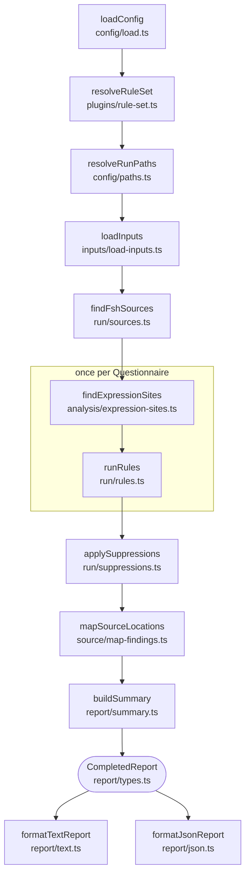

# How the linter works

This is a map of one lint run through `packages/core/src`, for contributors. Terms follow [GLOSSARY.md](../GLOSSARY.md); the behaviour each step implements is specified in [core-plan.md](core-plan.md), [plan-amendments.md](plan-amendments.md) and [cli.md](cli.md).

## The pipeline

`lint()` in `packages/core/src/lint.ts` runs one lint run and returns a `CompletedReport`, or throws a `LintFailure` for a run that cannot complete.

The CLI (`cli/run.ts`) calls `lint()` and passes the report to one of the two formatters.

## 1. Config (`config/`)

- `load.ts`: `loadConfig` uses `--config` when given; otherwise it looks in the working directory only for `sdc-questionnaire-lint.config.json` or `sdc-questionnaire-lint.config.mjs`, and fails if both exist. It returns `null` when no config is used.
- `validate.ts`: `validateConfig` checks the config's shape. Plugins can be listed only in an `.mjs` config.
- `paths.ts`: `resolveRunPaths` resolves `files`, `source.fsh` and the defaults against the config's directory, or the working directory when there is no config.

## 2. Rule set (`plugins/`)

`resolveRuleSet` in `rule-set.ts` builds the run's rule set from:

- the built-in `sdc` plugin (`sdcPlugin` in `builtin.ts`);
- the reserved `lint` namespace (`lintPlugin` in `builtin.ts`), used only for `lint/stale-suppression`;
- the plugins listed in the config.

It validates each plugin's shape against the plugin contract (`contract.ts`), rejects a reserved or duplicate namespace, and gives each rule its effective setting: the configured one, or the rule's default severity. It also rejects unknown rule IDs in `rules` and `suppress`, and suggests a similar name when one exists. All of this happens before any input is read, so `lint` and `explain` fail the same way.

## 3. Inputs (`inputs/`)

`loadInputs` in `load-inputs.ts` runs these steps and fails with `NO_QUESTIONNAIRES` when none are found:

- `select.ts`: `selectInputEntries` picks the paths. CLI paths make a targeted run; otherwise the config's `files`, or the default directory, make a full run. These are precedence levels, not fallbacks: a list that fails to match never lets a later one run.
- `expand.ts`: `expandEntries` expands globs and directories.
- `paths.ts`: `canonicalizeInputFiles` deduplicates files by their real path.
- `read.ts`: `readInputs` parses each file into `QuestionnaireDocument`s, standalone or from inside a Bundle. Every resource of a Bundle is kept as a `localResources` entry. Other JSON is skipped.

`findFshSources` in `run/sources.ts` then records which FSH directories exist, for the summary and for source mapping (section 7).

## 4. Expression discovery (`analysis/`)

This is the heart of the linter.

- `expression-site.ts` defines the expression-site model rules receive: `QuestionnaireDocument`, `ExpressionSite`, `CataloguedLocation`, `QueryFragment`, `Scope`. It is public API.
- `extension-catalog.ts`: `extensionCatalog` is data, not code. It lists the SDC extensions the linter understands, such as variable, calculatedExpression, enableWhenExpression, initialExpression, itemPopulationContext, targetConstraint, and cqf-expression on primitive elements (`_title` on the root; `_text`, `_prefix` and `_answerValueSet` on items). For each one it records where the extension may sit, its sub-extension for a complex extension, whether it declares a name, and which use cases evaluate it (rendering, population or extraction). Supporting a new location means adding an entry here, not changing `expression-sites.ts`.
- `expression-sites.ts`: `findExpressionSites` walks a Questionnaire's JSON depth-first and returns a flat list of frozen `ExpressionSite`s in document order.
  - A site at a catalogued location is catalogued.
  - Any other object with a string `language` and `expression`, including in a contained resource, is uncatalogued; only its syntax and function names can be checked.
  - An x-fhir-query site with text is directly followed by one fragment site per `{{…}}` fragment: carrier `fragment`, language `text/fhirpath`, with offsets into the query.

The analysis helpers:

- `fhirpath.ts` is the only place fhirpath.js is used: it parses an expression, turns parser errors into offsets (`findFhirPathSyntaxProblem`) and extracts function calls (`findFunctionCalls`).
- `x-fhir-query.ts` scans x-fhir-query strings for fragments and shape problems.
- `fhirpath-function-catalog.ts` is generated from fhirpath.js's `invocationTable` by `scripts/generate-functions.ts`; never edit it by hand.

## 5. Rules (`rules/`, run by `run/rules.ts`)

`runRules` calls each rule that is not off once per Questionnaire. A rule's `check(ctx)` is synchronous; `ctx` provides `document`, `sites`, `scopeAt()` (a stub until the scope model exists), `options` (always `undefined` for now) and `report()`.

The runner validates every finding. A bad site, pointer or range, a throw, or a returned promise fails the run with `RULE_CRASH`; built-in and plugin rules are treated alike. It then turns each finding into a report `Finding` with its JSON location, an expression excerpt and a fingerprint. A finding in a fragment is shown within its whole query. Every finding starts with `sourceLocation` unmapped as `source-unavailable`; `runRules` also records each finding's document and site as a `FindingOrigin`, for source mapping.

## 6. Suppressions (`run/suppressions.ts`, `run/fingerprint.ts`)

- `applySuppressions` matches each `suppress` entry to exactly one expression by its selectors: `file` (required), `linkId`, `extensionUrl`, `name`, `resource` and `pointer`. An entry that matches several expressions fails the run as an invalid config.
- `fingerprint.ts`: `siteKeys` gives each site a stable key based on its item's linkId and its catalogued location rather than array indexes, so keys survive reordering. `questionnaireFingerprint` and `configFingerprint` build the findings' fingerprints from them.
- Every entry ends up applied, stale or not assessed. It counts as stale only when the rule could have completed its check at that site; the `completesCheck` table in `plugins/builtin.ts` decides this. A rule missing from it, such as a plugin rule, leaves its suppressions not assessed.
- Stale suppressions are reported as `lint/stale-suppression` warnings at the config entry. With that rule off, staleness is not assessed. `lint/` findings cannot be suppressed.

## 7. Source mapping (`source/`)

`mapSourceLocations` in `map-findings.ts` gives each finding left after suppressions its FSH location, or the reason it has none (core-plan §7.1–7.2 and [plan-amendments.md](plan-amendments.md) § From the source-mapping design). It reads FSH only when a Questionnaire finding remains and FSH directories exist, and it never fails the run: an exception while mapping a finding leaves it `not-found`. It changes nothing but `sourceLocation`, so fingerprints and counts are the same with or without FSH.

For each finding, `locateExpression` in `locate.ts`:

1. finds the FSH Instance behind the finding's resource (`definitions.ts`): through the SUSHI index (`sushi-index.ts`) when its entry for the input file is current, otherwise by searching the FSH directories for the one Instance with the resource's id and type;
2. lists the Instance's expression literals with their anchors (`expression-literals.ts`): the linkId of their item, their extension and their Expression's name, found through the full path of every rule (`fsh-paths.ts`);
3. maps text that occurs once in the resource's JSON and once in the Instance as `exact`, and repeated text as `anchored` when the anchors single out one literal and one expression; otherwise the finding stays unmapped as `ambiguous`, `multiline` or `not-found`;
4. turns the reported range into lines and columns (`positions.ts`), after reading the literal again from the file and checking that it and the range's source decode to the reported text (`fsh-string.ts`).

The FSH modules mirror SUSHI 3.20.1, so they read FSH as SUSHI does: `fsh-document.ts` splits a file into definitions and rules with SUSHI's longest-match tokens, `fsh-paths.ts` applies indentation context and soft indices as SUSHI's importer and `resolveSoftIndexing` do, and `fsh-string.ts` decodes strings as SUSHI's `unescapeQuotedString` does. `fsh-files.ts` reads and parses each FSH file of a run at most once.

## 8. Report (`report/`)

- `types.ts` defines the public report contract, which matches [lint-report.schema.json](schemas/lint-report.schema.json).
- `summary.ts`: `buildSummary` computes the counts.
- `expression-coverage.ts`: `summarizeExpressionCoverage` counts the analysed and unchecked expressions for the summary.
- `sort.ts`: `compareFindings` orders findings; both formatters use it.
- `json.ts` and `text.ts` are the two output formats: `formatJsonReport` and `formatTextReport`.
