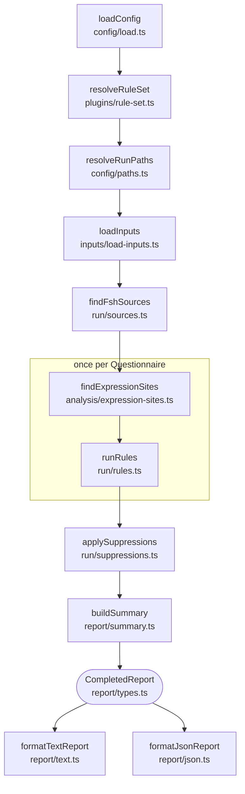

# How the linter works

This is a map of one lint run through `packages/core/src`, for contributors. Terms follow [GLOSSARY.md](../GLOSSARY.md); the behaviour each step implements is specified in [core-plan.md](core-plan.md), [plan-amendments.md](plan-amendments.md) and [cli.md](cli.md).

## The pipeline

`lint()` in `packages/core/src/lint.ts` runs one lint run and returns a `CompletedReport`, or throws a `LintFailure` for a run that cannot complete.

The CLI (`cli/run.ts`) calls `lint()` and passes the report to one of the two formatters.

## 1. Config (`config/`)

- `load.ts`: `loadConfig` uses `--config` when given; otherwise it looks in the working directory only for `sdc-questionnaire-lint.config.json` or `sdc-questionnaire-lint.config.mjs`, and fails if both exist. It returns `null` when no config is used.
- `validate.ts`: `validateConfig` checks the config's shape. Plugins can be listed only in an `.mjs` config.
- `paths.ts`: `resolveRunPaths` resolves `files`, `source.fsh` and the defaults against the config's directory, or the working directory when there is no config.

## 2. Rule set (`plugins/`)

`resolveRuleSet` in `rule-set.ts` builds the run's rule set from:

- the built-in `sdc` plugin (`sdcPlugin` in `builtin.ts`);
- the reserved `lint` namespace (`lintPlugin` in `builtin.ts`), used only for `lint/stale-suppression`;
- the plugins listed in the config.

It validates each plugin's shape against the plugin contract (`contract.ts`), rejects a reserved or duplicate namespace, and gives each rule its effective setting: the configured one, or the rule's default severity. It also rejects unknown rule IDs in `rules` and `suppress`, and suggests a similar name when one exists. All of this happens before any input is read, so `lint` and `explain` fail the same way.

## 3. Inputs (`inputs/`)

`loadInputs` in `load-inputs.ts` runs these steps and fails with `NO_QUESTIONNAIRES` when none are found:

- `select.ts`: `selectInputEntries` picks the paths. CLI paths make a targeted run; otherwise the config's `files`, or the default directory, make a full run. These are precedence levels, not fallbacks: a list that fails to match never lets a later one run.
- `expand.ts`: `expandEntries` expands globs and directories.
- `paths.ts`: `canonicalizeInputFiles` deduplicates files by their real path.
- `read.ts`: `readInputs` parses each file into `QuestionnaireDocument`s, standalone or from inside a Bundle. Every resource of a Bundle is kept as a `localResources` entry. Other JSON is skipped.

`findFshSources` in `run/sources.ts` then records which FSH directories exist, for the summary. No source mapping is done yet: every finding keeps its compiled JSON location.

## 4. Expression discovery (`analysis/`)

This is the heart of the linter.

- `expression-site.ts` defines the expression-site model rules receive: `QuestionnaireDocument`, `ExpressionSite`, `CataloguedLocation`, `QueryFragment`, `Scope`. It is public API.
- `extension-catalog.ts`: `extensionCatalog` is data, not code. It lists the SDC extensions the linter understands, such as variable, calculatedExpression, enableWhenExpression, initialExpression, itemPopulationContext, targetConstraint, and cqf-expression on primitive elements (`_title` on the root; `_text`, `_prefix` and `_answerValueSet` on items). For each one it records where the extension may sit, its sub-extension for a complex extension, and its use cases as the SDC expressions table lists them (rendering, population or extraction). Use cases do not decide which names an expression can reference. Supporting a new location means adding an entry here, not changing `expression-sites.ts`.
- `expression-sites.ts`: `findExpressionSites` walks a Questionnaire's JSON depth-first and returns a flat list of frozen `ExpressionSite`s in document order.
  - A site at a catalogued location is catalogued.
  - Any other object with a string `language` and `expression`, including in a contained resource, is uncatalogued; only its syntax and function names can be checked.
  - An x-fhir-query site with text is directly followed by one fragment site per `{{…}}` fragment: carrier `fragment`, language `text/fhirpath`, with offsets into the query.
  - A catalogued Expression with a `name` has `declares` set: it declares that name for other expressions.
- `declarations.ts`: `findDeclarations` lists a document's declarations in document order: the declaring sites (`variable`, `itemPopulationContext` and other named expressions), `launchContext` names on the root, and `extractAllocateId` names on the root and items. Each records its name, kind, pointer, declaring item (none for the root), use cases and, when it is an Expression, its site. Contained resources declare nothing; sourceQueries results are host variables, not declarations.
- `document-analysis.ts`: `analyseDocument` computes core's internal analysis of a document once per run: so far, its declarations and the variable references of each FHIRPath site that parses. `lint.ts` keeps it on each analysed document. It is not exported, and plugin rules never receive it.

The analysis helpers:

- `fhirpath.ts` is the only place fhirpath.js is used: it parses an expression, turns parser errors into offsets (`findFhirPathSyntaxProblem`) extracts function calls (`findFunctionCalls`) and lists `%name` references (`findVariableReferences`). A reference gives the name fhirpath.js looks up and its range as written; a name that `defineVariable` binds for the later steps of its chain is left out, and a reference after a `defineVariable` with a computed name is marked incomplete.
- `x-fhir-query.ts` scans x-fhir-query strings for fragments and shape problems.
- `fhirpath-function-catalog.ts` is generated from fhirpath.js's `invocationTable` by `scripts/generate-functions.ts`; never edit it by hand.

## 5. Rules (`rules/`, run by `run/rules.ts`)

`runRules` calls each rule that is not off once per Questionnaire. A rule's `check(ctx)` is synchronous; `ctx` provides `document`, `sites`, `scopeAt()` (a stub until the scope model exists), `options` (always `undefined` for now) and `report()`. An `sdc` rule also receives the document's analysis as a second argument (`CoreRule` in `plugins/core-rule.ts`); a plugin cannot register an `sdc` rule.

The runner validates every finding. A bad site, pointer or range, a throw, or a returned promise fails the run with `RULE_CRASH`; built-in and plugin rules are treated alike. It then turns each finding into a report `Finding` with its JSON location, an expression excerpt, its related locations and a fingerprint. A finding in a fragment is shown within its whole query.

## 6. Suppressions (`run/suppressions.ts`, `run/fingerprint.ts`)

- `applySuppressions` matches each `suppress` entry to exactly one expression by its selectors: `file` (required), `linkId`, `extensionUrl`, `name`, `resource` and `pointer`. An entry that matches several expressions fails the run as an invalid config. An entry whose `extensionUrl` is launchContext or extractAllocateId instead matches one name on one element among the declarations, and hides the rule's findings at every declaration of that name there.
- `fingerprint.ts`: `siteKeys` gives each site a stable key based on its item's linkId and its catalogued location, plus its name when it declares one, rather than array indexes, so keys survive reordering. `declarationKeys` does the same for a launchContext or extractAllocateId by its item, kind and name. Since core-rules slice 3, every named Expression at a catalogued location declares, so the keys, and the fingerprints, of findings at named Expressions other than variables and itemPopulationContexts changed once. `questionnaireFingerprint` and `configFingerprint` build the findings' fingerprints from them.
- Every entry ends up applied, stale or not assessed. It counts as stale only when the rule could have completed its check at that site; the `completesCheck` table in `plugins/builtin.ts` decides this, and `completesDeclarationCheck` for a declaration that has no site. A rule missing from it, such as a plugin rule, leaves its suppressions not assessed.
- Stale suppressions are reported as `lint/stale-suppression` warnings at the config entry. With that rule off, staleness is not assessed. `lint/` findings cannot be suppressed.

## 7. Report (`report/`)

- `types.ts` defines the public report contract, which matches [lint-report.schema.json](schemas/lint-report.schema.json).
- `summary.ts`: `buildSummary` computes the counts.
- `expression-coverage.ts`: `summarizeExpressionCoverage` counts the analysed and unchecked expressions for the summary.
- `sort.ts`: `compareFindings` orders findings; both formatters use it.
- `json.ts` and `text.ts` are the two output formats: `formatJsonReport` and `formatTextReport`.
