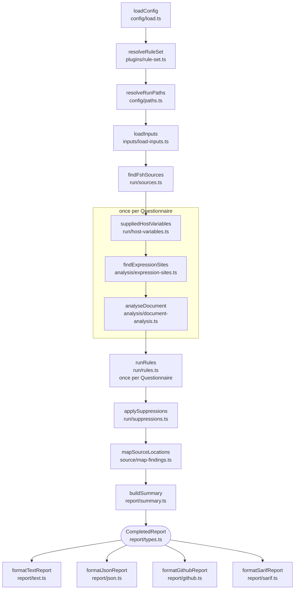

# How the linter works

This is a map of one lint run through `packages/core/src`, for contributors. Terms follow [GLOSSARY.md](../GLOSSARY.md); the behaviour each step implements is specified in [core-plan.md](core-plan.md), [plan-amendments.md](plan-amendments.md) and [cli.md](cli.md).

## The pipeline

`lint()` in `packages/core/src/lint.ts` runs one lint run and returns a `CompletedReport`, or throws a `LintFailure` for a run that cannot complete.

The CLI (`cli/run.ts`) calls `lintWithRules()`, which is `lint()` returning the run's resolved rules as well, and passes the report to the formatter `--format` selects; SARIF also describes the rules. With `--format github`, `cli/step-summary.ts` appends `formatGithubSummary` to the job summary that `GITHUB_STEP_SUMMARY` names. A failure goes through `renderFailureOutput` in `failure.ts`: stderr in every format, and a failure document on stdout in `json`, `github` and `sarif`.

## 1. Config (`config/`)

- `load.ts`: `loadConfig` uses `--config` when given; otherwise it looks in the working directory only for `sdc-questionnaire-lint.config.json` or `sdc-questionnaire-lint.config.mjs`, and fails if both exist. It returns `null` when no config is used.
- `validate.ts`: `validateConfig` checks the config's shape. Plugins can be listed only in an `.mjs` config. A `hostVariables` entry must be a name (`hostVariableProblem`, which a plugin's hook results are checked with too), listed once, that FHIRPath, FHIR or SDC does not define.
- `paths.ts`: `resolveRunPaths` resolves `files`, `source.fsh` and the defaults against the config's directory, or the working directory when there is no config.

## 2. Rule set (`plugins/`)

`resolveRuleSet` in `rule-set.ts` builds the run's rule set from:

- the built-in `sdc` plugin (`sdcPlugin` in `builtin.ts`);
- the reserved `lint` namespace (`lintPlugin` in `builtin.ts`), used only for `lint/stale-suppression`;
- the plugins listed in the config.

It validates each plugin's shape against the plugin contract (`contract.ts`), rejects a reserved or duplicate namespace, and gives each rule its effective setting: the configured one, or the rule's default severity. It also rejects unknown rule IDs in `rules` and `suppress`, and suggests a similar name when one exists.

It then resolves the config's `compat` against the versions each plugin declares in `LintPlugin.compat`: `"latest"`, the default, takes the last, newest, verified version of every component, and an explicit object must name exact verified versions of the required components. Core treats versions as opaque strings. The result becomes the report's `run.compat`, and each rule's `compat`, frozen, the versions of its own namespace. All of this happens before any input is read, so `lint` and `explain` fail the same way.

Last, it keeps, in config order, each listed plugin that has a `hostVariables` hook, with the same frozen compat its rules get (`hostVariableHooks`).

## 3. Inputs (`inputs/`)

`loadInputs` in `load-inputs.ts` runs these steps and fails with `NO_QUESTIONNAIRES` when none are found:

- `select.ts`: `selectInputEntries` picks the paths. CLI paths make a targeted run; otherwise the config's `files`, or the default directory, make a full run. These are precedence levels, not fallbacks: a list that fails to match never lets a later one run.
- `expand.ts`: `expandEntries` expands globs and directories.
- `paths.ts`: `canonicalizeInputFiles` deduplicates files by their real path.
- `read.ts`: `readInputs` parses each file into `QuestionnaireDocument`s, standalone or from inside a Bundle. Every resource of a Bundle is kept as a `localResources` entry. Other JSON is skipped.

`findFshSources` in `run/sources.ts` then records which FSH directories exist, for the summary and for source mapping (section 7).

Every document is then analysed, before any rule runs. For each one, `suppliedHostVariables` in `run/host-variables.ts` calls each plugin hook with the document and the plugin's compat, whether or not the plugin's rules are on. A throw, a promise or a result that is not an array of names fails the run with `PLUGIN_CRASH`, naming the plugin and the file; the names FHIRPath, FHIR or SDC define are dropped. The config's `hostVariables`, followed by the hooks' names, are the document's host variables.

## 4. Expression discovery (`analysis/`)

This is the heart of the linter.

- `expression-site.ts` defines the expression-site model rules receive: `QuestionnaireDocument`, `ExpressionSite`, `CataloguedLocation`, `QueryFragment`. It is public API.
- `extension-catalog.ts`: `extensionCatalog` is data, not code. It lists the SDC extensions the linter understands, such as variable, calculatedExpression, enableWhenExpression, initialExpression, itemPopulationContext, targetConstraint, and cqf-expression on primitive elements (`_title` on the root; `_text`, `_prefix` and `_answerValueSet` on items). For each one it records where the extension may sit, its sub-extension for a complex extension, and its use cases as the SDC expressions table lists them (rendering, population or extraction). Use cases do not decide which names an expression can reference. Supporting a new location means adding an entry here, not changing `expression-sites.ts`.
- `expression-sites.ts`: `findExpressionSites` walks a Questionnaire's JSON depth-first and returns a flat list of frozen `ExpressionSite`s in document order.
  - A site at a catalogued location is catalogued.
  - Any other object with a string `language` and either `expression` or `reference`, including in a contained resource, is uncatalogued; only its syntax and function names can be checked when text is present. A reference-only Expression remains unchecked and may prevent an unused-variable finding.
  - An x-fhir-query site with text is directly followed by one fragment site per `{{…}}` fragment: carrier `fragment`, language `text/fhirpath`, with offsets into the query.
  - A catalogued Expression with a `name` has `declares` set: it declares that name for other expressions.
- `declarations.ts`: `findDeclarations` lists a document's declarations in document order: the declaring sites (`variable`, `itemPopulationContext` and other named expressions), `launchContext` names on the root, and `extractAllocateId` names on the root and items. Each records its name, kind, pointer, declaring item (none for the root), use cases and, when it is an Expression, its site. Contained resources declare nothing; sourceQueries results are host variables, not declarations.
- `available-variables.ts`: `availableVariables` answers, for each catalogued site, which names its expressions can reference: the declarations on its element, its ancestor items and the root, the innermost of a name winning; the built-in names FHIRPath, FHIR and SDC define (`builtinNames`, plus the `vs-` and `ext-` prefixes); the names the root's `assembleContext` lists, which the Questionnaire that includes the module supplies (`findAssembleContextNames` in `declarations.ts`; they are not declarations); and the host variables: the configured `hostVariables` and the names plugin hooks supply. An extraction site sees only extractAllocateId names and named extraction contexts among the declarations; any other site sees every declaration except extractAllocateId names, whatever the declaring expression's use cases. An uncatalogued site gets none, because name analysis cannot run there. At a declaring site, and in the fragments of its query, the declaration's own name resolves to the next binding outward, and to the declaration itself only when nothing else supplies the name (core-rules D25).
- `dependencies.ts`: `findDependencies` records, for each declaration, the declarations its expression references, resolved at the expression's site or at each fragment of its query, and whether that list is known: the expression parses and no reference follows a `defineVariable` with a computed name. A reference that may be bound locally is left out.
- `uses.ts`: `findUses` records, for each declaration, whether the expressions of others reference it: `referenced` when a reference resolves to it, `unreferenced` when none does and every expression that could see it was analysed, and otherwise `blocked` or `unknown`. An expression that could see it but was not analysed is CQL or another language, an Expression with only a reference, FHIRPath that does not parse, an uncatalogued expression that names it, a reference after a `defineVariable` with a computed name, a `questionnaire-constraint`, or a `subQuestionnaire`. `blocked` means only expressions with a syntax error were among them. A reference from a declaration's own expression is not a use of it, and a duplicate on the same element shares the uses of the other.
- `linkids.ts`: `findLinkIds` lists the linkIds of a Questionnaire's items at any depth, not those of contained resources. `findLinkIdReferencesAt` gives the linkId references of each FHIRPath site that parses, with what the site establishes as items of this form: at a catalogued site, `%questionnaire`, `%resource`, `%context` and the expression's input, plus `%qitem` at an item site. Nothing is established at an uncatalogued site or in a modular Questionnaire, one that includes a `subQuestionnaire` or is a module (it has `assembleContext`, or an `assemble-expectation` that allows a child), because the assembled form has other items.
- `document-analysis.ts`: `analyseDocument` computes core's internal analysis of a document once per run, from the document, its sites and its host variables: its declarations, the variable references of each FHIRPath site that parses, the available variables at each site (`variablesAt`), the dependencies of each declaration, their uses, the Questionnaire's linkIds, the linkId references of each FHIRPath site that parses, and, found on first use, whether each such site reads its input (`readsInput`). `lint.ts` keeps it on each analysed document. It is not exported. A plugin rule receives only its references, `variablesAt`, declarations, dependencies, uses and `readsInput`, through `RuleContext`, frozen: rules run before the suppression assessment reuses the analysis.

The analysis helpers:

- `fhirpath.ts` is the only place fhirpath.js is used: it parses an expression, turns parser errors into offsets (`findFhirPathSyntaxProblem`), extracts function calls (`findFunctionCalls`), lists `%name` references (`findVariableReferences`), finds linkId references (`findLinkIdReferences`) and tells whether an expression reads its input (`readsInput`). A reference gives the name fhirpath.js looks up and its range as written; a name that `defineVariable` binds for the later steps of its chain is left out, and a reference after a `defineVariable` with a computed name is marked incomplete. A reference is conditional when fhirpath.js 4.10.1 may skip evaluating it: in an `iif` argument after the criterion, a `coalesce` argument after the first, or an argument evaluated once per item of the function's target (`where`, `select`, `exists`, `all`, `repeat`, the first of `aggregate`, `sort`'s selectors), or below one of these, and in any argument of a call whose name has an escape sequence. The operands of operators, `combine` and `union` arguments, and `trace`'s and `defineVariable`'s values are always evaluated. A linkId reference is `where(linkId = …)`; its input is followed through `item`, `answer`, `repeat`, `where` and `select` from the roots the site establishes. The literals of established references are listed, and the reference is uncertain when its input is not established or its linkId is computed. A selection that flows through item steps into `exists()`, `empty()` or a `count()` comparison is an absence probe and is left out. `readsInput` follows the focus as fhirpath.js 4.10.1 sets it: an argument typed `Expr`, and `sort`'s, is evaluated against the function's target, `coalesce`'s against its target with the enclosing `$this`, and every other argument and operand against the enclosing `$this`, or else the input. A term on the input other than `linkId`, a function on it other than `iif`, `select`, `today`, `now` and `timeOfDay`, and the input itself used as a value, including through `%context`, read it.
- `x-fhir-query.ts` scans x-fhir-query strings for fragments and shape problems.
- `fhirpath-function-catalog.ts` is generated from fhirpath.js's `invocationTable` by `scripts/generate-functions.ts`; never edit it by hand.

## 5. Rules (`rules/`, run by `run/rules.ts`)

`runRules` calls each rule that is not off once per Questionnaire. A rule's `check(ctx)` is synchronous; `ctx` provides `document`, `sites` (frozen, as is each site), `declarations` (the analysis's own frozen array), `referencesAt(site)`, `variablesAt(site)` and `readsInput(site)` (the analysis's references, available variables and input reads at a site), `dependenciesOf(declaration)` and `useOf(declaration)` (its dependencies and uses; see [What a plugin can import](#what-a-plugin-can-import)), `compat` (the versions selected for the rule's namespace; `{}` for a plugin without compat) and `report()`. Each Questionnaire finding carries its rule's `docsUrl`: the value read when the plugin was validated, kept in `ResolvedRule.docsUrl`. An `sdc` rule also receives the document's analysis as a second argument (`CoreRule` in `plugins/core-rule.ts`); a plugin cannot register an `sdc` rule.

`rules/describe.ts` names the element a finding is on, by the item's text and linkId, and places a finding about a declaration at its Expression or its extension.

The runner validates every finding. A bad site, pointer or range, a throw, or a returned promise fails the run with `RULE_CRASH`, naming the rule and the file; built-in and plugin rules are treated alike. It then turns each finding into a report `Finding` with its JSON location, an expression excerpt, its related locations and a fingerprint. A finding in a fragment is shown within its whole query. Every finding starts with `sourceLocation` unmapped as `source-unavailable`; `runRules` also records each finding's document and site as a `FindingOrigin` in a side table keyed by the finding object, which the source mapper reads; the stages in between pass findings on as they are. Related locations stay unmapped.

### What a plugin can import

A plugin imports from the `sdc-questionnaire-lint` package only; everything under `packages/core/src` that `index.ts` does not export is internal. Besides `lint`, `defineConfig` and the report and config types, `index.ts` exports:

- the plugin contract: `LintPlugin`, `LintRule`, `RuleContext`, `RuleFinding`, `RuleRelatedLocation`, `RuleDocs`, `PluginCompat` and `HostVariablesInput` (`plugins/contract.ts`). Besides its rules, a plugin can supply host variables through `LintPlugin.hostVariables({ document, compat })`: synchronous and pure, it only adds names, which resolve with `origin: 'host'` where no declaration or assembleContext name wins (S6);
- the expression-site model: `QuestionnaireDocument`, `ExpressionSite`, `CataloguedLocation`, `SiteItem` and the other types in `analysis/expression-site.ts`;
- the language lookups (API stage A, [smart-forms-rules.md](smart-forms-rules.md#public-api-stages-s5)):
  - `definedLanguages`: the six codes FHIR R4 and R5 define, frozen. A language outside them is `sdc/language-not-in-value-set`'s.
  - `languagesAllowedAt(location)`: the languages SDC allows at a catalogued location, or `undefined` where it allows any language. A language outside the list is `sdc/language-not-allowed`'s, or the FHIR Validator's: the list also rejects `application/x-fhir-query` on enableWhenExpression (`sdc-inv1`).
  - `isQueryLanguage(language)`: whether a language is either x-fhir-query code.
- the types of core's name analysis (API stages B, B2, C and D), which `RuleContext`'s `referencesAt`, `variablesAt`, `declarations`, `dependenciesOf` and `useOf` give:
  - `VariableReference`: one `%name` reference, with its `name`, its range as written (`startOffset`, `endOffset`), `complete`, which is false after a `defineVariable` with a computed name, and `conditional`, which is true where fhirpath.js may skip evaluating it (API stage D).
  - `AvailableVariables`: the `variables` available at a site, and `resolve(name)`, the `Variable` a reference gets: its `name`, its `origin` (`declaration`, `builtin`, `assembled` or `host`) and, for a declaration, the `Declaration`.
  - `Declaration` and `DeclarationKind`: a declaration's name, kind, pointer, item, use cases and declaring site.
  - `Dependencies`: what a declaration's expression references: `on`, the declarations its references resolve to, each once, in the order of their first reference; `analysed`, whether its references were found; and `known`, whether `on` is all of them, which a reference after a `defineVariable` with a computed name prevents.
  - `DeclarationUse`: whether the expressions of others reference a declaration: `referenced`, `unreferenced` (`sdc/unused-declaration`'s condition), or, when an expression that could reference it was not analysed, `blocked` (only expressions with a syntax error) or `unknown`.
- `definerOf(name)` and `BuiltinDefiner` (API stage C): the specification that defines a name, `FHIRPath`, `FHIR` or `SDC`, or `undefined`. `sdc/reserved-name` reports a declaration by it, so a plugin rule stays silent on such a name without a copy of core's list.

  `referencesAt(site)` is `undefined` when the site has no FHIRPath analysis: its language is not `text/fhirpath`, it has no text, or the text does not parse. It is `[]` when the text parses and references nothing. `variablesAt(site)` is `undefined` at an uncatalogued site. `readsInput(site)` is whether the expression's value can differ between two inputs that share their linkId, such as two repetitions of a group: some term is evaluated with the input as its focus, other than to read its `linkId`, or the expression uses `%context`. It is syntactic, not proof that a value differs, and `undefined` where `referencesAt` is. The three are `undefined` for an object that is not one of `ctx.sites`, and `dependenciesOf` and `useOf` for one that is not one of `ctx.declarations`. A rule treats `undefined` as "cannot check", never as "no references". The list of built-in names is not exported: a rule reads `origin`, or `definerOf`.

  `ctx.declarations` holds every declaration in the document, in document order, frozen: the array core's own rules use. Each `Variable.declaration` that `variablesAt` gives is one of its elements, and each declaration's `site` is one of `ctx.sites`. The `item` of a launchContext or extractAllocateId declaration is a different object from `site.item` for the same item, so a rule compares items by `pointer`.

A plugin rule that stays silent where a core rule reports the same root cause checks the condition with these lookups, never whether that rule ran.

## 6. Suppressions (`run/suppressions.ts`, `run/fingerprint.ts`)

- `applySuppressions` matches each `suppress` entry to exactly one expression by its selectors: `file` (required), `linkId`, `extensionUrl`, `name`, `resource` and `pointer`. An entry that matches several expressions fails the run as an invalid config. An entry whose `extensionUrl` is launchContext or extractAllocateId instead matches one name on one element among the declarations, and hides the rule's findings at every declaration of that name there.
- `fingerprint.ts`: `siteKeys` gives each site a stable key based on its item's linkId and its catalogued location, plus its name when it declares one, rather than array indexes, so keys survive reordering. `declarationKeys` does the same for a launchContext or extractAllocateId by its item, kind and name. Since core-rules slice 3, every named Expression at a catalogued location declares, so the keys, and the fingerprints, of findings at named Expressions other than variables and itemPopulationContexts changed once. `questionnaireFingerprint` and `configFingerprint` build the findings' fingerprints from them; a Questionnaire finding's also has the text of its range, so two findings of one rule in one expression differ. `distinctFingerprints` keeps fingerprints unique within a report: a repeat is hashed again with its occurrence number, per document in `runRules` and across stale suppressions in `applySuppressions`.
- Every entry ends up applied, stale or not assessed. It counts as stale only when the rule could have completed its check at that site; the `completesCheck` table in `plugins/builtin.ts` decides this from the site and the document's analysis, and `completesDeclarationCheck` for a declaration that has no site. A rule missing from it, such as a plugin rule, leaves its suppressions not assessed.
- Stale suppressions are reported as `lint/stale-suppression` warnings at the config entry. With that rule off, staleness is not assessed. `lint/` findings cannot be suppressed.

## 7. Source mapping (`source/`)

`mapSourceLocations` in `map-findings.ts` gives each finding left after suppressions its FSH location, or the reason it has none (core-plan §7.1–7.2 and [plan-amendments.md](plan-amendments.md) § From the source-mapping design). It reads FSH only when a Questionnaire finding remains and FSH directories exist, and it never fails the run: an exception while mapping a finding leaves it `not-found`. It changes nothing but `sourceLocation`, so fingerprints and counts are the same with or without FSH.

For each finding, `locateExpression` in `locate.ts`:

1. finds the FSH Instance behind the finding's resource (`definitions.ts`): through the SUSHI index (`sushi-index.ts`) when its entry for the input file is current, otherwise by searching the FSH directories for the one Instance with the resource's id and type;
2. lists the Instance's expression literals with their anchors (`expression-literals.ts`): the linkId of their item, their extension and their Expression's name, found through the full path of every rule (`fsh-paths.ts`);
3. maps text that occurs once in the resource's JSON and once in the Instance as `exact`, and repeated text as `anchored` when the anchors single out one literal and one expression; otherwise the finding stays unmapped as `ambiguous`, `multiline` or `not-found`;
4. turns the reported range into lines and columns (`positions.ts`), after reading the literal again from the file and checking that it and the range's source decode to the reported text (`fsh-string.ts`).

The FSH modules mirror SUSHI 3.20.1, so they read FSH as SUSHI does: `fsh-document.ts` splits a file into definitions and rules with SUSHI's longest-match tokens, `fsh-paths.ts` applies indentation context and soft indices as SUSHI's importer and `resolveSoftIndexing` do, and `fsh-string.ts` decodes strings as SUSHI's `unescapeQuotedString` does. `fsh-files.ts` reads and parses each FSH file of a run at most once.

## 8. Report (`report/`)

- `types.ts` defines the public report contract, which matches [lint-report.schema.json](schemas/lint-report.schema.json).
- `summary.ts`: `buildSummary` computes the counts.
- `expression-coverage.ts`: `summarizeExpressionCoverage` counts the analysed and unchecked expressions for the summary. A site where an enabled rule applies but could not complete, which `incompleteSites` in `plugins/builtin.ts` lists, is unchecked: so far, a site where `sdc/undefined-variable` meets a reference after a `defineVariable` with a computed name, a declaration from which `sdc/dependency-cycle` reaches a declaration with such a reference, a variable whose use `sdc/unused-declaration` cannot establish (`unknown`), and a site where `sdc/unresolved-linkid` meets a linkId reference whose target or linkId is uncertain. A declaration that does not parse or is in another language is not followed, so it leaves nothing unchecked; a variable that only an expression with a syntax error could reference (`blocked`) is not unchecked either.
- `sort.ts`: `compareFindings` orders findings; every formatter uses it.
- `locations.ts`: `primaryLocation` says where a finding or related location is (its FSH range, its compiled JSON site and the reason it is unmapped, or its config entry), and `findingDetailLines` gives the `location:`, `note:`, `related:` and `help:` lines. Text, GitHub and SARIF output share them.
- `json.ts`, `text.ts`, `github.ts` and `sarif.ts` are the four output formats: `formatJsonReport`, `formatTextReport`, `formatGithubReport` with `formatGithubSummary`, and `formatSarifReport`. `github.ts` and `sarif.ts` also render a failed run, for `renderFailureOutput`.
