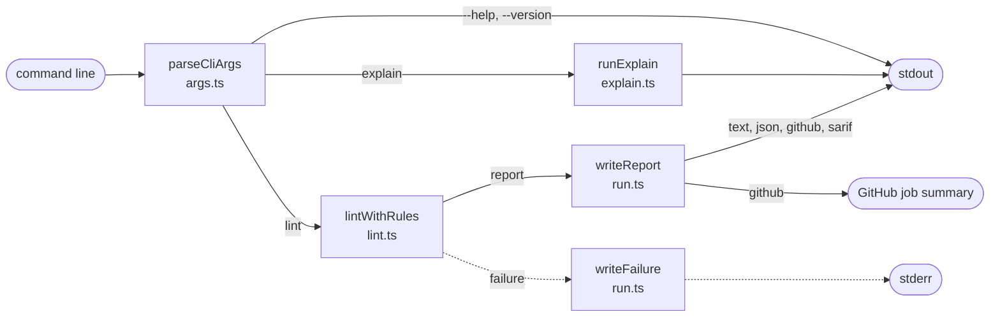

# CLI

The command-line entry point. It reads the arguments, runs `lint` or `explain`, prints the result in the format `--format` selects, and sets the exit code.

Both executables, `sdc-lint` and its alias `sdc-questionnaire-lint`, run the same file. The CLI does no analysis itself: `lint` calls the same `lintWithRules()` the library uses, and only then writes the report. Until then the report is buffered, so a run that fails never prints half a report. Console output from the config and plugins goes to stderr, so stdout holds only the report.

| Exit code | Meaning |
| :- | :- |
| 0 | The run completed with no errors; warnings and info may remain |
| 1 | The run completed with one or more errors |
| 2 | The run did not complete: wrong usage, a bad config, no Questionnaires or a rule crash |

[CLI reference](../cli.md) is the full contract: commands, flags, output formats and exit codes.

## Schema

## Code

In [`packages/core/src/cli/`](../../packages/core/src/cli):

- [`main.ts`](../../packages/core/src/cli/main.ts): the executable, built as `dist/cli.js`. Sends console output to stderr and sets the process exit code.
- [`run.ts`](../../packages/core/src/cli/run.ts): `runCli` picks the command, writes the report or the failure, and returns the exit code.
- [`args.ts`](../../packages/core/src/cli/args.ts): `parseCliArgs` turns the arguments into a command, or a usage error.
- [`explain.ts`](../../packages/core/src/cli/explain.ts): `runExplain` lists the rules, or prints one rule's documentation. It loads the config but reads no forms.
- [`help.ts`](../../packages/core/src/cli/help.ts): the `--help` text.
- [`output-guard.ts`](../../packages/core/src/cli/output-guard.ts): `guardStdout` sends `console.log` and other stdout writes from the config and plugins to stderr.
- [`step-summary.ts`](../../packages/core/src/cli/step-summary.ts): `appendStepSummary` adds the job summary in GitHub Actions.
- [`colour.ts`](../../packages/core/src/cli/colour.ts): colour only in a terminal, and never when `NO_COLOR` is set.

The output formats themselves are in [Report and formatters](report.md), and failures in [Failures](failures.md).
