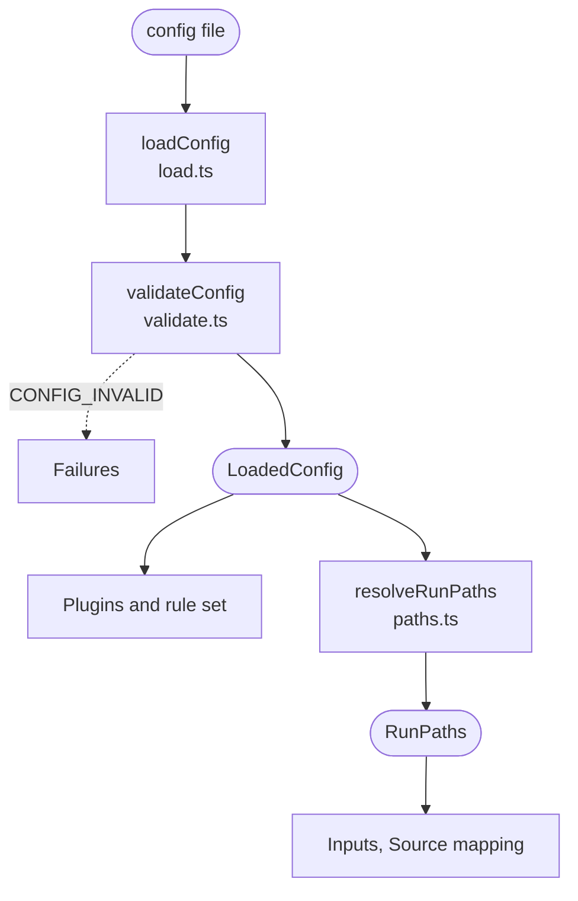

# Config

Finds the linter config, checks it, and works out the paths the run uses. It runs first, before any form is read.

The linter looks for `sdc-questionnaire-lint.config.json` or `sdc-questionnaire-lint.config.mjs` in the working directory only, not in its parents. `--config` names a file explicitly and never falls back to that search. Running without a config is fine: the defaults below apply. A `.mjs` config is imported, so it runs its own code and the code of the plugins it imports. Only an `.mjs` config can list plugins.

Every key is checked, and an unknown key is an error, so a mistyped setting is never silently ignored. A missing, unreadable or invalid config stops the run with `CONFIG_INVALID`, which exits with code 2. Paths in the config are relative to the config's directory.

| Key | What it sets | Default |
| :- | :- | :- |
| `files` | The compiled files or globs to lint | `fsh-generated/resources` |
| `source.fsh` | The FSH directories used to trace findings to source | `input/fsh` |
| `hostVariables` | Names the application running the form supplies | none |
| `plugins` | Plugins to load, in an `.mjs` config only | none |
| `compat` | The runtime versions each plugin checks against | `latest` |
| `rules` | A severity, or `off`, for each rule | each rule's own severity |
| `suppress` | Findings to hide, each with a reason | none |

[Configuration](../../README.md#configuration) shows example configs, and [Configuration and path bases](../cli.md#configuration-and-path-bases) is the full contract.

## Schema

Without a config, `loadConfig` returns `null`, and `resolveRunPaths` resolves the defaults against the working directory.

## Code

In [`packages/core/src/config/`](../../packages/core/src/config):

- [`load.ts`](../../packages/core/src/config/load.ts): `loadConfig` finds, reads and validates the config. It returns a `LoadedConfig` with the file's path, its directory, the path to show in messages, the format and the config, or `null` when there is none.
- [`validate.ts`](../../packages/core/src/config/validate.ts): `validateConfig` checks every key and every suppression entry. An error names the config file and the JSON Pointer of the bad entry. Rule IDs and plugins are checked later, by [Plugins and rule set](plugins.md), which knows them.
- [`types.ts`](../../packages/core/src/config/types.ts): the `LintConfig` type, and `defineConfig`, which types the default export of an `.mjs` config.
- [`paths.ts`](../../packages/core/src/config/paths.ts): `resolveRunPaths` makes the absolute paths the run uses, from the config or the defaults: the input files, the FSH directories and SUSHI's index file.
