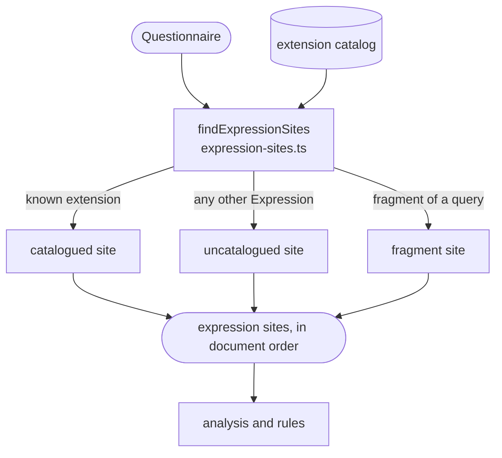

# Expression discovery

Finds every expression in a Questionnaire and records where it is and what kind it is. Each one becomes an **expression site**, and the list of sites is what the analysis and the rules work on.

The walk goes depth-first through the Questionnaire's JSON, so the sites come out in document order. There are three kinds:

- **Catalogued:** an Expression held by an SDC extension the linter knows, such as a `variable`, a `calculatedExpression` or an `enableWhenExpression`, where SDC allows it. The extension catalog lists these locations. Every check can run here. An Expression with a `name` at a catalogued location declares that name for other expressions.
- **Uncatalogued:** any other object with a `language` and an `expression` or `reference`, including one in a contained resource. Only its syntax and function names can be checked. `sdc/uncatalogued-expression` reports it as info.
- **Fragment:** each `{{…}}` in an x-fhir-query is a FHIRPath site of its own, listed right after its query.

For example, this item gives two sites:

```json
{
  "linkId": "weight",
  "extension": [{
    "url": "http://hl7.org/fhir/StructureDefinition/variable",
    "valueExpression": {
      "name": "obs",
      "language": "application/x-fhir-query",
      "expression": "Observation?subject={{%patient.id}}"
    }
  }]
}
```

1. The variable: catalogued, an x-fhir-query that declares `obs`, on item `weight`.
2. Its fragment `%patient.id`: FHIRPath, at its offsets within the query.

Supporting a new location means adding an entry to the catalog, not changing the walk. The site model is public API: plugin rules receive the same frozen sites as `ctx.sites`.

## Schema



## Code

In [`packages/core/src/analysis/`](../../packages/core/src/analysis):

- [`expression-sites.ts`](../../packages/core/src/analysis/expression-sites.ts): `findExpressionSites` walks a Questionnaire and returns its sites.
- [`extension-catalog.ts`](../../packages/core/src/analysis/extension-catalog.ts): `extensionCatalog` is data, not code. Each entry gives an extension's URL, the elements it may sit on, its sub-extension when it is complex, its use cases (rendering, population or extraction), and the languages SDC allows there. `definedLanguages` and `languagesAllowedAt`, which plugins can import, are here too.
- [`expression-site.ts`](../../packages/core/src/analysis/expression-site.ts): the site model, public API: `QuestionnaireDocument`, `ExpressionSite`, `CataloguedLocation`, `QueryFragment` and `SiteItem`.

[Expression discovery](../architecture.md#4-expression-discovery-analysis) in the architecture map has the details.
