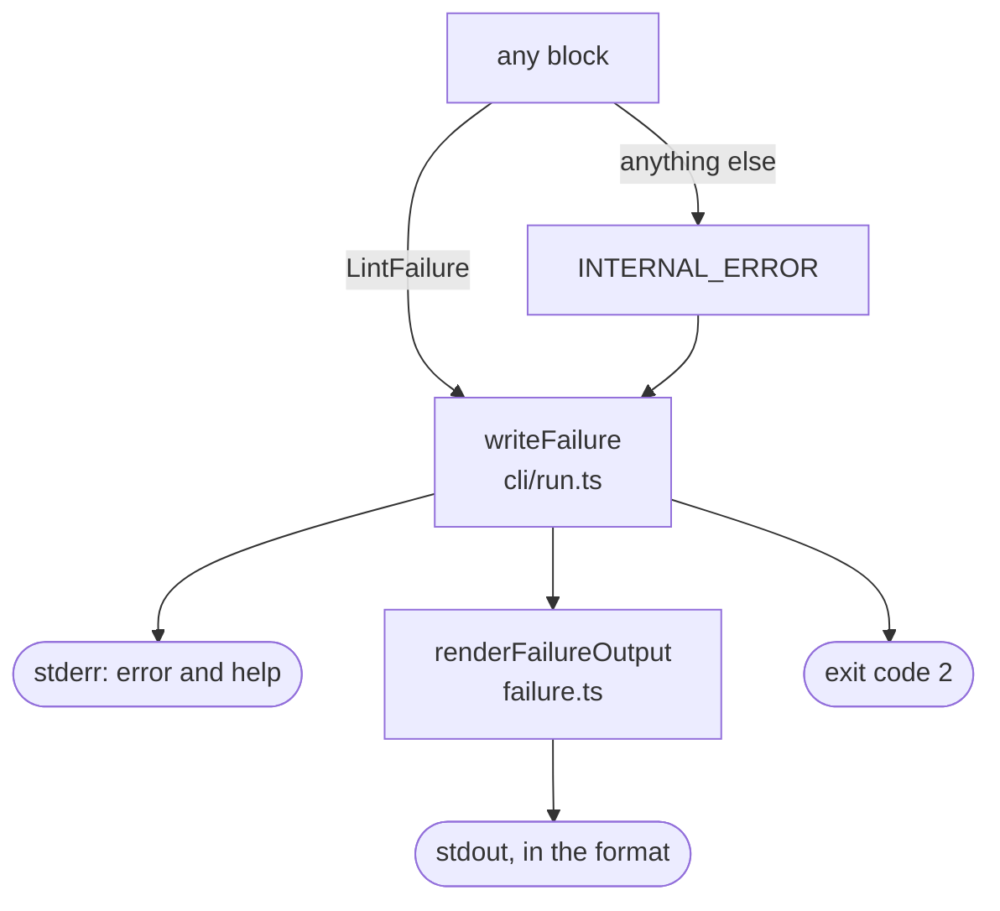

# Failures

Handles a run that cannot finish. The run stops, reports no findings, explains the cause and exits with code 2. Findings, even errors, are not failures: a run that completes exits 0 or 1.

Any block can raise a `LintFailure`, which carries a stable code, a message about this occurrence and a help line with the next step. It may also name the file involved and, for a rule crash, the rule, or for a plugin crash, the plugin. Anything else thrown during the run is reported as `INTERNAL_ERROR`. A stack trace is never part of the output.

| Code | Raised by | When |
| :- | :- | :- |
| `USAGE_ERROR` | CLI | The arguments are wrong |
| `CONFIG_INVALID` | Config, Plugins and rule set, Suppressions | The config is missing, unreadable or invalid, a plugin fails to load or check, or an entry matches several expressions |
| `INPUT_NOT_FOUND` | Inputs | A path given does not exist |
| `INPUT_PATTERN_UNMATCHED` | Inputs | A glob or directory selects no files |
| `INPUT_UNREADABLE` | Inputs | A file or directory cannot be read |
| `INPUT_INVALID_JSON` | Inputs | A file is not valid JSON |
| `NO_QUESTIONNAIRES` | Inputs | The files hold no Questionnaire |
| `RULE_CRASH` | Rule runner | A rule throws, returns a promise or reports an invalid finding |
| `PLUGIN_CRASH` | Name analysis, through a plugin's `hostVariables` hook | The hook throws, returns a promise or returns something other than a list of names |
| `INTERNAL_ERROR` | Any | Anything else: a bug in the linter |

Codes are stable and never reused for another cause, so scripts branch on the code, not on the message.

stderr always gets two lines, in every format:

```text
error: no Questionnaires found in fsh-generated/resources
help: run sushi . to generate fsh-generated/resources, then lint again; or pass paths to Questionnaire or Bundle JSON files, or list them in files in the config
```

stdout gets what the format can carry, so automation reads the failure where it reads the report:

| Format | stdout on failure |
| :- | :- |
| `text` | Nothing |
| `json` | A report with `status: "failed"` and the `failure`, and no findings or summary |
| `github` | One error annotation titled with the code, and a section in the job summary |
| `sarif` | A SARIF log with no results, and the failure as a tool notification |

[Failures](../report-format.md#failures) in the report format defines the failure record.

## Schema



## Code

- [`failure.ts`](../../packages/core/src/failure.ts): the failure codes, the `LintFailure` class, `asLintFailure` for anything else thrown, `renderFailureText` for stderr, and `renderFailureOutput` for stdout in each format.
- [`cli/run.ts`](../../packages/core/src/cli/run.ts): `writeFailure` writes it and returns exit code 2.
- [`run/host-variables.ts`](../../packages/core/src/run/host-variables.ts): raises `PLUGIN_CRASH` when a plugin's `hostVariables` hook fails.
- [`report/github.ts`](../../packages/core/src/report/github.ts) and [`report/sarif.ts`](../../packages/core/src/report/sarif.ts): the GitHub and SARIF output of a failure.
