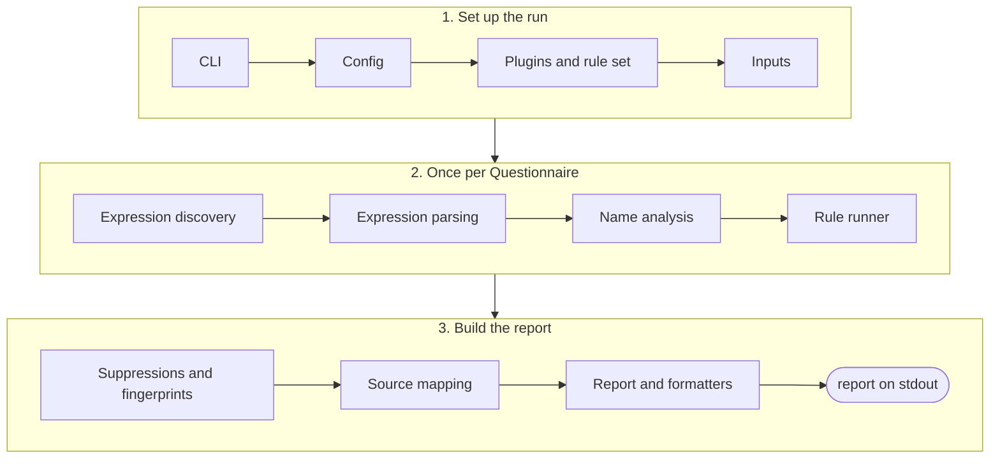

# Core

The `sdc-questionnaire-lint` package, `packages/core`, holds the CLI, the library and the built-in `sdc` rules. It is made of the blocks below, and each one has a page: what it does, where its code is, and a diagram. [How the linter works](../architecture.md) goes into more detail.

## One lint run

When a stage cannot complete, for example on a bad config or when no Questionnaires are found, the run stops. Failures then reports the cause and exits with code 2.

## Blocks

A block without a link has no page yet.

| # | Block | Code | What it does |
| :- | :- | :- | :- |
| 1 | [CLI](cli.md) | `cli/` | Reads the arguments, runs `lint` or `explain`, prints the result and sets the exit code |
| 2 | [Config](config.md) | `config/` | Finds and checks the config file, then works out the file paths |
| 3 | [Plugins and rule set](plugins.md) | `plugins/` | Checks the plugins and decides which rules run, at which severity |
| 4 | [Inputs](inputs.md) | `inputs/` | Finds the compiled JSON files and reads the Questionnaires out of them and out of Bundles |
| 5 | [Expression discovery](discovery.md) | `analysis/expression-sites.ts` | Finds every expression in a form and records what kind it is |
| 6 | [Expression parsing](parsing.md) | `analysis/fhirpath.ts` | Reads FHIRPath and x-fhir-query: syntax errors, function calls and references |
| 7 | [Name analysis](names.md) | `analysis/document-analysis.ts` | Works out which variables and linkIds exist, where they can be used and what depends on what |
| 8 | [Rule runner](runner.md) | `run/rules.ts` | Runs each rule on each form and checks every finding it returns |
| 9 | [Suppressions and fingerprints](suppressions.md) | `run/suppressions.ts` | Gives each finding a stable ID, applies suppressions and reports the ones that no longer match anything |
| 10 | [Source mapping](source-mapping.md) | `source/` | Traces a finding in the compiled JSON back to a line and column in the FSH |
| 11 | [Report and formatters](report.md) | `report/` | Builds the counts, then prints the report as text, JSON, GitHub annotations or SARIF |
| 12 | Failures | `failure.ts` | Handles a run that can't finish: the error codes, what goes to stderr and the failure output |

Paths are relative to `packages/core/src`. The rules themselves, in `rules/`, are described in the [rules library](../rules/index.md).
