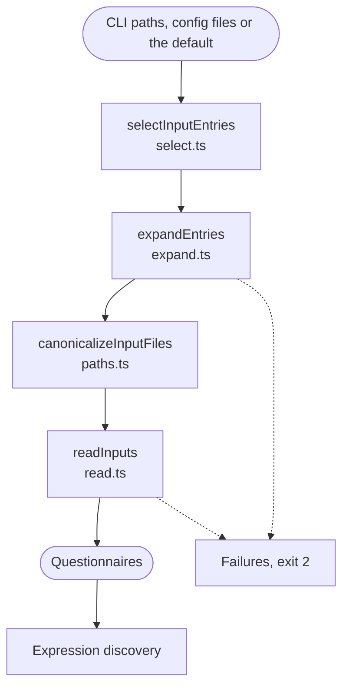

# Inputs

Finds the compiled JSON files to lint, and reads the Questionnaires out of them. The linter never reads FSH to find forms: it lints what SUSHI compiled.

The run lints exactly one list of paths, picked in this order:

1. The paths given on the command line: a **targeted** run.
2. Otherwise, the config's `files`: a **full** run.
3. Otherwise, `fsh-generated/resources`: a **full** run.

This is an order of precedence, not a fallback: if a path in the chosen list matches nothing, the run fails rather than moving on to the next list.

A path can be a file, a directory or a quoted glob. A directory means every `.json` file below it. The search skips `.git`, `node_modules` and symlinked directories. A file selected twice, for example through a symlink, is read once. A Questionnaire is one form, and a Bundle gives one form for each Questionnaire in it. The Bundle's other resources stay available to rules as targets of local references. Any other JSON file is skipped and counted in the summary.

| Failure code | When |
| :- | :- |
| `INPUT_NOT_FOUND` | A path given does not exist |
| `INPUT_PATTERN_UNMATCHED` | A glob or directory selects no files |
| `INPUT_UNREADABLE` | A selected file or directory cannot be read |
| `INPUT_INVALID_JSON` | A selected file is not valid JSON |
| `NO_QUESTIONNAIRES` | The files hold no Questionnaire. The help suggests running SUSHI when the default directory is missing. |

Each stops the run with exit code 2. [Input selection](../cli.md#input-selection) is the full contract.

## Schema

## Code

In [`packages/core/src/inputs/`](../../packages/core/src/inputs):

- [`load-inputs.ts`](../../packages/core/src/inputs/load-inputs.ts): `loadInputs` runs the steps below, and fails with `NO_QUESTIONNAIRES` when no form is found.
- [`select.ts`](../../packages/core/src/inputs/select.ts): `selectInputEntries` picks the one list of paths and says whether the run is targeted or full.
- [`expand.ts`](../../packages/core/src/inputs/expand.ts): `expandEntries` turns directories and globs into files.
- [`paths.ts`](../../packages/core/src/inputs/paths.ts): `canonicalizeInputFiles` resolves symlinks so each file is read once. `displayPath` gives the path relative to the working directory, as reports show it.
- [`read.ts`](../../packages/core/src/inputs/read.ts): `readInputs` parses each file and collects its Questionnaires, standalone or from a Bundle.

Two more lookups run at this point. Neither ever fails the run:

- [`run/sources.ts`](../../packages/core/src/run/sources.ts): `findFshSources` checks which FSH directories exist, for [Source mapping](source-mapping.md) and the summary.
- [`run/sushi-version.ts`](../../packages/core/src/run/sushi-version.ts): `findSushiVersion` reads the version of the IG's installed `fsh-sushi`, for the report's `run.sushi`.
