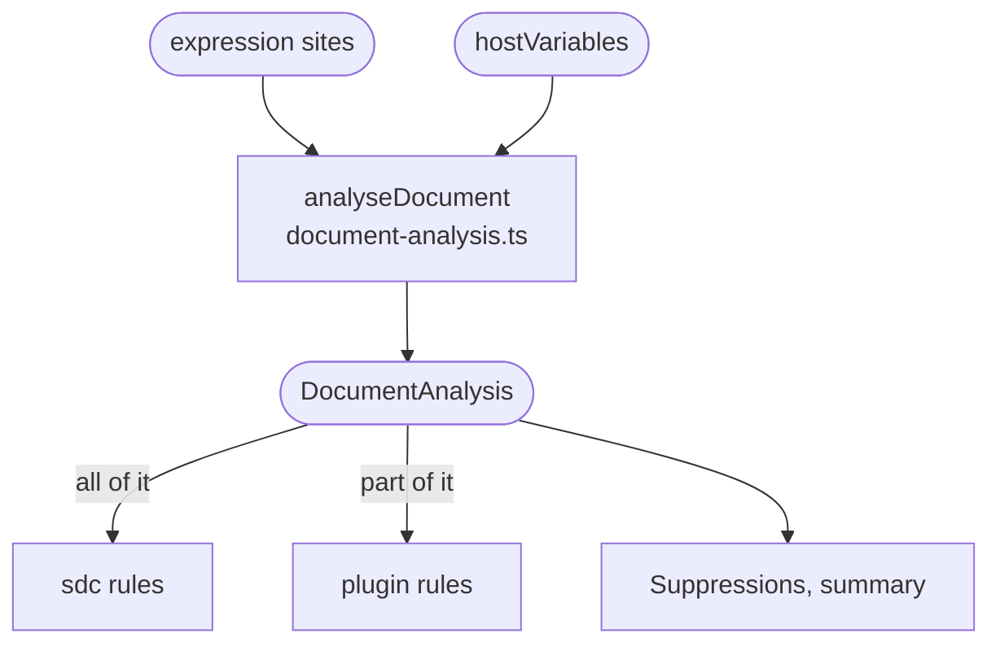

# Name analysis

Works out which names exist in a Questionnaire, which of them each expression can reference, and how they depend on each other. It also lists the form's linkIds and the expressions that refer to them. It runs once per Questionnaire, before the rules, and the rules read its answers.

A **declaration** introduces a name that other expressions reference as `%name`. It can be a named expression at a catalogued location, such as a `variable` or an `itemPopulationContext`, a `launchContext` on the root, or an `extractAllocateId`. A sourceQueries result is not a declaration: the application running the form supplies it, so it belongs in `hostVariables`.

An expression can reference:

- the declarations on its own element, on the items above it and on the root, the nearest one winning when names repeat;
- the names FHIRPath, FHIR and SDC define, such as `%resource`, `%context`, `%questionnaire` and `%qitem`, and any name starting `vs-` or `ext-`;
- the names a module's `assembleContext` lists, and the configured `hostVariables`.

An extraction expression sees only the extraction names; any other expression sees all the declarations except them. An uncatalogued expression gets no answer, because its scope is not known.

| What it works out | Read by |
| :- | :- |
| The declarations, in document order | `sdc/duplicate-declaration`, `sdc/shadowed-declaration`, `sdc/reserved-name` |
| The `%name` references of each FHIRPath expression, and the names available there | `sdc/undefined-variable` |
| What each declaration's expression references | `sdc/dependency-cycle` |
| Whether others reference each declaration: `referenced`, `unreferenced`, `blocked` or `unknown` | `sdc/unused-declaration` |
| The form's linkIds, and the `where(linkId = …)` references | `sdc/unresolved-linkid` |

When a question cannot be answered for certain, for example after a `defineVariable` with a computed name, the answer says so, and the rules stay silent rather than guess.

## Schema

Plugin rules get only the references, the available variables and the declarations, through `RuleContext`. [What a plugin can import](../architecture.md#what-a-plugin-can-import) describes it.

## Code

In [`packages/core/src/analysis/`](../../packages/core/src/analysis):

- [`document-analysis.ts`](../../packages/core/src/analysis/document-analysis.ts): `analyseDocument` runs the steps below once per Questionnaire, and returns the `DocumentAnalysis`.
- [`declarations.ts`](../../packages/core/src/analysis/declarations.ts): `findDeclarations` lists the declarations; `findAssembleContextNames` lists a module's `assembleContext` names.
- [`available-variables.ts`](../../packages/core/src/analysis/available-variables.ts): `availableVariables` gives the names available at each site, and the built-in names.
- [`dependencies.ts`](../../packages/core/src/analysis/dependencies.ts): `findDependencies` records what each declaration references.
- [`uses.ts`](../../packages/core/src/analysis/uses.ts): `findUses` records whether each declaration is referenced.
- [`linkids.ts`](../../packages/core/src/analysis/linkids.ts): `findLinkIds` lists the items' linkIds; `findLinkIdReferencesAt` gives the linkId references of each site.

[Expression discovery](../architecture.md#4-expression-discovery-analysis) in the architecture map has the full scope rules.
