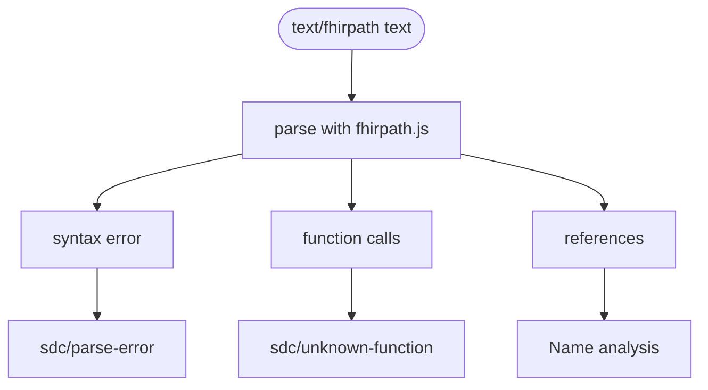
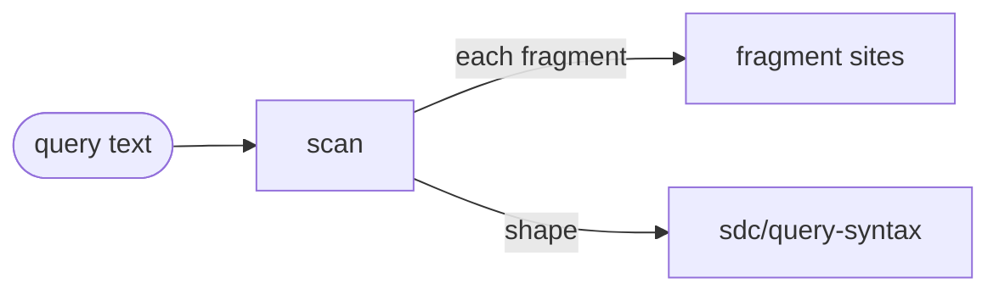

# Expression parsing

Reads the text of an expression: FHIRPath with the pinned fhirpath.js, and x-fhir-query with a small scanner. It is not a stage of the run but a set of helpers that the rules and [Name analysis](names.md) call.

**FHIRPath.** Only a site whose language is exactly `text/fhirpath` is parsed; CQL and other languages never are. `fhirpath.ts` is the only file that uses fhirpath.js, pinned to 4.10.1, so the linter parses as the engine does. From the parse tree it reads:

- the syntax error and its position, when the text does not parse, which `sdc/parse-error` reports, or `sdc/fragment-parse-error` in a query fragment;
- the function calls, which `sdc/unknown-function` checks against the functions fhirpath.js implements;
- the `%name` references, leaving out names that `defineVariable` binds earlier in the chain. Each says whether it is complete, and whether it is conditional: fhirpath.js may skip it, as in an `iif` branch;
- the linkId references, written `where(linkId = '…')`;
- whether the expression reads its input other than its linkId, which plugin rules use to tell whether a value can differ between repetitions of a group.

**x-fhir-query.** Both codes, `application/x-fhir-query` (R4) and `text/x-fhir-query` (R5), are read as queries. The scanner finds each `{{…}}` fragment, which becomes a FHIRPath site of its own, and checks that the query has the shape of a FHIR search. It does not check resource types or search parameters.

## Schema

FHIRPath, in `fhirpath.ts`:

x-fhir-query, in `x-fhir-query.ts`:

## Code

In [`packages/core/src/analysis/`](../../packages/core/src/analysis):

- [`fhirpath.ts`](../../packages/core/src/analysis/fhirpath.ts): `findFhirPathSyntaxProblem`, `findFunctionCalls`, `findVariableReferences`, `findLinkIdReferences` and `readsInput`. Each returns `undefined` when the text does not parse.
- [`x-fhir-query.ts`](../../packages/core/src/analysis/x-fhir-query.ts): `scanQueryFragments` and `findQueryShapeProblem`. `isQueryLanguage`, which plugins can import, is here too.
- [`fhirpath-function-catalog.ts`](../../packages/core/src/analysis/fhirpath-function-catalog.ts): the names of the functions fhirpath.js implements. It is generated by `npm run generate:functions --workspace sdc-questionnaire-lint`; regenerate it after bumping fhirpath.js, and never edit it by hand.

[The analysis helpers](../architecture.md#4-expression-discovery-analysis) in the architecture map have the details.
