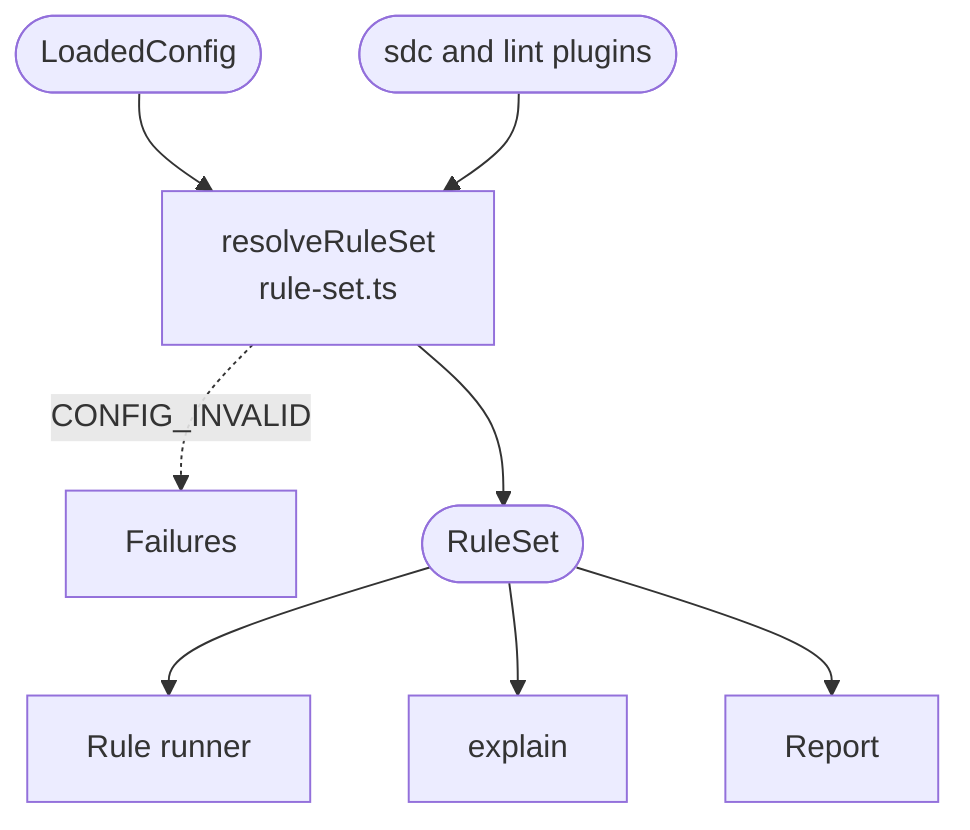

# Plugins and rule set

Decides which rules the run has, and the severity each one runs at. It works from the built-in plugins and the plugins the config lists, and it runs before any form is read.

A plugin is an object with a name, a version and its rules. The name is the namespace of its rules' IDs: the `smart-forms` plugin's rule `unsupported-query-embedding` is `smart-forms/unsupported-query-embedding`. Core has two built-in plugins: `sdc`, with the core rules, and `lint`, which holds only `lint/stale-suppression`. Both names are reserved. Installing a plugin's package does not enable it; listing it in `plugins` in an `.mjs` config does.

`resolveRuleSet` builds the rule set in four steps:

1. It checks each listed plugin against the plugin contract, and rejects a reserved namespace or one already registered.
2. It picks the runtime versions for each plugin that declares `compat`: the newest verified ones by default (`latest`), or the exact verified versions the config names.
3. It gives each rule its setting: the one in the config's `rules`, or else the rule's default severity. `off` keeps the rule from running.
4. It checks every rule ID that `rules` and `suppress` name, and suggests a similar ID when one is unknown. `lint/stale-suppression` can only be `warning` or `off`, and `lint/` findings cannot be suppressed.

A problem at any step stops the run with `CONFIG_INVALID`. `lint` and `explain` build the same rule set, so they fail the same way.

[Plugins](../../README.md#plugins) shows how to list one, [Adding a rule](../adding-a-rule.md) how to write one, and [What a plugin can import](../architecture.md#what-a-plugin-can-import) the API core gives plugins.

## Schema

The `RuleSet` holds every rule sorted by ID, including those set to `off`, each with its setting and its `compat` versions. It also holds the plugin versions and the selected `compat` for the report.

## Code

In [`packages/core/src/plugins/`](../../packages/core/src/plugins):

- [`rule-set.ts`](../../packages/core/src/plugins/rule-set.ts): `resolveRuleSet` builds the rule set as above. `unknownRuleHelp` suggests a similar rule ID, for the config and for `explain`.
- [`contract.ts`](../../packages/core/src/plugins/contract.ts): the plugin contract, public API: `LintPlugin`, `LintRule`, `RuleContext`, `RuleFinding`, `RuleDocs` and `PluginCompat`.
- [`builtin.ts`](../../packages/core/src/plugins/builtin.ts): the `sdc` and `lint` plugins. It also says where each built-in rule completes its check, which [Suppressions](suppressions.md) uses to find stale entries and the summary uses to count unchecked expressions.
- [`core-rule.ts`](../../packages/core/src/plugins/core-rule.ts): `CoreRule`, an `sdc` rule that also receives core's analysis of the form. Plugin rules get only the public `RuleContext`.
