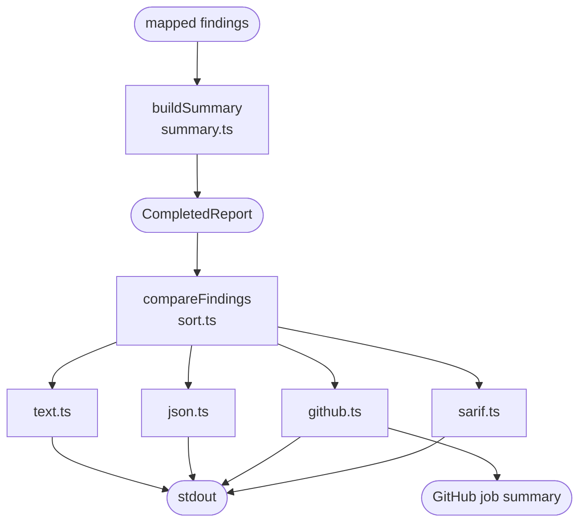

# Report and formatters

Builds the run's report, the counts included, and prints it in the format `--format` selects. Every format renders the same report, with findings in the same order.

The report holds the run's metadata (linter, plugin and SUSHI versions, `compat`, full or targeted run), every finding left after suppressions, and a summary: files read and skipped, Questionnaires, expressions analysed and unchecked, findings by severity, suppressions and the FSH directories. An expression is **unchecked** when a rule that applies there could not finish its check, for example after a `defineVariable` with a computed name.

| Format | For | What it writes |
| :- | :- | :- |
| `text` | People at a terminal | One block per finding, then the summary. Info findings are hidden unless `--show-info` is given. |
| `json` | Scripts and agents | The report itself, as the [JSON report format](../report-format.md) and its schema define it |
| `github` | GitHub Actions | One annotation per finding, every finding in a collapsed log group, and a Markdown table in the job summary |
| `sarif` | GitHub code scanning and other SARIF viewers | One SARIF 2.1.0 log, with the rules that ran and one result per finding |

The first line of each finding in `text` has a stable shape, so editors and scripts can read it:

```text
input/fsh/Example.fsh:42:18: error sdc/undefined-variable "Patient name" (patient-name) uses %patientNmae, which is not defined.
```

The lines below it (`location:`, `note:`, `related:` and `help:`) are the same in `text`, `github` and `sarif`. A finding with no FSH location names the compiled file, without a line or column, and its `location:` line gives the resource and JSON Pointer instead.

[Output formats](../cli.md#text) in the CLI reference is the full contract for each format.

## Schema



## Code

In [`packages/core/src/report/`](../../packages/core/src/report):

- [`types.ts`](../../packages/core/src/report/types.ts): the report's types, public API, matching the [report schema](../schemas/lint-report.schema.json).
- [`summary.ts`](../../packages/core/src/report/summary.ts) and [`expression-coverage.ts`](../../packages/core/src/report/expression-coverage.ts): `buildSummary` computes the counts, and `summarizeExpressionCoverage` the analysed and unchecked expressions.
- [`sort.ts`](../../packages/core/src/report/sort.ts): `compareFindings`, the one order every format uses: by file, line and column, then rule.
- [`locations.ts`](../../packages/core/src/report/locations.ts): where a finding is, and its `location:`, `note:`, `related:` and `help:` lines, shared by text, GitHub and SARIF.
- The formats: [`text.ts`](../../packages/core/src/report/text.ts), [`json.ts`](../../packages/core/src/report/json.ts), [`github.ts`](../../packages/core/src/report/github.ts) with the job summary, and [`sarif.ts`](../../packages/core/src/report/sarif.ts). `github.ts` and `sarif.ts` also write a failed run.
- [`colour.ts`](../../packages/core/src/report/colour.ts): colours the severity in `text`, when the CLI allows colour.
