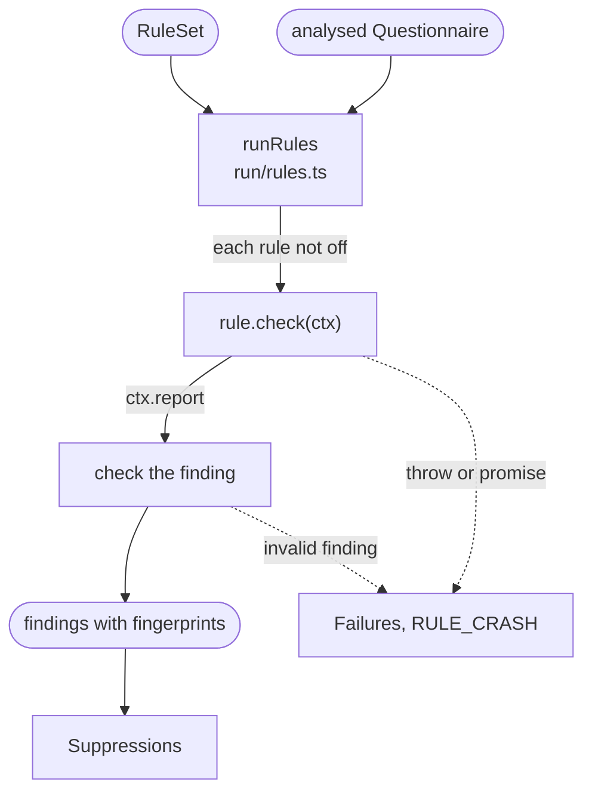

# Rule runner

Runs every enabled rule on every Questionnaire, checks each finding a rule reports, and turns it into a report finding. Built-in and plugin rules are run the same way.

For each Questionnaire, `runRules` calls `check(ctx)` once for each rule that is not `off`. A check is synchronous. Through `ctx`, a rule gets:

- `document` and `sites`: the Questionnaire and its expression sites, frozen;
- `declarations`, `referencesAt(site)`, `variablesAt(site)`, `dependenciesOf(declaration)`, `useOf(declaration)` and `readsInput(site)`: answers from [Name analysis](names.md);
- `compat`: the runtime versions selected for the rule's plugin;
- `report(finding)`: reports a finding at a site or a JSON Pointer, with a message and, optionally, help, a note, a range in the text and related locations.

An `sdc` rule also receives core's full analysis of the form, the linkId analysis included, as a second argument; plugin rules get only `ctx`.

Each finding is checked before it is accepted: its site must be one of `ctx.sites`, its pointer must lie in the resource, and its range in the expression's text. A rule that throws, returns a promise or reports an invalid finding stops the run with `RULE_CRASH`, which names the rule. A finding takes the rule's severity, unless the finding sets its own.

An accepted finding gets its JSON location, an excerpt of the expression, its related locations, a fingerprint, and its rule's `docsUrl` when the rule has one. A finding in a query fragment is shown within its whole query. Its FSH location is filled in later, by [Source mapping](source-mapping.md).

[Adding a rule](../adding-a-rule.md) explains how to write a rule, and the [rules library](../rules/index.md) has a page for each one.

## Schema

## Code

- [`run/rules.ts`](../../packages/core/src/run/rules.ts): `runRules` runs the rules on one Questionnaire, checks and converts their findings, and records where each came from for Source mapping.
- [`plugins/contract.ts`](../../packages/core/src/plugins/contract.ts): `RuleContext` and `RuleFinding`, what a rule receives and reports.
- [`plugins/core-rule.ts`](../../packages/core/src/plugins/core-rule.ts): `CoreRule`, an `sdc` rule that also takes the analysis.
- [`rules/describe.ts`](../../packages/core/src/rules/describe.ts): how core rules name an element in a message, by its item's text and linkId, and where they place a finding about a declaration.
- [`rules/`](../../packages/core/src/rules): the core rules, one file each.
