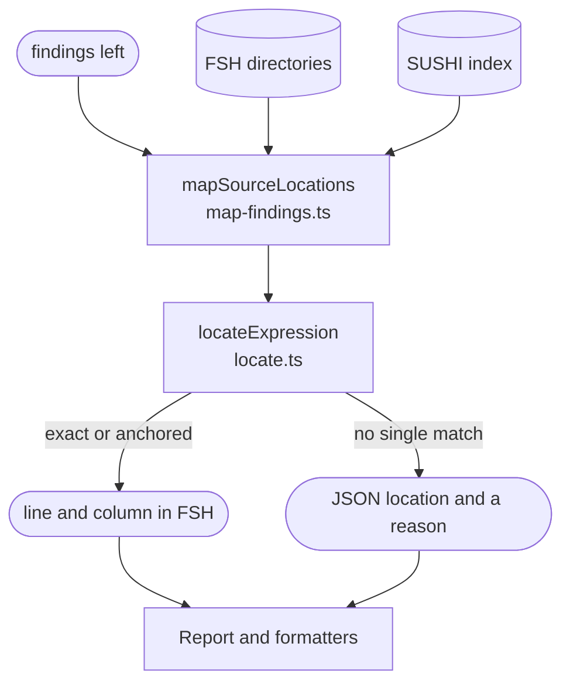

# Source mapping

Traces each finding in the compiled JSON back to a line and column in the FSH the author wrote. It runs on the findings left after suppressions, and only changes their `sourceLocation`: fingerprints, severities and counts are the same with or without FSH.

It never fails the run. A finding it cannot place keeps its JSON location, with the reason it has no FSH one. FSH is read only when a finding about a Questionnaire remains and an FSH directory exists, and each file is read and parsed at most once.

For each finding it:

1. finds the FSH Instance that compiled into the finding's resource, through SUSHI's index file when it is current, or else by searching the FSH directories for the one Instance with the resource's id and type;
2. lists the expression strings in that Instance, each with what anchors it: its item's linkId, its extension and its Expression's name;
3. matches the finding's expression to one of them: text that occurs once in both the JSON and the Instance is `exact`; repeated text is `anchored` when the anchors single out one string;
4. turns the reported range into lines and columns, after decoding the FSH string as SUSHI does and checking that it gives the same text.

| `sourceLocation` | Meaning |
| :- | :- |
| `mapped`, `exact` | The expression's text occurs once, so its place is certain |
| `mapped`, `anchored` | The text repeats, but the linkId, extension and name single out one string |
| `unmapped`, `ambiguous` | Several strings could be the one |
| `unmapped`, `multiline` | The expression is in a `"""` string, or in a quoted string that spans lines |
| `unmapped`, `not-found` | No Instance or string matches, for example for an expression a parameterised RuleSet produces |
| `unmapped`, `source-unavailable` | There is no FSH directory, or the finding is not about a Questionnaire |

The FSH reader mirrors SUSHI 3.20.1: it splits files into definitions and rules, resolves paths, indentation and soft indices, and decodes strings as SUSHI does. [Findings and locations](../report-format.md#findings-and-locations) defines the field.

## Schema

## Code

In [`packages/core/src/source/`](../../packages/core/src/source):

- [`map-findings.ts`](../../packages/core/src/source/map-findings.ts): `mapSourceLocations` maps every finding, one at a time.
- [`locate.ts`](../../packages/core/src/source/locate.ts): `locateExpression` places one finding: steps 1 to 4 above.
- [`definitions.ts`](../../packages/core/src/source/definitions.ts) and [`sushi-index.ts`](../../packages/core/src/source/sushi-index.ts): find the FSH Instance behind a resource.
- [`expression-literals.ts`](../../packages/core/src/source/expression-literals.ts): lists an Instance's expression strings with their anchors.
- [`positions.ts`](../../packages/core/src/source/positions.ts): turns offsets into lines and columns.
- The FSH reader: [`fsh-files.ts`](../../packages/core/src/source/fsh-files.ts) reads and caches files, [`fsh-document.ts`](../../packages/core/src/source/fsh-document.ts) parses them, [`fsh-paths.ts`](../../packages/core/src/source/fsh-paths.ts) resolves rule paths, and [`fsh-string.ts`](../../packages/core/src/source/fsh-string.ts) decodes strings.

`npm run source-map:coverage --workspace sdc-questionnaire-lint -- <IG directory>` maps every expression of an IG and reports how many it placed.
