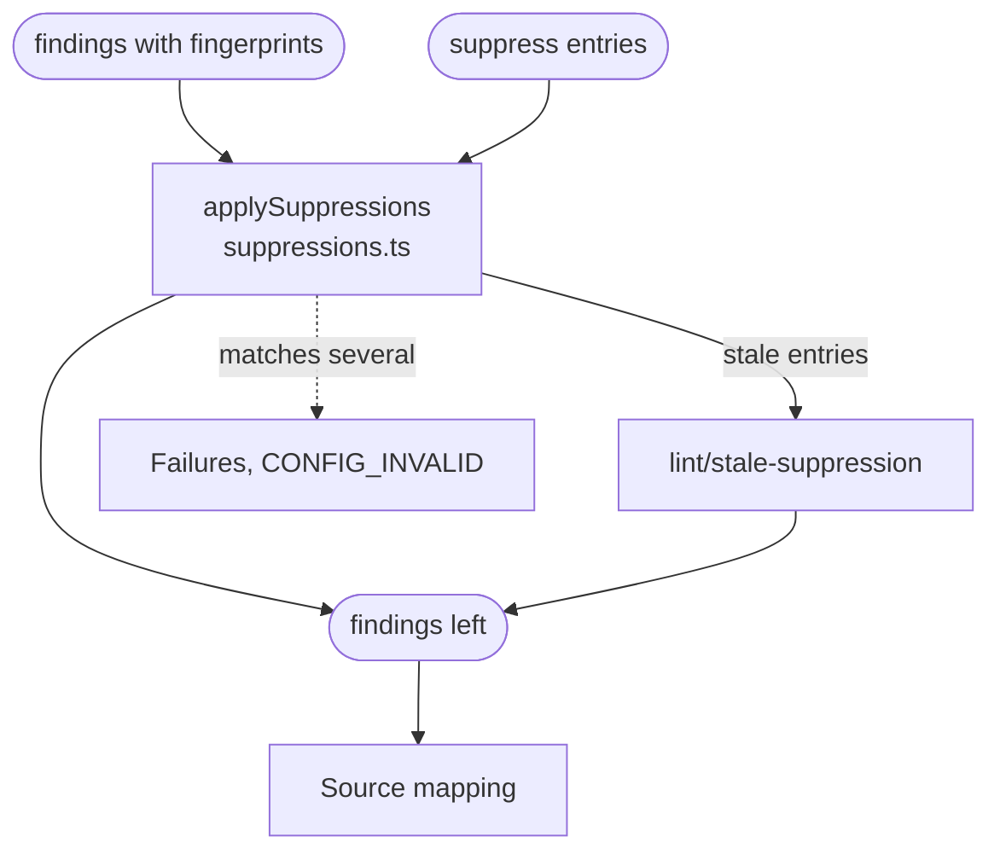

# Suppressions and fingerprints

Gives every finding a stable ID, its fingerprint, then hides the findings the config's `suppress` entries name, and reports the entries that no longer hide anything.

## Fingerprints

A fingerprint identifies a finding across runs, so CI and code scanning can tell a new finding from one they have seen before. The Rule runner computes it from:

- the rule, the file and the resource;
- the site's key: its item's linkId, its extension and, for a named expression, its name;
- the text of the reported range.

It never uses a line number, an offset or an array index above the item, so moving items or editing the FSH elsewhere does not change it. Fingerprints are unique within a report: when two findings would share one, the later gets a different one. A finding about a suppression entry is fingerprinted by its rule, the suppressed rule and the entry's selectors, never by its reason or its place in the list.

## Suppressions

A `suppress` entry hides one rule's findings at one expression. Its selectors are `file`, which is required, then `linkId`, `extensionUrl`, `name`, `resource` and `pointer`, and every selector given must match. An entry that matches several expressions is a config error. An entry for a `launchContext` or `extractAllocateId` selects a declared name on one element instead of an expression. Suppressing an x-fhir-query also hides the findings in its `{{…}}` fragments. `lint/` findings cannot be suppressed.

Every entry ends up in one of three states:

| State | When | Reported |
| :- | :- | :- |
| Applied | It hides at least one finding | In the summary's counts |
| Stale | The run shows it hides nothing: its file is gone, nothing matches it, or its rule checked the expression and found no problem | As a `lint/stale-suppression` warning at the entry |
| Not assessed | The run cannot tell, for example its file is outside a targeted run or its rule is a plugin rule; or `lint/stale-suppression` is `off` | In the summary's counts |

[Suppressing a finding](../../README.md#suppressing-a-finding) shows examples, and [Stale suppressions](../cli.md#stale-suppressions) is the full contract.

## Schema

## Code

In [`packages/core/src/run/`](../../packages/core/src/run):

- [`suppressions.ts`](../../packages/core/src/run/suppressions.ts): `applySuppressions` matches each entry, hides the findings of applied ones and reports stale ones.
- [`fingerprint.ts`](../../packages/core/src/run/fingerprint.ts): `siteKeys` and `declarationKeys` give each site and declaration a stable key; `questionnaireFingerprint` and `configFingerprint` build fingerprints from them; `distinctFingerprints` keeps them unique.
- [`plugins/builtin.ts`](../../packages/core/src/plugins/builtin.ts): `completesCheck` says where each built-in rule completes its check. Only there can an entry be stale, which is why a plugin rule's entries are not assessed.
