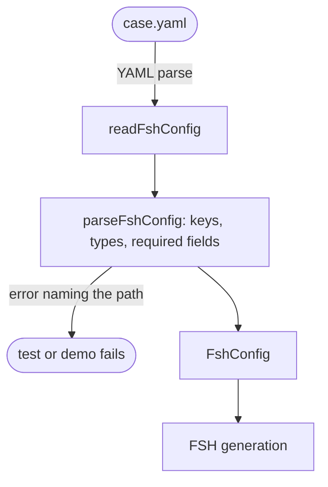

# Case config

Reads a lint case's YAML and checks it before anything is generated. A case describes one Questionnaire: its root extensions and items, any contained resources, and the linter config it is linted with. Each mistake is reported with the file and the path in the config, such as `items[0].extensions[1]: give an expression, a reference or both`.

```yaml
# packages/core/test/cases/undefined-variable/available-names.yaml, shortened
hostVariables: [PrePopQuery]
extensions:
  - url: variable
    name: total
    expression: '%PrePopQuery.total'
fsh:
  - 'extension[+].url = "http://hl7.org/fhir/uv/sdc/StructureDefinition/sdc-questionnaire-launchContext"'
  - 'extension[=].extension[0].url = "name"'
  - 'extension[=].extension[=].valueCoding = http://hl7.org/fhir/uv/sdc/CodeSystem/launchContext#patient'
  - 'extension[=].extension[+].url = "type"'
  - 'extension[=].extension[=].valueCode = #Patient'
items:
  - linkId: a
    type: string
    extensions:
      - url: calculatedExpression
        expression: '%total + %patient.count() + %resource.count()'
```

**Quote every whole expression:** `'%a'`, `'1'`, `"'text'"`. Unquoted, `%a` is invalid YAML and `1` is a number, and `'text'` alone is YAML quoting, so the FHIRPath string literal becomes a path.

| Key | Holds |
| :- | :- |
| `instance` | The Questionnaire's name, which also names its FSH file. A case's is `<group>-<case>`, from its path; a case that gives another one fails. Letters, digits and hyphens |
| `status` | The Questionnaire's status; `draft` by default |
| `hostVariables`, `rules`, `suppress` | The case's linter config, as the config file gives them. A suppression's file is `fsh-generated/resources/Questionnaire-<instance>.json`. Only their shape is checked here; the linter checks their content |
| `extensions` | The root's expression extensions, described below |
| `fsh` | Raw FSH lines for anything else on the root, such as a launchContext |
| `items` | The items, each `{ linkId, type, text?, extensions?, fsh?, items? }` |
| `contained` | Contained resources, each `{ resourceType?, extensions?, fsh?, items? }`; `resourceType` is `Questionnaire` by default |

An **extension** is `{ url, name?, language?, expression?, reference? }`, with an expression, a reference or both. `url` is a full URL or one of the aliases `variable`, `calculatedExpression`, `enableWhenExpression`, `initialExpression`, `answerExpression`, `candidateExpression` and `itemPopulationContext`. `language` is `text/fhirpath` by default.

An extension that holds its Expression in a sub-extension, such as a template extraction context, or anything else the keys do not cover, such as an answerOption or an enableWhen, is written as raw `fsh` lines on its element.

## Schema



## Code

In [`packages/lint-cases/src/generate-fsh.ts`](../../packages/lint-cases/src/generate-fsh.ts):

- The comment at the top: the reference for every key.
- `FshConfig`, `FshItem`, `FshExtension` and `FshContained`: the config's types.
- `parseFshConfig`: checks a parsed config and returns it typed; `readFshConfig` reads a file and prefixes each error with its path.
- `extensionUrls`: the aliases and the URLs they stand for.

[`packages/core/test/cases/`](../../packages/core/test/cases) and [`packages/plugin-smart-forms/test/cases/`](../../packages/plugin-smart-forms/test/cases) hold every case, each with a comment saying what it shows.
