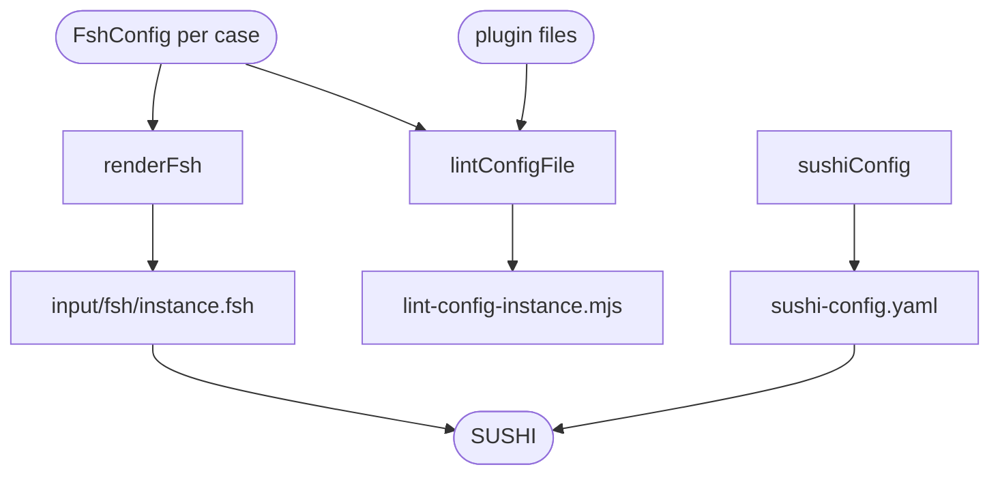

# FSH generation

Writes lint case configs as a SUSHI project: one FSH file per case, a shared SUSHI config, and a linter config for each case that needs one. The same code writes the project of a package's cases and the one-case project of `npm run demo`.

Each case becomes one Questionnaire instance with `Usage: #example`. At every level, its extensions come first, then its raw `fsh` lines, then its items. A list of one extension has no index; a longer one starts each extension with `[0]` or `[+]` and refers back to it with `[=]`. Contained resources become inline instances, named and given the id `<instance>-contained-<n>` unless their `fsh` sets one. Only a Questionnaire gets a status.

```yaml
# packages/core/test/cases/demo/contained.yaml
items:
  - linkId: a
    type: string
    extensions:
      - url: calculatedExpression
        expression: '%missing'
contained:
  - extensions:
      - url: variable
        name: c
        expression: '%nope'
```

```fsh
Instance: demo-contained
InstanceOf: Questionnaire
Usage: #example
* status = #draft
* item[0].linkId = "a"
* item[=].type = #string
* item[=].extension.url = "http://hl7.org/fhir/uv/sdc/StructureDefinition/sdc-questionnaire-calculatedExpression"
* item[=].extension.valueExpression.language = #text/fhirpath
* item[=].extension.valueExpression.expression = "%missing"
* contained[0] = demo-contained-contained-1

Instance: demo-contained-contained-1
InstanceOf: Questionnaire
Usage: #inline
* status = #draft
* extension.url = "http://hl7.org/fhir/StructureDefinition/variable"
* extension.valueExpression.name = "c"
* extension.valueExpression.language = #text/fhirpath
* extension.valueExpression.expression = "%nope"
```

A case gets a **linter config**, `lint-config-<instance>.mjs`, when it gives `hostVariables`, `rules` or `suppress`, or when the project lists plugins. It sits at the project root, because the linter resolves the FSH directories and the SUSHI index against the config's directory. It is an `.mjs` file, because only an `.mjs` config can list plugins; it imports each plugin's file by its URL.

The **SUSHI config** is the same for every project: FSH only, FHIR 4.0.1, and SDC 4.0.0 as the one dependency.

```text
<project>/
  sushi-config.yaml
  lint-config-<instance>.mjs                              a case with a linter config
  input/fsh/<instance>.fsh                                one per case
  fsh-generated/resources/Questionnaire-<instance>.json   written by SUSHI
  fsh-generated/data/fsh-index.json                       written by SUSHI, read by source mapping
```

`generateProject` fails when two cases have the same instance. It removes only what it and SUSHI write, `sushi-config.yaml`, `input/` and `fsh-generated/`, so a wrong output directory cannot lose other files.

## Schema



## Code

In [`packages/lint-cases/src/generate-fsh.ts`](../../packages/lint-cases/src/generate-fsh.ts):

- `renderFsh`: a config as FSH, with `extensionLines`, `itemLines` and `instanceLines` for each level.
- `lintConfigFile`: the name of a case's linter config, or `undefined` when it needs none; `lintConfigModule` writes it.
- `sushiConfig`: the SUSHI config.
- `generateProject`: writes the whole project.

[`packages/core/scripts/demo.ts`](../../packages/core/scripts/demo.ts) uses `generateProject` with one config, then compiles and lints it.
