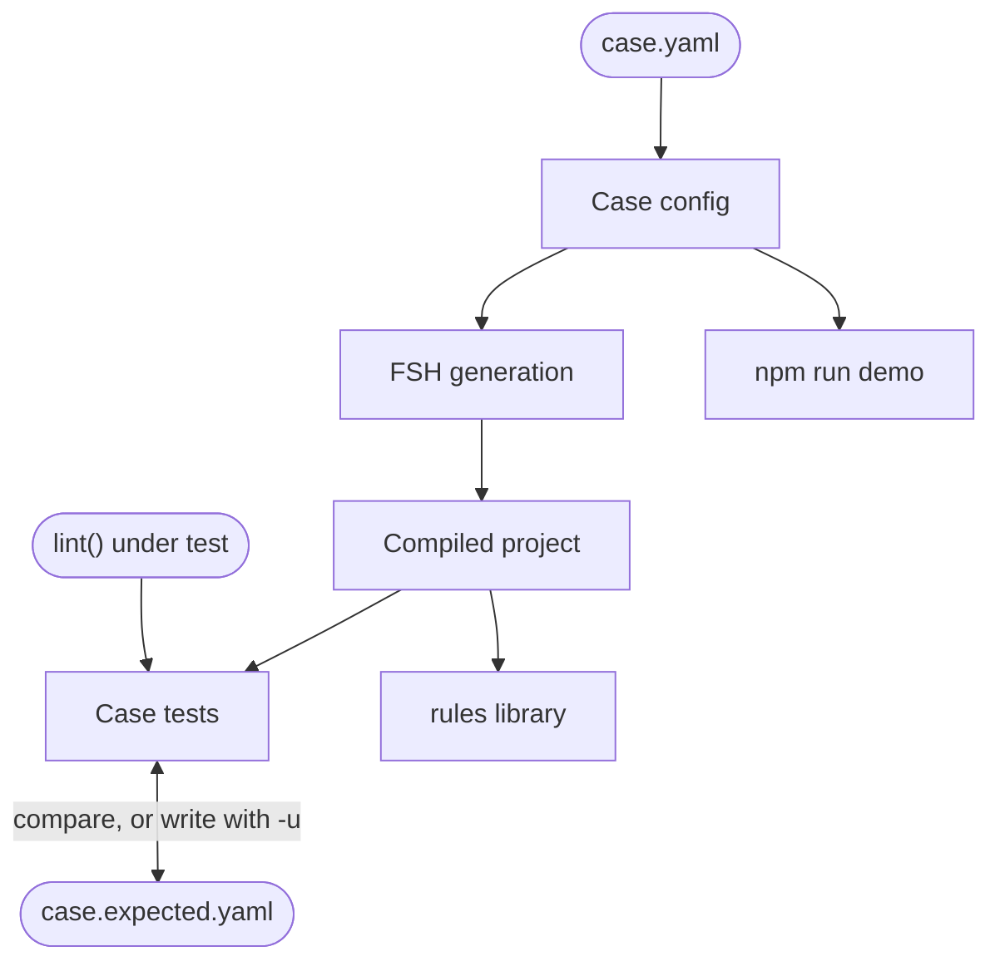

# Testing rules with lint cases

This section is for contributors to this repository: using the linter needs none of it.

The `@aehrc/sdc-questionnaire-lint-cases` package, `packages/lint-cases`, is how this repository tests its rules. A **lint case** is a YAML config describing a minimal form, `test/cases/<rule>/<case>.yaml`, beside the findings the linter must report for it, `<case>.expected.yaml`. The package writes every case of a package as FSH, compiles them with SUSHI into one project, lints each compiled Questionnaire and compares the findings with the expected file.

Because SUSHI compiles each case, a case tests a rule the way an IG author meets it: through FSH, with each finding mapped back to its FSH line.

The package is private test support: it is never built or published, and its exports are TypeScript sources. A plugin outside this repository tests its rules through `lint()` instead, as [Adding a rule](../adding-a-rule.md#5-tests) explains.

## Where it fits

Four parts of the repository use it:

| User | Uses | What for |
| :- | :- | :- |
| Core's tests, `packages/core/test/cases/` | `lintCases`, `testLintCases`, `copyCase` | Lint core's cases with core's source; the source-map tests run the CLI on a copy of `demo/invalid-demo` |
| The Smart Forms plugin's tests, `packages/plugin-smart-forms/test/cases/` | `lintCases`, `testLintCases` | Lint the plugin's cases with the built core, the plugin's source listed in each case's linter config |
| The rules library, `docs/.vitepress/rules.ts` | `readLintCases`, `compileLintCases` | Show each rule's example case and list its other cases, from the project the tests compiled |
| `npm run demo`, `packages/core/scripts/demo.ts` | `readFshConfig`, `generateProject`, `lintConfigFile` | Generate one config into `demo/<instance>`, to try a form by hand |

## Blocks

| # | Block | Code | What it does |
| :- | :- | :- | :- |
| 1 | [Case config](config.md) | `generate-fsh.ts` | Reads a case's YAML and checks every key, naming the path of a mistake |
| 2 | [FSH generation](fsh.md) | `generate-fsh.ts` | Writes each case as FSH, with the SUSHI config and the linter config around it |
| 3 | [Compiled project](project.md) | `project.ts` | Finds a package's cases and compiles them all with SUSHI into one cached project |
| 4 | [Case tests](tests.md) | `cases.ts` | Lints each case, compares its findings with the expected file, and checks that every rule has a case |

Paths are relative to `packages/lint-cases/src`. The package exports `cases.ts` as `@aehrc/sdc-questionnaire-lint-cases` and `generate-fsh.ts` as `@aehrc/sdc-questionnaire-lint-cases/generate-fsh`; the rules library imports `project.ts` by its path.
