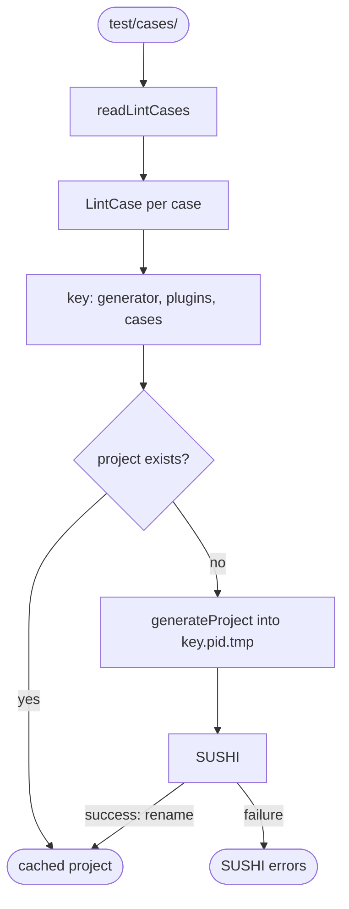

# Compiled project

Finds a package's lint cases and compiles them all into one SUSHI project, so SUSHI runs once per change to the cases, not once per case. The project is cached and shared by every test file of the package and by the rules library.

`readLintCases` reads every `.yaml` file under a package's `test/cases/`, except the `.expected.yaml` files, in name order. A case at `<group>/<case>.yaml` is named `<group>/<case>`, which is also its test name, and its instance is `<group>-<case>`.

`compileLintCases` builds the project in the gitignored `.cache/lint-cases/`, in a directory per package, such as `packages-core-test-cases/`. The project's directory is named after a key, a hash of:

- the generator, `generate-fsh.ts`;
- the paths of the plugin files listed in the linter configs;
- each case's name and YAML.

An unchanged key reuses the project. The expected files are not part of the key, so updating them never recompiles. Nor is a plugin's source: the linter config imports it, so the case tests always lint with the current source.

To compile, it writes the project into `<key>.<pid>.tmp`, runs SUSHI there with the same Node, and renames it into place only once SUSHI succeeds. Test files that compile at the same time, such as core's case tests and its source-map tests, therefore never see a half-built project, and the one that finishes second discards its copy. Then it removes the package's older projects.

When SUSHI fails, the error lists only SUSHI's errors with their file and line, since its full output is long. The first compile also downloads the FHIR packages, so the case tests allow it ten minutes.

The cache lives outside `node_modules` so that Vitest transforms the generated `.mjs` linter configs and the plugin sources they import; Node would import them as they are, and cannot load TypeScript that imports `./x.js`. `project.ts` does not import Vitest, so the documentation site can load it too.

## Schema

## Code

In [`packages/lint-cases/src/project.ts`](../../packages/lint-cases/src/project.ts):

- `LintCase`: a case's name, config path, expected path and parsed config.
- `readLintCases`: every case of a package.
- `compileLintCases`: the cache key, the SUSHI run, the rename into place and the removal of older projects.
- `sushiEntry`: finds the SUSHI binary of the installed `fsh-sushi`.

[`docs/.vitepress/rules.ts`](../.vitepress/rules.ts) calls both to build the rules library, with the same plugin paths as the tests, so `npm run docs:build` after `npm test` reuses the tests' project. Removing `.cache/lint-cases/` forces a fresh compile.
