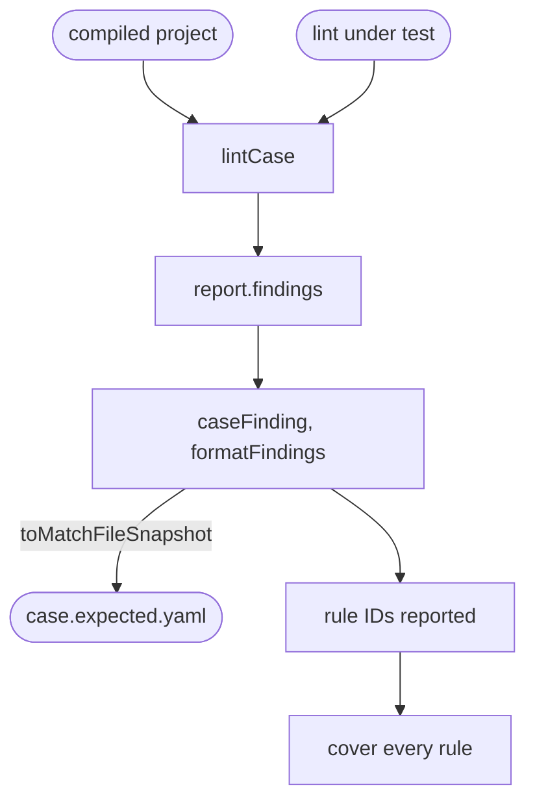

# Case tests

Lints each case's compiled Questionnaire, compares its findings with the case's expected file, and checks that every rule of the plugin under test has a case. Each package's `test/cases/cases.test.ts` is a few lines that call it.

`lintCases` takes the package's `test/cases/` directory, the `lint` function under test, and the plugin files to list in each case's linter config. Core passes `lint` from its source. The Smart Forms plugin passes `lint` from the built core and lists its own source, since a plugin runs inside the published core.

`lintCase` lints the case's one Questionnaire in the compiled project, with the case's linter config when it has one, so a case never sees another case's findings. Each finding is turned into a **case finding** and the list is compared with `<case>.expected.yaml`:

```yaml
# packages/lint-cases/test/cases/declaration/variable.expected.yaml
- ruleId: fixture/declaration
  severity: info
  at: input/fsh/declaration-variable.fsh:8:43
  message: '%a is declared.'
  expression:
    text: '1'
```

| Field | Holds |
| :- | :- |
| `ruleId`, `severity`, `message` | As in the report |
| `at` | The FSH file, line and column; or, for a finding with no FSH line, its JSON Pointer and why, such as `/item/0/extension/0/valueExpression (not-found)` |
| `help`, `note`, `expression`, `suggestions` | As in the report, when the finding has them |
| `related` | Each related location, as `at` and its `message` |

A case finding leaves out the fingerprint and the docs URL. The YAML is written with single quotes and without folded lines, so each message stays on one line. A finding on the linter config has no case: the test throws, and such a rule is tested on its own, as `lint/stale-suppression` is.

`testLintCases` registers one test per case, named `<group>/<case>`, then a test named `cover every <plugin> rule`. That test fails, listing the rules, when a rule of the plugin is not reported in any case's expected findings, so a new rule cannot land without a case.

`copyCase` copies a case's FSH, its compiled Questionnaire, the SUSHI config and the SUSHI index into another directory, for tests that change the project around a case. Core's source-map tests use it.

## Adding a case

1. Write `packages/<package>/test/cases/<rule>/<case>.yaml`, starting with a comment that says what the case shows. One case per behaviour; [Case config](config.md) lists the keys.
2. Run `npx vitest run -u packages/<package>/test/cases` to write its expected file. It also rewrites any expected file whose findings changed.
3. Review every new and changed expected file before committing: it is what the linter must report from now on.

## Schema



## Code

In [`packages/lint-cases/src/cases.ts`](../../packages/lint-cases/src/cases.ts):

- `lintCases`: `LintCasesOptions` in, `LintCases` out: `cases`, `compile`, `lintCase` and `copyCase`.
- `CaseFinding`, `caseFinding` and `formatFindings`: a finding as an expected file holds it.
- `testLintCases`: the case tests and the coverage test.

The callers are [`packages/core/test/cases/cases.test.ts`](../../packages/core/test/cases/cases.test.ts), with [`test/support/cases.ts`](../../packages/core/test/support/cases.ts), and [`packages/plugin-smart-forms/test/cases/cases.test.ts`](../../packages/plugin-smart-forms/test/cases/cases.test.ts). The package's own [`test/cases.test.ts`](../../packages/lint-cases/test/cases.test.ts) lints two cases with a fixture plugin, checking that a generated linter config loads a plugin written in TypeScript.
