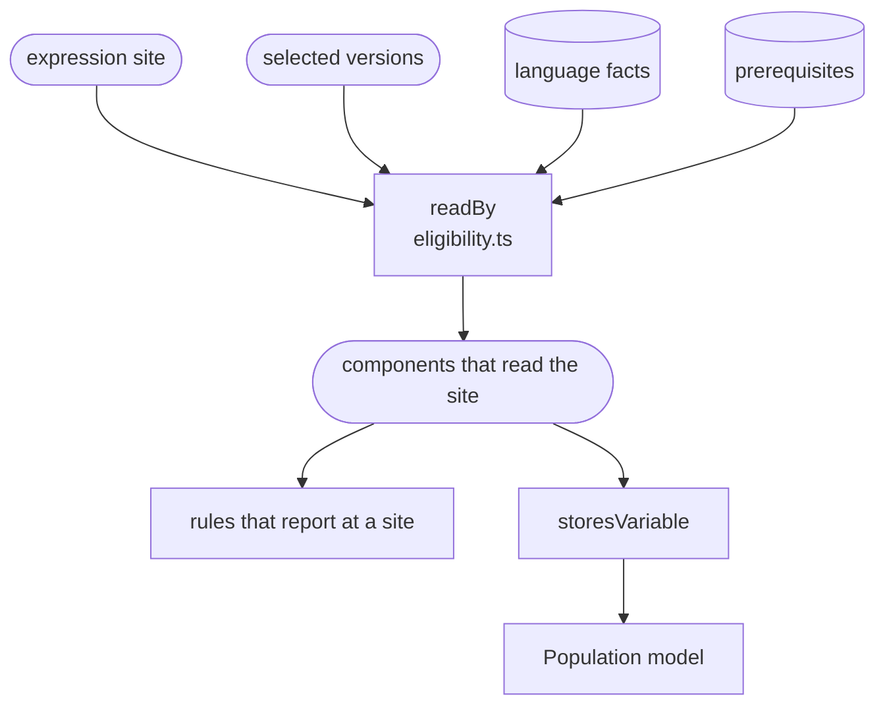

# Site eligibility

Works out which Smart Forms components actually read an expression, so a rule reports only what Smart Forms would act on. `readBy(ctx, site)` returns the selected components that read a site, each with how it handles the language there, or nothing when none does.

A component reads a site when both of these hold for its selected version:

1. **It reads the location.** It has a language fact for the site's extension, such as the renderer for a `calculatedExpression`.
2. **Every prerequisite holds there.** A prerequisite is what a component needs beyond the location, for example:
   - populate reads an `itemPopulationContext` only on an item with child items, only the first one on the item, and only with a name and text. A later one with the same name anywhere in the form replaces it.
   - the renderer reads an `initialExpression`, `enableWhenExpression` or `answerExpression` only when no earlier one of the same kind on the item is `text/fhirpath`.
   - the renderer builds a `targetConstraint` only with a key, a severity and a human-readable message, and keeps one per key.

The answer does not depend on the site's own language. That way `unsupported-expression-language` can report exactly the sites a component reads but ignores because of their language. A prerequisite never depends on the language either; how a component handles the language is a separate fact.

The answer is per component. For example, the renderer can read an `initialExpression` that population does not, because it re-reads the first `text/fhirpath` one to repopulate a form. A rule that cares about one component filters on it.

Nothing reads an uncatalogued site, a query fragment, or a location no component reads, such as `candidateExpression`, `contextExpression`, `itemExtractionContext`, the root `_title` and a root `itemPopulationContext`.

`storesVariable` builds on `readBy`: whether a component stores a value under a variable's name, because it evaluates the variable in a language it stores a name for. The Population model and stored names use it.

[Site eligibility](../smart-forms-rules.md#site-eligibility) in the design plan lists every prerequisite with its source.

## Schema

7 of the 9 rules call `readBy`. `variable-name-collision` uses it through stored names, and `unsupported-template-extract-context` works from the templates instead.

## Code

- [`src/eligibility.ts`](../../packages/plugin-smart-forms/src/eligibility.ts): `readBy` and the `Reader` it returns, `storesVariable`, and `requireCompat` and `templateExtractVersion`, which read the selected versions.
- [`src/facts/prerequisites.ts`](../../packages/plugin-smart-forms/src/facts/prerequisites.ts): the prerequisites of each component version, each with a `requires` description for maintainers and its evidence, and `prerequisitesHold`. It also has helpers that answer why populate does not read an `itemPopulationContext`, and which `targetConstraint` the renderer keeps.
- [`src/facts/languages.ts`](../../packages/plugin-smart-forms/src/facts/languages.ts): `languageFactAt`, the locations each component reads.
