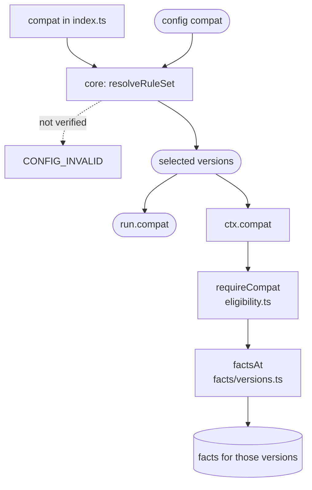

# Entry and compat

The plugin's default export: its name, its rules, the Smart Forms versions it has verified, and its names hook. Core reads only this object.

- `meta.name` is `smart-forms`, the namespace of its rule IDs, such as `smart-forms/variable-name-collision`. `meta.version` comes from the package's `package.json`.
- `rules` registers the 9 rules.
- `compat` lists the verified versions of each Smart Forms component, oldest to newest, and which components a config must name.
- `hostVariables` is the hook that supplies the sourceQueries names (Supplied names).

| Component | What it is | Verified versions | Required in an explicit `compat` |
| :- | :- | :- | :- |
| `renderer` | `@aehrc/smart-forms-renderer`, which renders the form and evaluates its expressions | 1.4.0 | Yes |
| `populate` | `@aehrc/sdc-populate`, which pre-populates the form | 4.7.1 | Yes |
| `template-extract` | `@aehrc/sdc-template-extract`, which extracts resources from the response through templates. Only `smart-forms/unsupported-template-extract-context` uses it, and only when it is selected. | 1.0.15 | No |

**How a config selects versions.** Without a `compat` entry, the plugin gets `"latest"`: the newest version of each component that this release of the plugin has verified, not the newest on npm. An explicit object names exact verified versions of `renderer` and `populate`, and of `template-extract` only when template extraction should be checked:

```js
compat: { 'smart-forms': { renderer: '1.4.0', populate: '4.7.1' } },
```

Core checks the selection before reading any form. An unverified version, or an unknown or missing component, stops the run with `CONFIG_INVALID`; there is no fallback to a nearby version. The report names the selected versions in `run.compat`.

**How a rule reads them.** A rule gets its namespace's selected versions as `ctx.compat`. `requireCompat` reads the renderer and populate versions, and `factsAt` looks up the facts recorded for a version. A selected version with no facts throws, because it is a plugin bug: every verified version must have facts.

Verifying a new Smart Forms version means adding it to the end of its list, recording its facts, and re-running the reproduction tests.

## Schema



## Code

- [`src/index.ts`](../../packages/plugin-smart-forms/src/index.ts): the default export, with `meta`, `rules`, `compat` and `hostVariables`.
- [`src/facts/versions.ts`](../../packages/plugin-smart-forms/src/facts/versions.ts): the components that have facts, `FactTable`, and `factsAt`.
- [`src/eligibility.ts`](../../packages/plugin-smart-forms/src/eligibility.ts): `requireCompat` and `templateExtractVersion`, how a rule reads the selected versions.
- In core, [Plugins and rule set](../core/plugins.md) checks the plugin and resolves `compat`.

[S3 in the design plan](../smart-forms-rules.md#compat) records why `compat` works this way.
