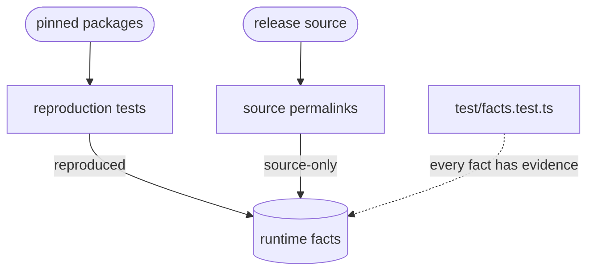

# Evidence and reproduction

Shows that each runtime fact is true of the Smart Forms version it describes. A fact is either **reproduced** by a test that runs the published npm package, or backed by a **source-only** permalink into the Smart Forms source at that version's release commit.

**Reproduction tests** run the exact package versions the plugin has verified, installed as dev dependencies. Each test builds a small synthetic form, runs Smart Forms on it, and asserts what Smart Forms does. A reproduced fact names its test by file and full title, and a unit test fails if that test does not exist.

| Component | Harness | How it runs | Facts |
| :- | :- | :- | :- |
| populate 4.7.1 | `populate.ts` | `@aehrc/sdc-populate` in plain Node, with a fetch callback that answers by URL, as the Smart Forms app's does | All reproduced |
| template-extract 1.0.15 | `extract.ts` | The CommonJS build of `@aehrc/sdc-template-extract`, because its ESM build fails to import in Node | All reproduced |
| renderer 1.4.0 | None yet | The renderer needs a browser environment, planned as the optional P9 | All source-only |

The populate tests cover languages, prerequisites, names, embeddings, sourceQueries, variable storage and evaluation order; the template-extract tests cover contexts and template selection. Run them with `npm test -- packages/plugin-smart-forms/test/reproduction`.

**Source permalinks** point at the release commit of a version, not at a later checkout: `f846e2d8` for renderer 1.4.0 and populate 4.7.1, and `0fca4c36` for template-extract 1.0.15. A cited file is checked to be the same at the release as in the code that was researched. A rule's message claims only what source-only evidence shows.

## Verifying a new Smart Forms version

See [Verifying a new Smart Forms release](new-release.md): what to check, how to run the reproduction tests against the new packages, and how to record the versions.

## Schema

## Code

- [`src/facts/evidence.ts`](../../packages/plugin-smart-forms/src/facts/evidence.ts): the `Evidence` type, `reproduced` and `source`, the release commit, and the path of each reproduction test file.
- [`test/reproduction/`](../../packages/plugin-smart-forms/test/reproduction): the harnesses [`populate.ts`](../../packages/plugin-smart-forms/test/reproduction/populate.ts) and [`extract.ts`](../../packages/plugin-smart-forms/test/reproduction/extract.ts), and one test file per kind of fact.
- [`test/facts.test.ts`](../../packages/plugin-smart-forms/test/facts.test.ts): every fact has evidence, cites the release commit, and names a test that exists; every populate and template-extract fact is reproduced.

[Where the facts come from](../smart-forms-rules.md#where-the-facts-come-from) and decisions S4, S10 and S11 in the design plan record how evidence works and why.
