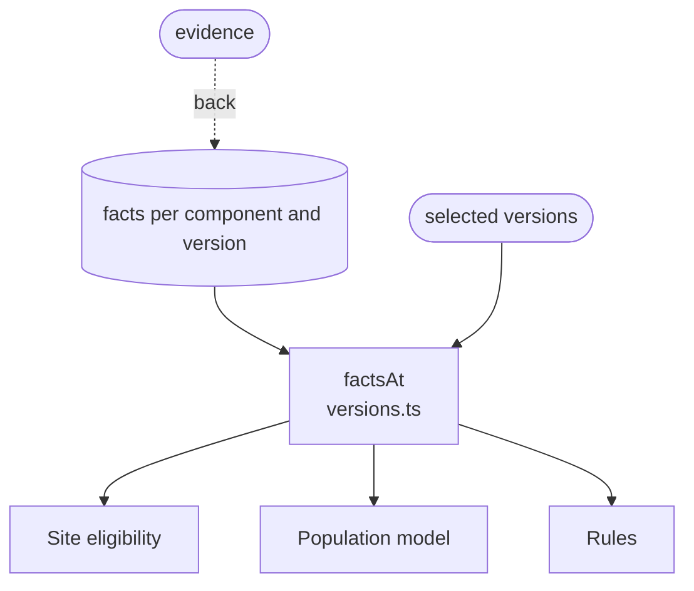

# Runtime facts

Records how each Smart Forms version behaves, as small typed data rather than code. The rules reason from these facts; they never run Smart Forms.

Each fact describes one behaviour of one component, such as "populate evaluates an itemPopulationContext as FHIRPath, whatever its language". Facts are kept per component and per verified version, so `factsAt` returns the facts of exactly the versions `compat` selected. A fact does not name a rule: several rules can read one fact, and a new Smart Forms version can change a fact without changing a rule.

Every fact carries its **evidence**:

- **reproduced:** a test that runs the pinned npm package and shows the behaviour. Every populate and template-extract fact is reproduced.
- **source-only:** a permalink into the Smart Forms source at the release commit. The renderer has no test harness yet, so its facts are source-only, and a rule's message claims only what the source shows.

A fact can also list the aehrc/smart-forms issues that report its behaviour as a bug. When a release with the fix is verified, its facts leave the behaviour out, and the rule stops reporting for that version with no rule change.

| File | What it records | Read by |
| :- | :- | :- |
| `languages.ts` | How a component handles the language of an expression at each location it reads: FHIRPath only, FHIRPath or query, or anything as FHIRPath | Site eligibility, `unsupported-expression-language` |
| `prerequisites.ts` | What a component needs before it reads an expression there, such as an itemPopulationContext on a group with child items | Site eligibility, Population model |
| `names.ts` | Names SDC defines that a component does not supply: `%questionnaire` and `%qitem` | `questionnaire-variable-unavailable` |
| `embeddings.ts` | How population fills the `{{%…}}` embeddings of an x-fhir-query | `unsupported-query-embedding` |
| `variables.ts` | How names are stored and when variables are evaluated, such as one value per name for the whole form, and population's evaluation order | Population model, `variable-name-collision`, `repeating-group-variable`, `named-expression-not-referenceable` |
| `source-queries.ts` | Which sourceQueries results population binds, and under which names | Population model |
| `extraction.ts` | How template-extract finds templates and reads their templateExtractContext. Kept per template-extract version only, because extraction is checked only when selected. | `unsupported-template-extract-context` |

Rule names are shown without their `smart-forms/` prefix. [Reference: Smart Forms runtime facts](../smart-forms-rules.md#reference-smart-forms-runtime-facts) in the design plan describes each behaviour, with its source.

## Schema

## Code

In [`packages/plugin-smart-forms/src/facts/`](../../packages/plugin-smart-forms/src/facts):

- [`versions.ts`](../../packages/plugin-smart-forms/src/facts/versions.ts): `FactTable`, the facts of one kind per component and version, and `factsAt`.
- [`languages.ts`](../../packages/plugin-smart-forms/src/facts/languages.ts), [`prerequisites.ts`](../../packages/plugin-smart-forms/src/facts/prerequisites.ts), [`names.ts`](../../packages/plugin-smart-forms/src/facts/names.ts), [`embeddings.ts`](../../packages/plugin-smart-forms/src/facts/embeddings.ts), [`variables.ts`](../../packages/plugin-smart-forms/src/facts/variables.ts), [`source-queries.ts`](../../packages/plugin-smart-forms/src/facts/source-queries.ts) and [`extraction.ts`](../../packages/plugin-smart-forms/src/facts/extraction.ts): one kind of fact each, as in the table. Each file's opening comment lists its behaviours.
- [`evidence.ts`](../../packages/plugin-smart-forms/src/facts/evidence.ts): the `Evidence` type, the upstream issues, and the release commits the permalinks point at.
- [`test/facts.test.ts`](../../packages/plugin-smart-forms/test/facts.test.ts) checks that every fact has evidence, that each reproduced fact names a test that exists, and that every verified version has facts.
