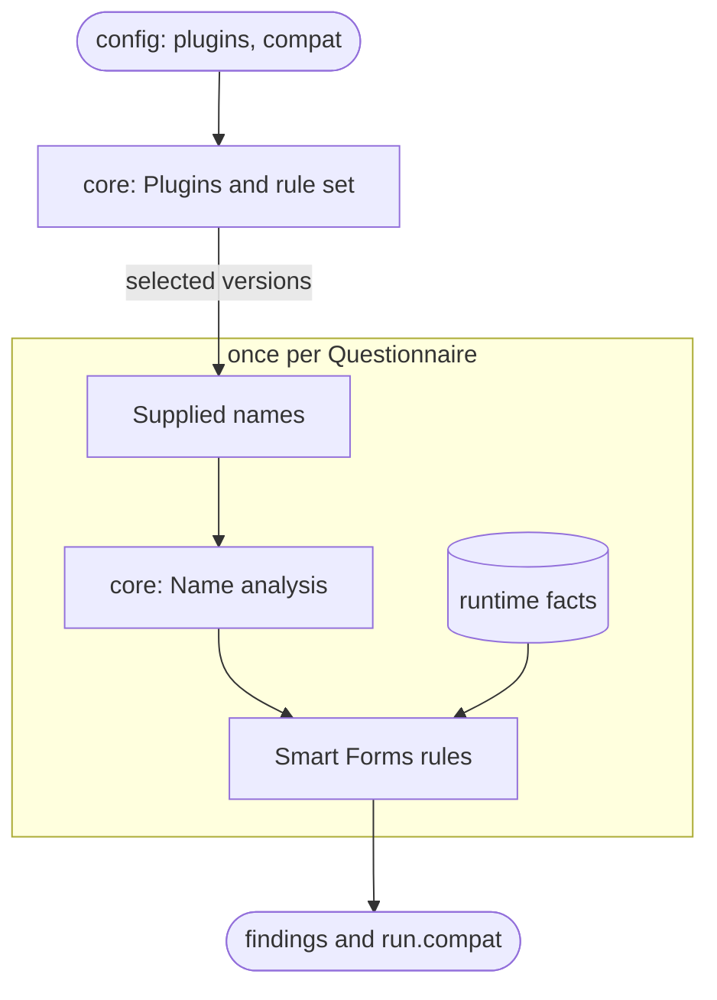

# Smart Forms plugin

The `@sdc-questionnaire-lint/plugin-smart-forms` package, `packages/plugin-smart-forms`, reports where [Smart Forms](https://github.com/aehrc/smart-forms) behaves differently from SDC, in the Smart Forms versions you select. For example, it reports an expression Smart Forms ignores, one it evaluates in the wrong language, or a reference to a variable it never supplies. It also gives core the names Smart Forms binds to a form's sourceQueries results, so `sdc/undefined-variable` accepts them.

Its rules never run Smart Forms code or evaluate an expression. They reason from core's analysis of the form and from **runtime facts**: what each Smart Forms version does, recorded in the plugin and backed by tests against the published packages. They assume the form is populated with sdc-populate and then rendered, as the Smart Forms app does.

The plugin is turned on by listing it in an `.mjs` config:

```js
// sdc-questionnaire-lint.config.mjs
import { defineConfig } from 'sdc-questionnaire-lint';
import smartForms from '@sdc-questionnaire-lint/plugin-smart-forms';

export default defineConfig({ plugins: [smartForms] });
```

The [plugin README](../../packages/plugin-smart-forms/README.md) covers installing it, choosing versions, the names it supplies and suppressions. The [rules library](../rules/index.md#smart-forms-rules) has a page for each of its rules.

## Where it fits in a run



Core owns the run: it [checks the plugin and selects the versions](../core/plugins.md), [analyses each form](../core/names.md), [runs the rules](../core/runner.md) and builds the report. The plugin owns only what it knows about Smart Forms. [How the plugin is embedded in a run](../smart-forms-rules.md#how-the-plugin-is-embedded-in-a-run) in the design plan has the full picture.

## Blocks

A block without a link has no page yet.

| # | Block | Code | What it does |
| :- | :- | :- | :- |
| 1 | [Entry and compat](entry-and-compat.md) | `index.ts`, `facts/versions.ts` | Registers the rules and the Smart Forms versions the plugin has verified; a rule reads the selected ones |
| 2 | [Runtime facts](facts.md) | `facts/` | Records how each Smart Forms version behaves: languages, names, embeddings, variable storage, sourceQueries, extraction |
| 3 | [Site eligibility](eligibility.md) | `eligibility.ts`, `facts/prerequisites.ts` | Works out which Smart Forms component reads an expression, and under what conditions |
| 4 | [Population model](population.md) | `population.ts`, `stored-names.ts` | Works out what population binds, under which name, and in what order |
| 5 | [Form readers](readers.md) | `source-queries.ts`, `launch-contexts.ts`, `templates.ts`, `document.ts` | Read sourceQueries, launchContexts and templates as Smart Forms reads them |
| 6 | [Supplied names](supplied-names.md) | `host-variables.ts` | Gives core the sourceQueries names, so `sdc/undefined-variable` accepts them |
| 7 | Rules | `rules/` | Lists each rule with the blocks and facts it uses |
| 8 | Evidence and reproduction | `facts/evidence.ts`, `test/reproduction/` | Backs each fact with a test or a source link, and explains how to verify a new Smart Forms version |

Paths are relative to `packages/plugin-smart-forms/src`, except `test/`, which is relative to the package.
