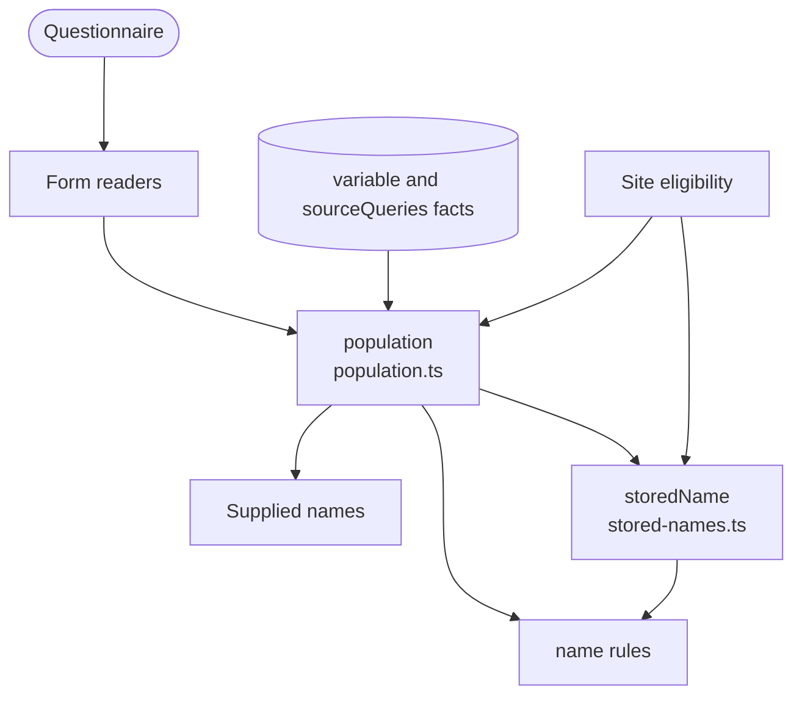

# Population model

Works out what Smart Forms population binds for a form: which names it stores values under, from which declarations, and in what order. The name rules and the supplied names ask it; it is built once per form and populate version.

It assumes the supported integration: the form is populated with sdc-populate and then rendered with what population supplied, as the Smart Forms app does, and external fetches succeed.

For one form, the model answers:

- **Does population run?** Only with a root launchContext, a sourceQueries reference or a query variable to fetch, and a `subjectType` that allows Patient.
- **Which sourceQueries results does it bind, and under which names?** For example `PrePopQuery` for `#PrePopQuery`, or `sourceQuery0` for a fetched reference.
- **What does a declaration store, and when?** The name it stores a value under, and the step it is evaluated in. The answer is `never` when population keeps the name but never evaluates the declaration, and `unknown` when a missing or repeated linkId makes the order unreadable.
- **Who binds a name?** Everything that stores a value under it, earliest first. Population keeps one value per name for the whole form, so the last one wins.
- **Does it read an itemPopulationContext?** If not, why not: on the root, no child items, not the first, no name or no text.

Population binds names in four steps:

| Step | What it binds |
| :- | :- |
| 1 | The launch resources, then contained `#id` sourceQueries Bundles, then the fetched sourceQueries results, then the `application/x-fhir-query` variables |
| 2 | The root `text/fhirpath` variables |
| 3 | The item variables: each item after its child items, in the order population keeps its items, where numeric linkIds come first |
| 4 | The itemPopulationContexts |

Within a step, extensions are bound in array order.

**Stored names.** Smart Forms makes a declaration available to other expressions only by storing a value under its name, and each component stores its own set. `storedName` answers for any selected component: population stores what this model says, and the renderer stores the names of the variables it evaluates (`storesVariable` from Site eligibility) and nothing else.

The [variable storage and order](../smart-forms-rules.md#variable-storage-and-order) facts in the design plan describe each behaviour, with its source.

## Schema

The name rules are `variable-name-collision`, `forward-variable-reference` and `named-expression-not-referenceable`.

## Code

- [`src/population.ts`](../../packages/plugin-smart-forms/src/population.ts): `population(ctx)` builds the model and returns `Population`, with `runs`, `sourceQueries`, `bindingOf`, `bindersOf` and `readsContext`. `Position` is a binding's place in the order, and `compare` orders two.
- [`src/stored-names.ts`](../../packages/plugin-smart-forms/src/stored-names.ts): `storedName`, the name a declaration stores a value under in any of the selected components.
- [`src/facts/variables.ts`](../../packages/plugin-smart-forms/src/facts/variables.ts) and [`src/facts/source-queries.ts`](../../packages/plugin-smart-forms/src/facts/source-queries.ts): the facts the model follows.
- [`test/reproduction/populate-evaluation-order.test.ts`](../../packages/plugin-smart-forms/test/reproduction/populate-evaluation-order.test.ts) and [`populate-variable-storage.test.ts`](../../packages/plugin-smart-forms/test/reproduction/populate-variable-storage.test.ts) reproduce the order and the storage against populate 4.7.1.
