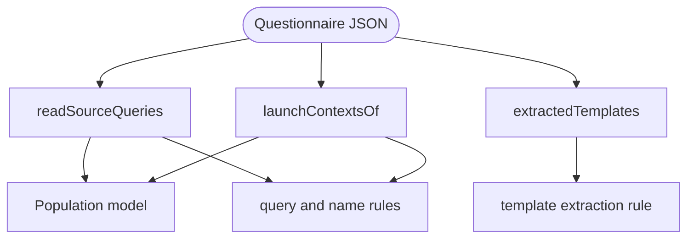

# Form readers

Read the parts of a Questionnaire that Smart Forms reads its own way: sourceQueries, launchContexts and templates. Each reader copies how Smart Forms finds and reads them, quirks included, so a form that Smart Forms misreads gives the plugin the same result.

Core reads a form by its SDC meaning; Smart Forms reads it the way its code does, and the two can differ. For example, core finds a launchContext's name by its sub-extension's URL, while population takes the first sub-extension as the name and the second as the type, whatever their URLs. The readers know no facts: they give every reading, and the caller checks against the facts which one a component version uses.

| Reader | What it reads | Used by |
| :- | :- | :- |
| `readSourceQueries` | The root sourceQueries extensions with a reference, in order. Each gets the name population binds its result to: `PrePopQuery` for `#PrePopQuery`, or `sourceQuery<i>` for any other reference, where `i` counts every sourceQueries extension with a reference. For `#id`, it also finds the contained Bundle population reads, and whether population binds it. | Population model, `unsupported-query-embedding` |
| `launchContextsOf` | The root launchContexts, each read two ways: by sub-extension URL, as SDC defines them, and by position, as population binds them. It also says whether population takes it as an input, and the name it binds the launch resource under. | Population model, `unsupported-query-embedding`, `named-expression-not-referenceable` |
| `extractedTemplates` | The contained resources template extraction uses as templates, by template-extract's four selection steps. For example, a template referenced only from the root is never extracted, and when ids repeat, the last resource wins. | `unsupported-template-extract-context` |

Two smaller modules serve every block:

- `document.ts` reads the JSON behind a site, because core publishes no item API: it resolves JSON Pointers, lists items in the order population walks them, finds the extension that holds a site's expression, and names an item in a message the same way core does.
- `urls.ts` holds the extension URLs.

## Schema

## Code

In [`packages/plugin-smart-forms/src/`](../../packages/plugin-smart-forms/src):

- [`source-queries.ts`](../../packages/plugin-smart-forms/src/source-queries.ts): `readSourceQueries` and the `SourceQuery` record.
- [`launch-contexts.ts`](../../packages/plugin-smart-forms/src/launch-contexts.ts): `launchContextsOf`, and the `LaunchContext` record with its `byUrl` and `byPosition` readings.
- [`templates.ts`](../../packages/plugin-smart-forms/src/templates.ts): `extractedTemplates`, with each selection step commented.
- [`document.ts`](../../packages/plugin-smart-forms/src/document.ts): `resolve`, `itemsOf`, `extensionOf`, `itemOf` and `elementName`.
- [`urls.ts`](../../packages/plugin-smart-forms/src/urls.ts): the extension URLs.

In the design plan, [launchContexts](../smart-forms-rules.md#launchcontexts) explains the two readings, and the [sourceQueries](../smart-forms-rules.md#environments) and [template extraction](../smart-forms-rules.md#template-extraction) facts describe what Smart Forms does, with its source.
