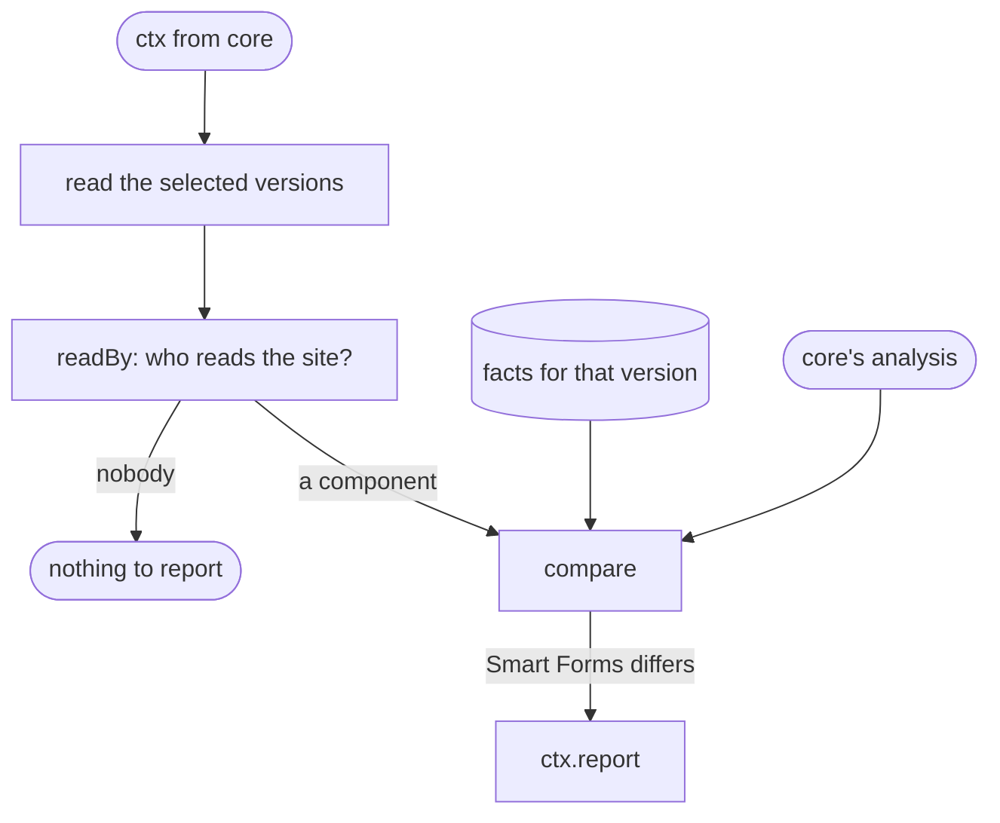

# Rules

The 9 `smart-forms/` rules, and the blocks each one is built from. Each rule has its own page in the [rules library](../rules/index.md#smart-forms-rules), with what it checks, an example form and its lint cases.

Every rule works the same way. It reads the selected versions, finds the expressions a Smart Forms component actually reads, compares what that component does, from the facts, with what the form expects, from core's analysis, and reports where they differ. A rule never runs Smart Forms or evaluates an expression.

When it cannot tell, it stays silent. If core has no analysis for a site, for example because the text does not parse, the rule reports nothing there. It also leaves a problem to the core rule that reports the same cause; for example, a reference-only expression is `sdc/external-expression`'s.

| Rule | Severity | Reports | Built from |
| :- | :- | :- | :- |
| [`unsupported-expression-language`](../rules/smart-forms/unsupported-expression-language.md) | error | An expression Smart Forms ignores because of its language | Site eligibility, language facts |
| [`expression-evaluated-as-fhirpath`](../rules/smart-forms/expression-evaluated-as-fhirpath.md) | error | An expression Smart Forms evaluates as FHIRPath, whatever its language | Site eligibility |
| [`questionnaire-variable-unavailable`](../rules/smart-forms/questionnaire-variable-unavailable.md) | error | A reference to `%questionnaire` or `%qitem`, which Smart Forms does not supply | Site eligibility, name facts, core's references |
| [`unsupported-query-embedding`](../rules/smart-forms/unsupported-query-embedding.md) | error | A `{{…}}` embedding in an x-fhir-query that population does not fill as written | Site eligibility, embedding facts, sourceQueries and launchContext readers |
| [`variable-name-collision`](../rules/smart-forms/variable-name-collision.md) | error | A name declared on two elements, or named like a sourceQueries result, which Smart Forms stores as one value | Population model, stored names, variable facts |
| [`repeating-group-variable`](../rules/smart-forms/repeating-group-variable.md) | warning | A variable on or below a repeating group whose value differs between repetitions, of which Smart Forms keeps one | Site eligibility, variable facts, core's uses |
| [`named-expression-not-referenceable`](../rules/smart-forms/named-expression-not-referenceable.md) | error | A reference to a named expression Smart Forms does not make available, or a name an answerExpression cannot get | Site eligibility, Population model, stored names, prerequisites, launchContext reader |
| [`forward-variable-reference`](../rules/smart-forms/forward-variable-reference.md) | warning | A variable that references a variable or itemPopulationContext population evaluates after it | Site eligibility, Population model, core's dependencies |
| [`unsupported-template-extract-context`](../rules/smart-forms/unsupported-template-extract-context.md) | error | A templateExtractContext written as a valueExpression, which template extraction ignores | Template reader, extraction facts. Runs only when `template-extract` is selected. |

Findings of plugin rules can be suppressed like any other, but a suppression is never judged stale just because the rule reported nothing: only built-in rules record where they completed a check. See [Suppressions and fingerprints](../core/suppressions.md).

## Schema

## Code

In [`packages/plugin-smart-forms/src/rules/`](../../packages/plugin-smart-forms/src/rules):

- one file per rule, named after it, such as [`variable-name-collision.ts`](../../packages/plugin-smart-forms/src/rules/variable-name-collision.ts). Each has `meta`: its description, default severity and the documentation `sdc-lint explain` prints.
- [`language-sites.ts`](../../packages/plugin-smart-forms/src/rules/language-sites.ts): which sites the rules that report at an expression check.

The lint cases are in [`test/cases/`](../../packages/plugin-smart-forms/test/cases): a folder per rule, and `source-queries` for the supplied names. [Adding a rule](../adding-a-rule.md) explains how to add one, and each slice of the [design plan](../smart-forms-rules.md#slices) records why a rule works the way it does.
