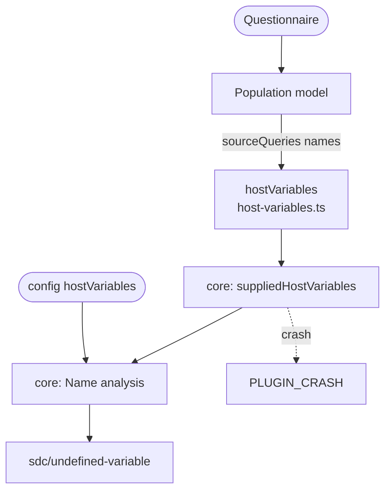

# Supplied names

Gives core the names Smart Forms population binds to the results of a form's sourceQueries, so expressions can reference them, and `sdc/undefined-variable` accepts them without a `hostVariables` entry in the config.

The plugin's `hostVariables` hook is part of the plugin contract. For each Questionnaire, core calls it before the analysis and adds its names to the config's `hostVariables`. It is called whether or not the plugin's rules are on: listing the plugin activates its names, and rule settings control only its findings. A declaration of the same name in the form still wins.

The names come from the Population model:

- A reference to a contained resource, `#PrePopQuery`, is named `PrePopQuery`. It is supplied when the first contained resource with that id is a Bundle with an `entry` element, even an empty one.
- Any other non-empty reference, such as `Observation?code=…`, is named `sourceQuery<i>`, where `i` counts every sourceQueries extension with a reference from 0. It is supplied assuming the fetch succeeds.
- Nothing is supplied when the form's `subjectType` is set and lacks `Patient`, because population stops before reading sourceQueries.
- Never supplied: an empty or display-only reference, `#` alone, a reference to a contained resource that is not such a Bundle, and `#%x`, which population binds as `%x`.

Core drops any name that FHIRPath, FHIR or SDC already defines. A hook that throws, returns a promise or returns something other than a list of names stops the run with `PLUGIN_CRASH`, which names the plugin.

Names your application passes to the renderer itself belong in `hostVariables` in the config. Don't list the sourceQueries names there: listing a name the plugin does not supply claims the application supplies it, which usually hides a failure instead of fixing it.

[The names it supplies](../../packages/plugin-smart-forms/README.md#the-names-it-supplies) in the plugin README also covers the limits, such as the sourceQueries Bundle entries the Smart Forms app never fills.

## Schema

## Code

- [`src/host-variables.ts`](../../packages/plugin-smart-forms/src/host-variables.ts): `hostVariables`, the hook, which returns the names of `population(input).sourceQueries`.
- [`src/index.ts`](../../packages/plugin-smart-forms/src/index.ts): registers the hook on the plugin.
- [`src/population.ts`](../../packages/plugin-smart-forms/src/population.ts) and [`src/source-queries.ts`](../../packages/plugin-smart-forms/src/source-queries.ts): which sourceQueries population binds, and their names.
- In core, [`run/host-variables.ts`](../../packages/core/src/run/host-variables.ts) calls the hook and checks its result, and [`plugins/contract.ts`](../../packages/core/src/plugins/contract.ts) defines `hostVariables` and `HostVariablesInput`.
- [`test/reproduction/populate-source-queries.test.ts`](../../packages/plugin-smart-forms/test/reproduction/populate-source-queries.test.ts) reproduces the names against populate 4.7.1.
