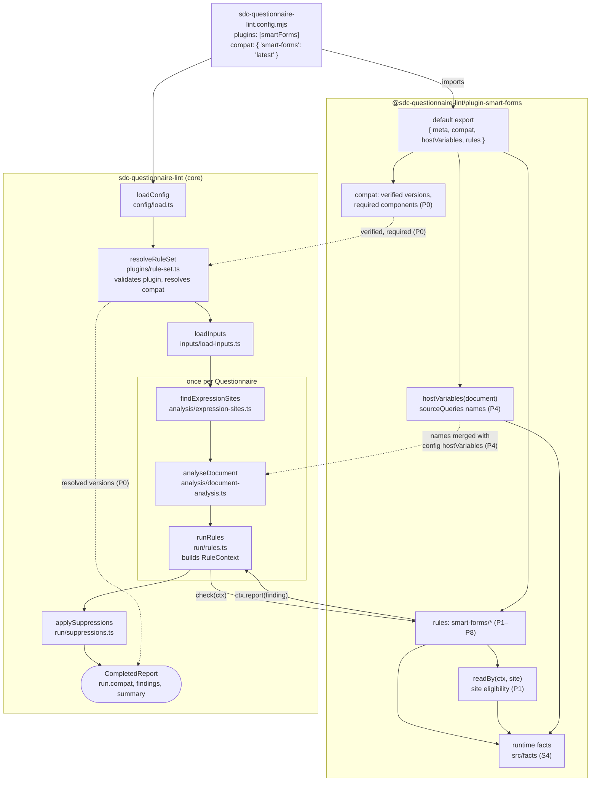
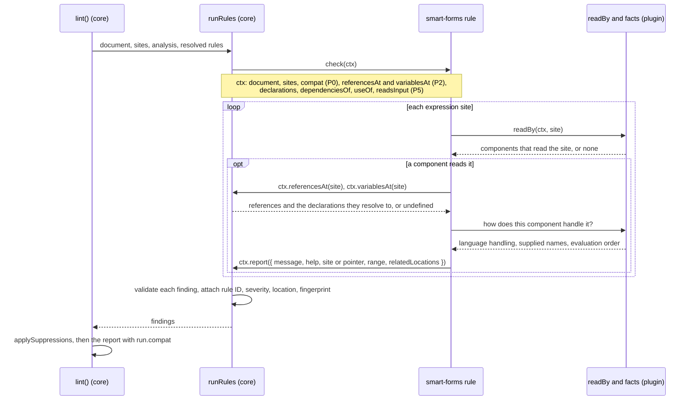
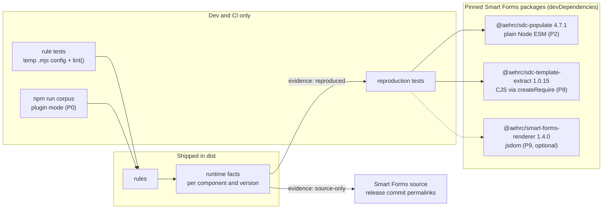

# Smart Forms rules plan: the `smart-forms/` plugin

Builds the Smart Forms compatibility plugin from [core-plan.md](core-plan.md) §2.1, §2.3, §4.2, §4.3 and §5, and the [plugin follow-ups](core-rules.md#plugin-follow-ups-not-in-this-plan) of the core rules plan. Researched on 2026-10-09 against Smart Forms commit `7e64a22f` (renderer 1.4.0, sdc-populate 4.7.1, sdc-template-extract 1.0.15). Revised the same day after a review: its runtime claims were checked against the source, and the population claims were reproduced with the published `@aehrc/sdc-populate@4.7.1`.

**Status: in progress.** S1, S3, S4, S7 and S11 were accepted on 2026-10-09, and S2, S5, S9 and S10 with P1 the same day; the other decisions are proposals until reviewed. A slice merges once every decision it cites is accepted; record each accepted override of core-plan in [plan-amendments.md](plan-amendments.md). Decision IDs are stable once other docs cite them.

P0 and P1 are done: config `compat` is resolved against the plugin's verified versions, the report names them in `run.compat`, and the plugin has the two language rules.

## How to work on a slice

1. Pick the next slice in the [slice table](#slices-at-a-glance) whose status is `todo` and whose dependencies are done.
2. Read the slice section, every decision it cites (Sn, and Dn in [core-rules.md](core-rules.md#decisions)), the [GLOSSARY](../GLOSSARY.md) terms it uses, and the [runtime facts](#reference-smart-forms-runtime-facts) it relies on.
3. Re-check every runtime fact the slice relies on against the pinned source before writing the rule, and reproduce it where a harness exists (S10). Several facts in the first draft of this plan were wrong until reproduced.
4. If a decision the slice cites is not accepted, or the slice has an [open item](#open-items), ask the user to settle it before the PR merges. An unresolved decision blocks only the first slice that depends on it.
5. Complete the [checklist for every slice PR](#checklist-for-every-slice-pr), then set the slice's status to `done`.

## Slices at a glance

One PR per slice, in this order.

| Slice | Delivers | Default severity | Depends on | Status |
| :- | :- | :- | :- | :- |
| [P0](#p0-plugin-skeleton-and-compat) | Plugin skeleton, `compat` config, `run.compat`, `ctx.compat`, plugin test helper, corpus with the plugin | – | – | done |
| [P1](#p1-language-rules) | API stage A (language lookups), the site-eligibility helper, `smart-forms/unsupported-expression-language` | error | P0 | done |
|  | `smart-forms/expression-evaluated-as-fhirpath` | error | P0 | done |
| [P2](#p2-smart-formsquestionnaire-variable-unavailable) | API stage B (`referencesAt`, `variablesAt`), populate reproduction harness, `smart-forms/questionnaire-variable-unavailable` | error | P1 | todo |
| [P3](#p3-smart-formsunsupported-query-embedding) | `smart-forms/unsupported-query-embedding` | error | P2 | todo |
| [P4](#p4-supplied-names-hook) | Supplied-names hook; the plugin supplies sourceQueries result names | – | P0 | todo |
| [P5](#p5-smart-formsvariable-name-collision-and-smart-formsrepeating-group-variable) | API stage C (`declarations`, `dependenciesOf`, `useOf`, `readsInput`), `smart-forms/variable-name-collision` | error | P2 | todo |
|  | `smart-forms/repeating-group-variable` | warning | P5 | todo |
| [P6](#p6-smart-formsnamed-expression-not-referenceable) | `smart-forms/named-expression-not-referenceable` | error | P1, P2, P4 | todo |
| [P7](#p7-smart-formsforward-variable-reference) | `conditional` flag on references, `smart-forms/forward-variable-reference` (new, S12) | warning | P5 | todo |
| [P8](#p8-smart-formstemplate-extract-context-string-only) | Template-extract reproduction harness, suppression by exact pointer, `smart-forms/template-extract-context-string-only` | error | P0 | todo |
| [P9](#p9-renderer-reproduction-harness-optional) | Renderer reproduction harness; upgrades renderer facts from source-only | – | P1 | optional |

P1 is the tracer bullet: it exercises the plugin package, the compat resolution, the report and the corpus run, and needs only small exports from core. P2 is the first slice that publishes analysis.

Severities are the core-plan §4.2 defaults. The research confirmed each one; S12 adds the only new rule. Four rule IDs differ from core-plan §4.2 (S17).

## Checklist for every slice PR

- The rule has `meta.docs`, written with the `explain` template, and `explain smart-forms/<rule>` works with the plugin listed.
- The rule has focused tests built from synthetic minimal forms. GP CCMP and other restricted forms are never committed (D14).
- Every runtime fact the rule depends on is recorded with its evidence (S4): a reproduction test against the pinned npm package where a harness exists, otherwise `source-only` with a permalink (S10).
- The rule reports only at sites some selected component evaluates (the [eligibility helper](#site-eligibility)).
- The rule stays silent where a core rule reports the same root cause (S9), with a test for each such case. The silence never depends on whether that core rule is enabled.
- Every message states only a consequence the evidence shows. Messages use author terms; `help` states the fix ([linter-design-guidelines.md](linter-design-guidelines.md), C3).
- The corpus has been run locally with the plugin (P0), and the PR description lists the findings that were added or removed, by rule ID, count and JSON Pointer, without expression excerpts from restricted forms (D14). A rule that reports at error merges only with zero false-positive errors on the corpus. The [corpus counts](#corpus-at-a-glance) in this plan are expectations to investigate, not targets to reproduce.
- `npm run check` passes.

## Principles

- **The plugin reports where Smart Forms differs from SDC; core reports SDC.** A plugin rule never re-reports an SDC violation that a core rule or the FHIR Validator already catches (S9).
- **A finding states a demonstrated runtime consequence** in the pinned components: a value that is never set, an expression that is ignored, a query sent with the wrong URL. If the consequence cannot be shown from source or a reproduction, the rule does not report it, and a message never claims more than was shown.
- **The supported integration is population, then rendering** (S1): rules assume population succeeded and its context reached the renderer. Template extraction is checked only when it is selected in `compat` (S3).
- **Version facts are data beside the rules** (S4). They are small typed structures with evidence links, not a universal entry schema; a runtime change can still require a rule change.
- **Publish core analysis when a slice needs it, together with what it needs** (S5, D15, D18).

## Architecture

The plugin is an ordinary npm package that a project's `.mjs` config imports and lists in `plugins`. Core owns the run: it loads the config, validates the plugin and resolves `compat`, finds the expression sites, analyses each document and calls the plugin's rules. The plugin owns only Smart Forms knowledge: its versions, its runtime facts, the names it supplies and its rules. Everything in the plugin box is new; a slice in parentheses marks a piece this plan adds, in core or the plugin. Dotted arrows show how the Smart Forms versions and supplied names flow through a run. The core pipeline itself is described in [architecture.md](architecture.md).

### How the plugin is embedded in a run

- **Config time.** `resolveRuleSet` checks the plugin's shape, registers its rules under `smart-forms/`, and resolves `compat` against the plugin's verified versions (S3). An invalid `compat` fails `lint` and `explain` with `CONFIG_INVALID` before any input is read.
- **Analysis time.** For each Questionnaire, core calls the plugin's `hostVariables(document)` before `analyseDocument`, so `sdc/undefined-variable` accepts the sourceQueries names Smart Forms supplies (S6). A throw fails the run with `PLUGIN_CRASH`.
- **Rule time.** `runRules` calls each enabled rule's `check(ctx)` once per Questionnaire, synchronously. The rule reads the context, consults its facts, and reports. Core validates each finding, attaches the rule ID, severity, location and fingerprint, and applies suppressions as for any rule (S8).
- **Report time.** `run.compat` names the exact versions the run checked against.

### What a rule sees and does

A rule never reads Smart Forms code at run time and never evaluates an expression: it reasons from core's analysis and the plugin's recorded facts. `undefined` from `referencesAt` or `variablesAt` means the analysis is unavailable, and the rule reports nothing there.

### Where the facts come from

Each fact names its evidence (S4, S10). When a harness exists, the evidence is a reproduction test that runs the pinned package; otherwise it is a permalink, and the rule's message claims only what the source shows. Verifying a new Smart Forms version means adding it to the plugin's verified versions, re-running the reproductions, and updating the facts and, where behaviour changed, the rules.

## Shared plugin infrastructure

### Public API stages (S5)

`RuleContext` today gives a plugin `document`, the flat frozen `sites`, a `scopeAt` stub, `options: undefined` and `report()` with `relatedLocations`. Everything else is internal to core (`DocumentAnalysis`, `plugins/core-rule.ts`). Each stage is plumbing in `run/rules.ts` from an analysis core already computes once per document, plus exported readonly types in `index.ts` and a section in [architecture.md](architecture.md).

| Stage | Slice | Adds to `RuleContext` | Exported types and functions |
| :- | :- | :- | :- |
| 0 | P0 | `compat: Readonly<Record<string, string>>`, the resolved versions for the rule's own namespace | – |
| A | P1 | – | The query-language predicate, the SDC allowed-languages lookup and the six value-set codes (`isQueryLanguage`, `languagesAllowedAt`) |
| B | P2 | `referencesAt(site)`, `variablesAt(site)`; replaces the `scopeAt` stub and `Scope` | `VariableReference { name, startOffset, endOffset, complete }`; `AvailableVariables` with `resolve(name)` giving `{ name, origin, declaration? }`; `Variable`; `Declaration { name, kind, pointer, item?, useCases, site? }` |
| C | P5 | `declarations`, `dependenciesOf(declaration)`, `useOf(declaration)`, `readsInput(site)` | `Dependencies`, `DeclarationUse` |

- **Empty versus unavailable.** `referencesAt` returns `undefined` when the site has no FHIRPath analysis (a non-FHIRPath site, or text that does not parse) and `[]` when it parses and references nothing. `variablesAt` returns `undefined` for an uncatalogued site. Document both; a rule treats `undefined` as "cannot check", never as "no references".
- Stage B is a breaking contract change (`scopeAt` goes) and lifts D15 and D18. Bump core's minor and the plugin's peer range in the same PR, and do the GLOSSARY rename D15 deferred.
- `readsInput(site)` is in core because core owns the parser; the plugin takes no `fhirpath` dependency. Its definition is in [P5](#p5-smart-formsvariable-name-collision-and-smart-formsrepeating-group-variable).
- P7 adds a `conditional` flag to `VariableReference`: the reference is inside an `iif` branch, so it may not be evaluated.
- Not planned: a completion hook, rule options, an item-tree API, inline config. A plugin reads an item by resolving `site.item.pointer` against `document.resource` (strip `document.resourcePointer` first); put that helper in the plugin.

### Site eligibility

A private plugin helper, `readBy(ctx, site)` in `src/eligibility.ts`, returns the selected components that read a site, each with how it handles the language there, or none. It answers whatever the site's language: `unsupported-expression-language` reports exactly the sites a component reads but does not evaluate. It is built in P1 and used by every rule that reports at an expression site (P1, P2, P6). It accounts for each component's prerequisites (`src/facts/prerequisites.ts`), not only the location. A prerequisite never depends on the language:

- an itemPopulationContext is read only on an item with child items, and only the first of its URL on the item, with a `name` and expression text;
- only the first initialExpression on an item is read. Populate evaluates it once for an item outside a repeating group with an itemPopulationContext. Below one, only a direct child of a repeating group is evaluated, once per repetition, and only when a direct child's initialExpression names a context and the group is reached; a nested repeating group is reached only when it has an itemPopulationContext of its own (`constructResponse.ts:225-238,574-713`);
- a targetConstraint is built only with `key` (`valueId`), `severity` (`valueCode` `error` or `warning`), `human` (`valueString`) and an `expression` sub-extension; the first `expression` sub-extension with a `valueExpression` is used;
- an answerOptionsToggleExpression is read only with an `option` sub-extension that has `valueCoding`, `valueString` or `valueInteger`; the first `expression` sub-extension with a `valueExpression` is used;
- an answerExpression is read only as a fallback when answerValueSet produced no codings, so it is evaluated, but not always;
- candidateExpression, contextExpression, itemExtractionContext, the root `_title` cqf-expression and a root itemPopulationContext are read by nothing, and neither are uncatalogued and fragment sites.

`readBy` answers per component: a site population does not read, such as a second initialExpression, can still be read by the renderer, which reads the first `text/fhirpath` initialExpression to repopulate a form. A rule that cares about one component filters on `component` or on the handling.

A rule whose `ctx.compat` names no renderer or populate version throws, so an older core fails with `RULE_CRASH`. A selected version with no facts throws too: it is a plugin bug.

### Completion and suppressions

Plugin rules do not take part in completion evidence: `completesCheck` and `leavesUnchecked` in `plugins/builtin.ts` are built-in tables, and core-rules.md ([Shared analysis](core-rules.md#shared-analysis-and-completion-evidence)) forbids a public completion framework. The consequences (S8):

- A suppression of a plugin finding is applied when it hides a finding, and stale when its file, expression or declaration is gone, like any suppression.
- When its target exists and the plugin reported nothing there, the suppression is not assessed: rule-completion evidence cannot establish staleness for a plugin rule.
- A plugin rule never makes a site unchecked.

Document this in [cli.md](cli.md) and the plugin README.

### Test harness

- A plugin test helper writes a temporary `.mjs` config that imports the plugin's built `dist` by absolute file URL, and calls `lint({ cwd, configPath })` in-process. This already works (`packages/core/test/lint.test.ts`, `test/support/tmp.ts`). Do not add an inline `config` option to `LintOptions` for tests: it would need its own answers for the base directory of `files`, `source.fsh` and suppression paths, the config path shown in the report, and the `.mjs`-only rule for plugins.
- CLI tests reuse the inline-plugin `.mjs` pattern in `packages/core/test/cli/lint.test.ts`.
- Both Vitest projects use one shared global setup that builds core at most once per run; the plugin's then builds the plugin (P0).
- Add a plugin docs test like core's `docs.test.ts`, which covers only built-in rules.

## Slices

### P0. Plugin skeleton and compat

Decisions: S1, S3, S4, S7, S11.

P0 resolves the compatibility target; it adds no Smart Forms findings and runs no compatibility checks. `run.compat` names the selected versions that enabled plugin rules run against, and its presence does not imply any coverage.

**Core:**
- Add `compat` to `knownKeys` and `LintConfig` (`config/validate.ts`, `config/types.ts`). Shape: `compat?: { [namespace]: "latest" | { [component]: string } }`. `validateConfig` checks the shape only.
- `validatePlugin` checks a plugin's `compat`: `verified` is a non-empty object whose lists are non-empty, unique, non-empty strings, none of them `"latest"`; `required` holds unique keys of `verified`. Failures point at `/plugins/<i>/compat/…`.
- `resolveRuleSet` checks the meaning, so `lint` and `explain` fail the same way before inputs are read. Each is `CONFIG_INVALID` with a pointer:
  - `/compat/<ns>` names no listed plugin. Help: list the plugin in `plugins`.
  - The plugin declares no compat.
  - A component is unknown, or a required component is missing.
  - A version is not verified. Help lists the verified versions; never fall back to the nearest one (core-plan §2.3).
- A listed plugin with compat and no `compat` entry gets `"latest"` (C1).
- `"latest"` selects every component, each at the last, newest, entry of its verified list in the installed plugin, not npm's latest (S3). npm already has renderer 1.5.0, populate 4.7.2 and template-extract 1.0.16; they stay unverified until a PR verifies them.
- `lint.ts` fills `run.compat` from the resolved versions, always exact. Make `template-extract` optional in the report schema (`smartFormsVersions`), `SmartFormsVersions` and [report-format.md](report-format.md); `schemaVersion` stays 1 before the first release. `report/text.ts` prints the Smart Forms line without template-extract when it is not selected.
- `ctx.compat` (stage 0): a frozen copy of the resolved versions for the rule's own namespace; `{}` for `sdc` and for a plugin without compat.

**Plugin contract addition:** `LintPlugin.compat?: { verified: Readonly<Record<string, readonly string[]>>; required: readonly string[] }`. The components are the keys of `verified`, each list oldest to newest; `required` lists those an explicit object must name. Core reads only this.

**Plugin:**
- Default export `{ meta: { name: 'smart-forms', version }, rules: {}, compat }`, with the version from a `package.json` JSON import.
- Components: `renderer` and `populate` (required), `template-extract` (optional). Verified: renderer 1.4.0, populate 4.7.1, template-extract 1.0.15.
- No runtime facts yet: each arrives with its first consumer (S4). Remove `compat` from `files` in `package.json`; nothing ships outside `dist`.
- Peer range stays `^0.1.0`: core is unreleased, so 0.1.0 is the version that ships `compat`. From P1, a rule that receives no `ctx.compat` throws, so an older core fails with `RULE_CRASH` instead of running silently.
- Tests build through one shared global setup that builds core at most once per Vitest run, then the plugin, so the plugin's tests also run alone from a clean checkout.

**Corpus:** `npm run corpus -- --smart-forms` builds both packages, lints with the committed `packages/plugin-smart-forms/scripts/corpus.config.mjs` (it imports `../dist/index.js`, with `compat: 'latest'`), prints the Smart Forms versions from `run.compat`, and compares with a separate snapshot, `corpus/findings.smart-forms.json`. The snapshot keeps findings of every namespace, without messages; `--smart-forms --update` writes only that snapshot. Core slices keep their snapshot and stay independent of the plugin build.

**Docs:** cli.md (the `compat` key, its default and errors), report-format.md (the compat `CONFIG_INVALID` cases, optional `template-extract`), architecture.md (compat resolution and `ctx.compat`), GLOSSARY ("Compatibility matrix", "Component"), plan-amendments.md (S1, S3, S4, S7, S11 and the merge gate).

**Tests:**
- Resolution: `latest` resolves all three; no entry resolves like `latest`; with two versions per component, `latest` takes the last; an object with renderer and populate resolves without template-extract; an unknown version, an unknown component, a missing required component, a per-component `"latest"` and a namespace with no plugin each fail with their pointer; `explain` fails on the same config errors.
- Plugin validation: each invariant of `compat` above.
- Runner: a synthetic plugin rule receives its own namespace's versions as a frozen copy; a plugin without compat receives `{}`; with two compat plugins, neither sees the other's versions.
- Report: text and JSON show the versions, with and without template-extract.

**Done when** `npm run check` passes, `npm run corpus -- --smart-forms` prints `Smart Forms: renderer 1.4.0, populate 4.7.1, template-extract 1.0.15.`, and its findings are identical to the core-only run's.

### P1. Language rules

Decisions: S1, S2, S5, S9, S10, D3, D10, D11. Uses the [language facts](#languages-by-location). The corrections below were found in the source while implementing it.

Build stage A and the [eligibility helper](#site-eligibility). Both rules check sites that are `carrier === 'expression'`, catalogued, not fragment sites, with a `language` and with `expression` text, that `readBy` returns a component for. Both name the element as core does: `item "Text" (linkId)`, `item linkId`, `item "Text"`, `an item that has no linkId`, or `the Questionnaire root`.

**`smart-forms/unsupported-expression-language` (error).** A component ignores the expression because of its language. Locations: root and item `variable`, calculatedExpression, enableWhenExpression, answerExpression, cqf-expression on `_text`, `_prefix` and `_answerValueSet`. Accepted: `text/fhirpath` everywhere, plus `application/x-fhir-query` for `variable`.
- Stay silent when:
  - the language is not allowed at the location by SDC (`sdc/language-not-allowed`, or the Validator's `sdc-inv1`);
  - the language is outside the six value-set codes (`sdc/language-not-in-value-set`); Smart Forms also ignores it, but core already reports the code;
  - the site is uncatalogued, or no component reads the location (no finding in v1; the facts record them);
  - the site is an initialExpression (the next rule);
  - a calculatedExpression, enableWhenExpression, answerExpression or cqf-expression has a sibling `text/fhirpath` extension with the same URL on the same element: the renderer reads the first `text/fhirpath` enableWhenExpression and answerExpression and every `text/fhirpath` calculatedExpression and cqf-expression, so the ignored one is an alternative, not lost behaviour (`getExpressionsFromItem.ts:48-60,137-152,178-191`);
  - a variable has no name, so ignoring it has no consequence, or the same element has a variable of its name that Smart Forms accepts (`text/fhirpath` or `application/x-fhir-query`), which sets the name; `sdc/duplicate-declaration` reports the duplicate.
- Message: `Smart Forms ignores this {extension} on {element} because it is written in {language}; it uses only text/fhirpath here, so {consequence}.` The extension is named `variable`, `calculatedExpression`, `enableWhenExpression`, `answerExpression`, or `cqf-expression on text`, `on prefix` or `on answerValueSet`. Consequences:
  - enableWhenExpression: "this expression never disables the item" (the item's `enableWhen` and `hidden` still apply);
  - calculatedExpression: "the answer is never calculated from it";
  - answerExpression: "its answers are not computed from it" (`answerOption` and `answerValueSet` still load);
  - variable: "this variable never sets %{name}". It does not claim that expressions using the name fail: Smart Forms keeps one flat set of names, so another declaration, such as a root FHIRPath variable of the same name, may still supply it;
  - cqf-expression on `_text`: "the text is not updated from it"; on `_prefix`: "the prefix is not updated from it";
  - cqf-expression on `_answerValueSet`: "the answer value set is not computed from it".
- Help:
  - a `text/x-fhir-query` variable: `Smart Forms runs a query in a variable only when its language is application/x-fhir-query`. This states a runtime reason, so it does not break slice 1's rule against suggesting the R4 code for spelling reasons.
  - otherwise: `rewrite it in FHIRPath with the language text/fhirpath; to use server data, fetch it in an application/x-fhir-query variable on this item or an ancestor and reference that variable`.
- Covers the core-rules follow-up "Smart Forms ignores `text/x-fhir-query` (D11)".

**`smart-forms/expression-evaluated-as-fhirpath` (error).** A component evaluates a non-FHIRPath expression as FHIRPath. Locations: targetConstraint and answerOptionsToggleExpression (renderer); initialExpression and itemPopulationContext (populate). The plan named only the first two; populate's are added (S2) because an `application/x-fhir-query` itemPopulationContext is valid SDC and occurs in the SDC demographics example.
- Stay silent when SDC disallows the language there: either query code on answerOptionsToggleExpression is `sdc/language-not-allowed`. targetConstraint has no R4 restriction, so every non-FHIRPath language is reported there. Stay silent, too, on a language outside the six codes: a misspelt `text/fhir-path` is evaluated as FHIRPath and may work, and core reports the code. The eligibility helper already excludes itemPopulationContexts populate never reads, a second initialExpression, and targetConstraints and toggles the renderer never builds.
- Message: `Smart Forms {renderer|population} evaluates this {extension} on {element} as FHIRPath although it is written in {language}, so {consequence}.` Query text throws on `?` and the error is caught, so for both query codes the consequences are: targetConstraint "the constraint never reports a problem"; answerOptionsToggleExpression "its options are not toggled"; initialExpression "the answer is not prefilled"; itemPopulationContext "the group is not prefilled". CQL text can be valid FHIRPath that returns a value, such as `true` or an element name like `status`, and the renderer marks a targetConstraint invalid when the result is empty and the text contains `intersect` (`targetConstraint.ts:99-107`). So for the three CQL codes, and for a query targetConstraint whose text contains `intersect`, the consequence is only "the {language} is never run".
- Help: for an itemPopulationContext query, `fetch the resources in an application/x-fhir-query variable on the Questionnaire root, and set itemPopulationContext to FHIRPath over it, such as %name.entry.resource` (the GP CCMP pattern). Otherwise `rewrite it in FHIRPath with the language text/fhirpath`.

**Reference-only Expressions:** no finding in v1 (settled with P1). Core reports `sdc/external-expression` at info, and both rules check only sites with expression text.

**Reproduction:** populate facts (initialExpression, itemPopulationContext) are reproduced in P2 when the harness lands; until then, and for every renderer fact, `source-only` (S10).

**Tests.** Positive: variable `text/x-fhir-query` at root and item; variable `text/cql`; calculatedExpression `application/x-fhir-query`; enableWhenExpression `text/cql`; answerExpression with both query codes; `_text`, `_prefix` and `_answerValueSet` cqf-expressions `text/cql`; a CQL item variable whose name a root FHIRPath variable declares; targetConstraint with `text/cql`, both query codes and `text/cql-identifier`; toggle with `text/cql` and `text/cql-expression`; initialExpression `text/cql` and `application/x-fhir-query`, including a child of a repeating itemPopulationContext group; itemPopulationContext with both query codes on a group with children. Negative: every stay-silent case above, with the core rule turned off for each S9 silence; an incomplete targetConstraint; `application/x-fhir-query` variables; and `text/fhirpath` at every location.

**Corpus:** GP CCMP 0. Other corpus forms: 1 for each rule (SDC form-behavior answerExpression `application/x-fhir-query`; SDC demographics itemPopulationContext `application/x-fhir-query` on a repeating group).

**Done when** both rules report as specified, each location in the language facts has evidence, and the corpus run shows only the expected findings.

### P2. `smart-forms/questionnaire-variable-unavailable`

Decisions: S1, S5, S9, S10, S13. Implements core-plan §4.3.

**Core API:** stage B, `referencesAt` and `variablesAt`. Record in plan-amendments.md that it lifts D15 and D18.

**Reproduction harness:** add `@aehrc/sdc-populate@4.7.1` as an exact dev dependency of the plugin. It runs headlessly in plain Node ESM: `populateQuestionnaire({ questionnaire, patient, fetchResourceCallback, fetchResourceRequestConfig })`, asserting on the URLs passed to `fetchResourceCallback`, the OperationOutcome issues, `populatedContext` and the response. After installing, check that the lockfile resolves a single `fhirpath` 4.10.1. Reproduce in this slice: this rule's facts, P1's populate facts, and an item-level query variable feeding an initialExpression (used by P5 and P7).

**Rule (error).** A complete reference that resolves to the built-in `%questionnaire` or `%qitem` (`resolve(name).origin`), at a non-fragment FHIRPath site that `readBy` returns a component for. No component supplies either name, and fhirpath.js throws on an undefined environment variable when the reference is evaluated. The renderer catches the error and leaves the variable unset, so later references to it fail too and calculations can keep a previous value. Populate turns it into an OperationOutcome warning.
- A form declaration of the name resolves to the declaration and is `sdc/reserved-name`'s; `%qitem` at a root site resolves to nothing and is `sdc/undefined-variable`'s.
- Fragments belong to P3.
- Range: the reference.
- A reference inside an `iif` branch still reports, because the branch may run; `iif(false, %qitem, 1)` returns `[1]` without failing, so the message says "when the reference is evaluated".
- Message: `Smart Forms does not supply %{name}, so this {extension} gets no value on item "{text}" ({linkId}) when the reference is evaluated.`
- Help: for `%qitem.linkId`, `use the literal value instead, such as '{linkId}'`; otherwise `copy the value the expression needs from the Questionnaire into the expression`.
- Host exceptions (S13): a renderer host can supply `%questionnaire` through `additionalContext`, and a direct `populate()` caller through a `context` parameter; the app does neither. A host can supply `%qitem` correctly only when every expression that uses it is on one item, because `additionalContext` is one value for the whole form. A host that does either records a suppression with a reason naming itself. `hostVariables` cannot express it: core resolves built-in names before host names.

**Tests.** Positive: root variable `%questionnaire.title`; item variable `%qitem.text`; calculatedExpression; enableWhenExpression; itemPopulationContext on a group with children; a reference inside `iif`. Negative: `%qitem` at the root (core's); a declaration named `questionnaire` (core's); use inside a fragment (P3); CQL; candidateExpression; a suppressed finding. Reproduction: a root variable using `%questionnaire.title` and a dependent initialExpression produce populate's "undefined environment variable" warning and an empty answer.

**Corpus:** GP CCMP 0, Smart Forms forms 0, SDC STU4 2 (hunger-vital-signs, item variable `thisItem = %questionnaire.item.where(…)`).

**Core follow-up (not in this slice):** a config error for a built-in name listed in `hostVariables`, which is a silent no-op today.

### P3. `smart-forms/unsupported-query-embedding`

Decisions: S1, S9, S10. Uses the [embedding facts](#x-fhir-query-embeddings).

**Scope:** fragment sites whose query site is a catalogued `variable`, on the root or an item, with the language `application/x-fhir-query` and a name. Populate fetches exactly those, and the renderer never replaces `{{…}}`. Other query locations belong to P1. Bundle `entry.request.url` in a contained sourceQueries Bundle is not an expression site and stays out of scope, except as a target of check 4.

**Rule (error).** Check in this order and report the first problem, one finding per fragment. A fragment ends at the first `}}`, as populate's non-greedy regex does.
1. **Not recognised.** The fragment text does not match `^%[^\r\n]+$`: populate needs `%` immediately after `{{` and at least one character after it. The query is sent with the braces in it.
2. **No launch context.** The Questionnaire declares no launchContext. Populate replaces embeddings only when a launch resource is supplied, so every embedding in the form is sent with its braces, and no other problem can occur. Report once per fragment (open item).
3. **Invalid regular expression.** `new RegExp('{{%' + text + '}}', 'g')` throws. Populate builds that regular expression, unescaped, so population of the whole form fails with "An unknown error occurred". The linter decides this by compiling the same pattern. Metacharacters inside string literals count.
4. **Replacement fails or corrupts.** Simulate populate's replacement: apply the compiled pattern to the fragment's own `{{%text}}`, replacing with a sentinel.
   - The text is unchanged: the replacement never matches and the query is sent with its braces. Function calls, indexers, `+`, `*`, `?`, `^`, `$` and `\` do this.
   - The result is anything other than exactly the sentinel: the URL is corrupted. `|` does this: `{{%patient.id|id}}` becomes `p1|p1`.
   - Also apply the pattern to the text of every other `application/x-fhir-query` variable in the form: populate applies each embedding's replacement to every query. A match that is not an identical embedding corrupts that query; report it with the other variable as related location (`{{%patient.id|id}}` turns `Encounter?b={{%patient.id}}` into `Encounter?b=p1}}`).
5. **Head is not a launch context.** The text from `%` to the first `.` is not a root launchContext name: a variable, a sourceQueries name, a built-in or a backticked name. The query is sent with `undefined`. A missing `.` lands here too and is sent with an empty value.
6. **Depends on another name.** The remainder references a name that core resolves and that populate does not supply there. Populate evaluates the remainder against the launch resource with only these names: `%context` (the launch resource), `%ucum`, `%terminologyUrl`, `%async`, and `%fhirServerUrl` when a source server is configured. Form variables and other launch contexts, `%patient` included, are not available, so the evaluation throws and the embedding becomes empty. Names that do not resolve stay with `sdc/undefined-variable`. `%factory` resolves, but every use of it is a call, which check 4 reports first.

- Checks 1–5 are string checks and run even when `sdc/fragment-parse-error` reports the fragment; both findings are true and their fixes differ (S9). Check 6 needs references, so it is skipped for a fragment that does not parse.
- Operators and literals are not themselves a problem: `{{%patient.id = 'p1'}}`, `{{%patient.id & 'x'}}` and `{{%patient.id.length div 1}}` are replaced with their values.
- Range: the whole fragment for 1–5; the reference for 6.
- Messages:
  - 1: `Smart Forms does not replace the embedding {{ %patient.id }}: it must start with {{% with no space.` Help: `write it as {{%patient.id}}` (only when the trimmed text starts with `%`).
  - 2: `Smart Forms replaces {{…}} only when a launch context is supplied, and this Questionnaire declares none, so the query is sent with its braces.` Help: `declare the launch context the embedding uses, such as patient`.
  - 3: `Smart Forms builds a regular expression from the text inside {{…}}, and this text is not a valid one, so population of the whole form fails.`
  - 4, braces: `Smart Forms builds a regular expression from the text inside {{…}}, and this text does not match itself, so the query is sent with its braces.` Corrupts: `…and it matches other text, so it corrupts the query URL` (naming the other variable when it is another query).
  - 5: `Smart Forms fills {{%Condition.id}} only from a launch context, and Condition is not one, so the query is sent with "undefined".` A missing `.`: `…so the query is sent with an empty value.` Help: `use a launch context declared on the Questionnaire, such as %patient.id`.
  - 6: `Smart Forms evaluates the text after %{head} with only the launch resource, so %{name} is not available and the embedding becomes empty.` Help: `inside {{…}} only %context, %ucum, %terminologyUrl and %async are available, and %fhirServerUrl when a source server is configured`.
- Known limitations, not checked: values are inserted without URL encoding; a non-primitive result such as `%patient.name` becomes `[object Object]`; only the first result is used; a path with no result becomes `undefined`; a launch context that is declared but not supplied at runtime leaves its embeddings unreplaced or `undefined`.

**Tests.** Negative: `{{%patient.id}}`; several embeddings in one query; a custom launch name; `%context`, `%ucum` and `%terminologyUrl` in the remainder; an operator with literals; a fragment in contextExpression; the R5 query code; a fragment that does not parse (no check 6). Positive: each check above, including `{{%}}`, a metacharacter inside a string literal, the cross-query corruption, an item-level variable, and a head that is an x-fhir-query variable. Reproduction: each check against sdc-populate 4.7.1, asserting the URL passed to `fetchResourceCallback` or the failed population.

**Corpus:** GP CCMP 0 (15 embeddings: 14 `%patient.id`, 1 `%gpccmppractitionerrole.id`, a declared launchContext). SDC STU4 1 (rxterms item variable with `{{item.where(linkId=…)…}}`, check 1).

### P4. Supplied-names hook

Decisions: S6, D1, D16. Settles the core-rules follow-up "a plugin hook for supplied names".

- Add an optional `LintPlugin.hostVariables?(document: QuestionnaireDocument): readonly string[]`. It is synchronous and pure.
- `lint.ts` calls it once per document for each listed plugin, before `analyseDocument`, and merges the names with config `hostVariables`, deduplicated. The result is validated like config entries: non-empty strings without `%`.
- A throw or an invalid result fails the run. Add a `PLUGIN_CRASH` failure code naming the plugin (`RULE_CRASH` requires a rule ID): schema enum, report-format.md.
- `validatePlugin` accepts and checks the new function.
- This contradicts core-plan §5.1 ("plugins don't extend analysis"); record the amendment.
- The Smart Forms plugin supplies the sourceQueries result names. Choosing the name and supplying a value are separate steps in the runtime:
  - **Name.** A `#id` reference is named `id`, before any resolution. Any other reference is named `sourceQuery<i>`, where `i` counts from 0 only the sourceQueries extensions that have a `valueReference`.
  - **Value.** A `#id` name gets a value only when a contained resource with that id is a Bundle with an `entry` element; an empty `entry: []` is bound as it is, without fetching. Otherwise the name stays unset.
  - The hook returns a name only when it gets a value, so a `#id` without a usable contained Bundle stays `sdc/undefined-variable`. Other references are fetched at runtime and always returned.
  The renderer sees these names only through `additionalContext`, after a successful population (S1).
- The app's own `additionalContext` names stay in config `hostVariables` (D1): they belong to the host, not to Smart Forms.
- Tests: a contained Bundle supplies `%id`; an `entry: []` Bundle supplies `%id`; a Bundle without `entry` and a missing contained resource supply nothing, and the reference is still `sdc/undefined-variable`; a non-contained reference supplies `%sourceQuery<i>`, with the index skipping an extension without `valueReference`; a throwing hook fails with `PLUGIN_CRASH`. Reproduce the naming against sdc-populate 4.7.1.

### P5. `smart-forms/variable-name-collision` and `smart-forms/repeating-group-variable`

Decisions: S1, S5, S9. Uses the [variable storage facts](#variable-storage-and-order).

**Core API:** stage C: `declarations`, `dependenciesOf`, `useOf` and `readsInput`.

`readsInput(site)` is true when the expression's value can depend on its input: a path or `$this` evaluated against the expression's input, or `%context` anywhere. A path inside a `where`, `select`, `exists`, `all` or `repeat` argument applied to another collection reads that collection, not the input: `%resource.item.where(linkId = 'x')` does not read its input. Probes against two repetitions: `item.where(linkId='a').answer.value`, `%context.item.answer.value` and `$this.item.answer.value` differ; `linkId`, `%resource.item.where(linkId='x').answer.value` and `%resource.item.where(linkId=%context.linkId).count()` do not.

**`smart-forms/variable-name-collision` (error).** Smart Forms keeps one value per name for the whole form, so two declarations of a name on different elements overwrite each other.
- Stored declarations: `variable` in `text/fhirpath`; `variable` in `application/x-fhir-query`, root and item (both components fetch or preset them); itemPopulationContext on a group with child items; launchContext. Not stored: extractAllocateId, other named expressions (P6), other query codes (P1).
- Group by name. Report each declaration on an element other than the first declaration's. Same-element pairs are `sdc/duplicate-declaration`.
- Ancestor and descendant pairs are included: in Smart Forms the inner value leaks to the whole form. This co-fires with `sdc/shadowed-declaration` at info, which states the SDC fact; this rule states the runtime consequence (S9).
- Do not say which declaration wins: item variables are evaluated in post-order with integer-like linkIds first.
- Two itemPopulationContexts of one name: populate keeps only the last, so the first group's repetitions are never built.
- Report at the later declaration (its site, or its pointer for a launchContext), with the first as related location: `%{name} is also declared here`.
- Message: `%{name} is also declared on item "{text}" ({linkId}); Smart Forms keeps one value for each name, so expressions on either element can get the other's value.` Help: `rename one of the declarations so the name is declared on one element only`.
- Tests. Positive: siblings each declaring `%x`; a root and an item variable; a variable and an itemPopulationContext; two itemPopulationContexts on different groups; a launchContext `patient` and an item variable `patient`; an item x-fhir-query variable and a FHIRPath variable. Negative: same element; a named calculatedExpression and a variable; item allocateIds; a declaration in a contained resource.
- Corpus: GP CCMP 0 (58 root variables, 4 launchContexts and 7 itemPopulationContexts, all distinct). SDC 2 (sdc-modular-root: `person`, `linkIdPrefix`).

**`smart-forms/repeating-group-variable` (warning).** The renderer evaluates a variable on or below a repeating group once per repetition, and the last repetition's value wins; populate evaluates it once, against `{}`.
- Report a `text/fhirpath` `variable` on a group with `repeats: true`, or below one, when:
  - `readsInput(site)` is true; or
  - it references a variable declared earlier on the same item that is itself reported. Root variables and variables on other items never make it dependent: a root variable is evaluated once before the per-item loop, and another item's variables are evaluated in that item's own loop.
- Never report an itemPopulationContext (populate binds it per repetition), a repeating question that is not a group, an expression that does not parse, or a variable `useOf` says nothing references. The last uses core's usage analysis, whether or not `sdc/unused-declaration` is enabled.
- Report at the variable's site, with the repeating group as related location: `this group repeats`.
- Message: `%{name} is calculated for each repetition of group "{text}" ({linkId}), but Smart Forms keeps one value, so every repetition gets the last repetition's value.` Help: `compute it from the whole response, or move the item out of the repeating group`. Do not suggest a per-repetition calculatedExpression: the renderer evaluates those once per linkId too.
- Tests. Positive: a variable on a repeating group reading its input; one using `%context`; on a descendant; on a nested repeat; a same-item dependency. Negative: a `%resource` path with a `where` predicate; a reference to a root variable; a reference to a variable on another item; a constant; each case in "never report".
- Corpus: GP CCMP 0 (6 itemPopulationContexts on repeating groups, correctly silent). SDC 1 (rxterms `rxcui`).

### P6. `smart-forms/named-expression-not-referenceable`

Decisions: S1, S5, S9, S14.

**Rule (error).** For each complete reference at a site that `readBy` returns a component for, resolve it with `variablesAt` and report when the declaration it resolves to is one no component exposes:
- (a) a named expression that is not a `variable`: calculated, initial, enableWhen, answer, candidate, context or answerOptionsToggle expression, targetConstraint, cqf-expression;
- (b) an itemPopulationContext on the root or on a leaf item, which populate never reads;
- (c) an itemExtractionContext: Smart Forms does not support definition-based extraction.

The consuming site and the declaration are checked separately: a reference in a candidateExpression is not reported, because nothing evaluates it.
- It never overlaps `sdc/undefined-variable`, which reports only references that resolve to nothing. It is triggered by the reference, never by the declaration alone (core-plan §4.2).
- Populate-only names at renderer sites, such as an itemPopulationContext name in an enableWhenExpression, work after a successful population because its context reaches the renderer as `additionalContext`. They are not reported (S14).
- When another declaration of the name is exposed anywhere in the form, Smart Forms silently evaluates the reference with that value instead: its namespace is flat, so the other declaration can be on any element. Report with the exposed declaration as a second related location.
- Report at the reference, with the declaration as related location.
- Messages:
  - `%{name} is declared by a {extension}, which Smart Forms does not make available to other expressions.`
  - With another exposed declaration: `%{name} refers to the {extension} on {element}, which Smart Forms does not make available, so it uses the %{name} declared on {other element} instead.`
  - Help: `declare it as a variable on this item or an ancestor and reference that`.
- Tests. Positive: (a) for each kind; (b) root and leaf itemPopulationContext; (c); a reference with another exposed declaration of the name. Negative: a reference to a variable; a reference to an itemPopulationContext on a group with children; an unresolved name; a reference in a candidateExpression.
- Corpus: GP CCMP 0 under S14 (1 if renderer-only hosts counted: `%PostalAddressArray.exists()`). SDC 2 (sdc-test-fhirpath-prepop-candexpr: two initialExpressions using a named candidateExpression).

### P7. `smart-forms/forward-variable-reference`

Decisions: S12, D8. New rule, not in core-plan §4.2.

- **Warning.** A variable references a variable that population evaluates later, or an itemPopulationContext name. Populate fails the reference and adds an OperationOutcome warning, so the variable gets no value during population.
- Order (populate): supplied names (launchContexts, sourceQueries Bundles, x-fhir-query variables on the root and on items, all fetched first); root FHIRPath variables in array order; item FHIRPath variables, items in post-order with integer-like linkIds first and array order within an item; itemPopulationContexts; initialExpressions.
- A child item's variable that references an ancestor item's variable is a forward reference, because of the post-order.
- x-fhir-query variable names are never forward references: populate fetches them first, and the renderer presets them to `[]`.
- Add the `conditional` flag to `VariableReference` and skip references inside an `iif` branch.
- The renderer is not the basis of the finding. From source, it evaluates with the context of the previous update, so it may use a stale value; this is not reproduced (P9).
- Message: `%{name} is evaluated after %{declaration} when Smart Forms prefills the form, so %{declaration} gets no value then.` Help: `move %{name} to the Questionnaire root or before %{declaration}`.
- Tests: populate reproduction of a root variable referencing a later root variable, and of a child item variable referencing its parent's; negative for x-fhir-query names and `iif` branches.
- Corpus: GP CCMP 0, SDC 0 (regex-based check; confirm with the rule).

### P8. `smart-forms/template-extract-context-string-only`

Decisions: S3, S10.

Runs only when `template-extract` is selected in `compat` (S3).

**Reproduction harness:** `@aehrc/sdc-template-extract@1.0.15` as an exact dev dependency. Its ESM build fails in plain Node (directory import of `fhirpath/fhir-context/r4`); load the CJS build through `createRequire` and call `inAppExtract`.

**Suppression by exact pointer (core).** A finding reported with only a `pointer` cannot be suppressed today: the suppression selector searches expression sites, so such a suppression matches nothing and is reported stale while the finding stays. Add: a suppression `pointer` that equals a finding's `jsonLocation.pointer` hides it when no expression site has that pointer, and the suppression is stale when the pointer no longer exists in the file. Tests: a pointer finding inside a contained resource, its suppression applied, and stale after the extension is removed. No general target registration.

**Rule (error).** A `templateExtractContext` extension with `valueExpression` and no `valueString`, in a contained resource that a `templateExtract` extension on the root or an item references by `#id`. Template-extract reads only `valueString`: it returns the warning "…but no valueString found", creates no context, evaluates the values below against the item instead, never repeats per context result, and leaves the extension in the output. A named context is impossible.
- Core does not catalogue templateExtractContext, and an Expression without `language` produces no site. So the rule walks the template JSON itself. Report with `site` when an uncatalogued site exists at that pointer, otherwise with `pointer`.
- Stay silent: `valueString` present; an unreferenced contained resource; a template inside a `templateExtractBundle` (Smart Forms has no reader for it, so "string-only" would mislead).
- `sdc/uncatalogued-expression` (info) also fires on the same Expression when it has a language. Both stay (S9).
- Message: `Smart Forms template extraction ignores this templateExtractContext because it is an Expression, and reads only valueString, so the values below it are extracted without this context.` Help: `set the context as valueString with the same FHIRPath`. When `name` is set, add a note: `%{name} is not available to the values below it in Smart Forms`.
- SDC conflict: templateExtractContext says an Expression's "language MAY be omitted", but R4 `Expression.language` is 1..1. The rule reports whether or not `language` is present.
- Tests. Positive: an Expression with `text/fhirpath`; one with `name`; one with no `language` (pointer finding, suppressible); one nested in a sub-element. Negative: `valueString`; both `valueString` and `valueExpression`; an unreferenced contained resource; a templateExtractBundle; `compat` without template-extract.
- Corpus: 0 (all 28 contexts use `valueString`). Synthetic fixtures only.

### P9. Renderer reproduction harness (optional)

- `@aehrc/smart-forms-renderer@1.4.0` cannot be imported in plain Node (`lib/index.js` imports `@fontsource` CSS). It needs a separate jsdom Vitest project with `server.deps.inline`, `react`, `react-dom` and `@tanstack/react-query`.
- `buildForm`, `questionnaireStore` and `questionnaireResponseStore` are exported, so store-level checks without mounting React may work. Unverified.
- Keep it out of `npm run check` if it is slow; run it in a separate CI job.
- Upgrade the renderer facts from `source-only` to reproduced, starting with the P7 timing and the P1 ignored locations.
- Do not depend on `@aehrc/questionnaire-test-toolkit`: it is unpublished and a React harness. Its pipeline passes `{ patient, ...populatedContext }`; the app, which S1 models, passes `populatedContext` alone.

## Decisions

Proposed on 2026-10-09 and revised after review. S1, S3, S4, S7 and S11 were accepted on 2026-10-09, and S2, S5, S9 and S10 with P1 the same day; they are recorded in [plan-amendments.md](plan-amendments.md). The others are proposals.

### Model

- **S1. The supported integration is population followed by rendering, assuming population succeeded.** The app populates only with a SMART client, a patient and a user, and only for an unedited, unsaved response; when population fails it renders without populated context. After a successful population it passes `populatedContext` as `additionalContext` (`usePopulate.tsx:62-151`), which holds `%patient` only when a patient launchContext is declared. Template extraction is a separate step on the response, checked when selected (S3). Renderer-only and extraction-only targets are deferred: a renderer used without population, and a run where population failed, are outside the supported integration, and rules may report or miss findings there.
  _Why:_ this is the pipeline the app runs when it works, and a rule that assumed the renderer alone would report every itemPopulationContext reference in GP CCMP. Suppressions remove false findings in other integrations, but cannot add findings S14 omits for them, which is why those targets are deferred rather than claimed.
- **S2. Plugin rules map a location to a component through the runtime facts, never through `site.useCases`.**
  _Why:_ D20 made use cases follow the SDC table, not Smart Forms' evaluators. Populate evaluates initialExpression without a language check although SDC files it under both rendering and population.
- **S9. A plugin rule stays silent where a core rule or the Validator reports the same root cause, by checking the condition itself, never whether that rule ran.** Co-firing is allowed only when the two findings state different facts with different fixes: `variable-name-collision` with `sdc/shadowed-declaration`, embedding checks 1–5 with `sdc/fragment-parse-error`, and `template-extract-context-string-only` with `sdc/uncatalogued-expression`.
  _Why:_ one root cause should produce one finding, and a plugin finding must not appear or disappear when a core rule is turned off.
- **S14. Within S1, `named-expression-not-referenceable` does not report populate-only names at renderer sites.**
  _Why:_ after a successful population they reach the renderer through `additionalContext`.

### Compat

- **S3. `compat` is validated by core and resolved against the plugin's declared versions.** `"latest"` is the default and selects every component at its newest verified version in the installed plugin. An explicit object must name renderer and populate with exact verified versions, and may omit template-extract; extraction rules run only when template-extract is selected. There is no per-component `"latest"` and no nearest-version fallback. A plugin lists each component's verified versions oldest to newest, and `"latest"` takes the last; core treats versions as opaque strings and never compares them, so keeping the order is the plugin's job. Each component's versions are verified independently: under S1 any combination of listed versions is accepted, and a selected stack is never described as verified as a whole. If evidence shows that one component's behaviour depends on another's version, add supported combinations then.
  _Why:_ core-plan §2.3 forbids silent fallback, C1 sets the default, and a project that does not use template extraction should not have to pin it. Validation in core makes `lint` and `explain` fail identically before inputs are read.
- **S4. Runtime facts are small typed structures in the plugin, each with its evidence.** Group them by what they describe: language handling by location and component, eligibility prerequisites, supplied names, the evaluation order. Each fact that varies by version is keyed by component version, and carries its evidence: a reproduction test, or `source-only` with a permalink. A location can relate to several rules; a fact does not name a rule. JSON is optional packaging. A unit test checks that every referenced reproduction test exists. Each fact, and that test, arrive with the first slice that consumes a fact (P1); P0 ships only the verified versions.
  _Why:_ the facts have different shapes, and one universal entry schema would become a second rule engine. A new Smart Forms version can change facts, reproductions and rules.
- **S11. Runtime evidence is cited at a release commit where possible.** The local checkout is `7e64a22f`; the release commit for renderer 1.4.0 and populate 4.7.1 is `f846e2d8`. They differ by three UI fixes in the renderer (including `utils/manageForm.ts`), the addition of `questionnaire-test-toolkit`, and a change to `sdc-assemble/src/utils/assemble.ts`. The populate source, the app's prepopulate code, and the renderer's `utils/fhirpath.ts` and `stores/questionnaireStore.ts` are identical in both. Link to `f846e2d8` for a file after checking it is identical (`git diff f846e2d8 7e64a22f -- <file>`). Check each cited file against the release of the package it belongs to: one commit need not cover every component, and template-extract 1.0.15 may have its own release commit. `smart-forms-replay` (branch `feature/questionnaire-test-toolkit`) holds unreleased code under the same version numbers and is not evidence.
  _Why:_ a fact claims behaviour of a published version.

### Core contract

- **S5. Core publishes analysis to plugins in stages, each with the slice that first needs it and with everything that slice needs** ([table](#public-api-stages-s5)). References and name resolution go together in P2; declarations, dependencies, uses and `readsInput` in P5. Types are readonly, and "unavailable" (`undefined`) is distinct from "empty".
  _Why:_ D15 and D18 deferred publication until a plugin rule needs it. Publishing references without resolution would make plugins reconstruct core's answers.
- **S6. A plugin can supply host names through an optional, synchronous `hostVariables(document)` hook.** Core merges them with config `hostVariables`. The Smart Forms plugin supplies only sourceQueries result names that get a value.
  _Why:_ D16 left these names to config until a plugin could supply them. Host `additionalContext` names belong to the host, not to Smart Forms, so they stay in config (D1).
- **S7. No `presets`, `languages` or rule options.** Listing a plugin already enables its rules at their defaults, none of the nine rules needs options, and deployment facts belong in `compat` or `hostVariables`. Amend core-plan §6.1 and §6.2, whose examples use `presets` and `languages`.
  _Why:_ the keys would add configuration with no consumer.
- **S8. Plugin rules take part in no completion evidence.** A suppression of a plugin finding is applied or stale as usual, but an existing target with no plugin finding cannot be shown stale, so it is not assessed. Plugin rules never make a site unchecked.
  _Why:_ core-rules.md forbids a public completion framework; this is the current behaviour of `assess` in `run/suppressions.ts`, now documented.

### Rules

- **S10. Every runtime fact has a reproduction test against the pinned npm package where a harness exists.** Populate runs in plain Node ESM; template-extract through its CJS build; the renderer needs jsdom (P9). Until a harness exists, a fact is `source-only` with a permalink, and a message based on it claims only what the source shows.
  _Why:_ core-plan §2.1 asks for reproduction tests. Reproduction corrected several facts in this plan's first draft: item query variables, sourceQueries naming, the embedding replacement.
- **S12. Add `smart-forms/forward-variable-reference` (warning) for the D8 follow-up.**
  _Why:_ it is a different failure from a collision or an unexposed name, with a different fix. Warning, because the demonstrated failure is during population; the renderer still produces a value, possibly a stale one.
- **S13. A host-supplied `%questionnaire` or `%qitem` is handled by a suppression with a reason.** A host can supply `%qitem` correctly only when every expression that uses it is on one item.
  _Why:_ `hostVariables` cannot express it (built-in names resolve first) and names no component, and rule options are not built (S7).
- **S15. No rule for the answerExpression fallback or for `%context` being `{}`.** The fallback runs only when answerValueSet produced no codings, supplies only the first `%name` found by string operations, and has one FHIRPath answerExpression in the corpus. `%context` is `{}` at most renderer and populate evaluators, but the result is a silent empty value and the corpus has no real case. Record both as facts; revisit with corpus evidence.
  _Why:_ low value now.
- **S16. A launchContext is read by position in Smart Forms.** Populate and the renderer read `extension[0]` and `[1]` of a launchContext, while core finds sub-extensions by URL. A launchContext written type-first loses its resource. Record it as a fact; a rule is an open item.
- **S17. Rule IDs name the author's problem and avoid report vocabulary.** Four IDs differ from core-plan §4.2:
  - `unchecked-language-evaluated-as-fhirpath` → `expression-evaluated-as-fhirpath`: "unchecked" already means a site an applicable check could not complete (`expressions.unchecked`).
  - `x-fhir-query-embedding-shape` → `unsupported-query-embedding`: "shape" does not say what is wrong.
  - `flat-variable-context` → `variable-name-collision`: names the author's problem; "flat variable context" stays the glossary term for the runtime behaviour.
  - The new D8 rule is `forward-variable-reference`, not `variable-evaluation-order`.
  The reference flag is `conditional`, not `lazy`: it marks a reference inside an `iif` branch, which is narrower than the "lazy branches" core-rules.md describes. Use the glossary terms available variables, declarations, host variables and expression sites throughout.

## Open items

| Item | Blocks |
| :- | :- |
| Review and accept S6, S8 and S12–S17; record the accepted overrides in plan-amendments.md. | The first slice that cites each one. |
| Embedding check 2 (no launch context): one finding per fragment, or one per form? | P3 |
| Smart Forms-specific Expressions outside the core catalogue (binding-parameter expression, QuestionnaireItemTextAriaLabelExpression, calculatedExpression on `_text` and `_prefix`) cannot be targeted without an extension URL on uncatalogued sites. Add one, or catalogue them in the plugin? | Nothing in v1. |
| Should P3 check embeddings in sourceQueries Bundle `request.url` through pointer findings (possible after P8)? 25 embeddings in 5 corpus forms, all fine. | Nothing in v1. |
| Renderer-only and extraction-only targets (S1): an explicit `compat` without populate, and the findings S14 omits for such hosts. | Nothing in v1. |
| Populate evaluates the initialExpressions of the children of a repeating group without an itemPopulationContext, but builds that group only from an itemPopulationContext, so their answers are never prefilled whatever the language. A rule for it? `expression-evaluated-as-fhirpath` still reports a non-FHIRPath one there; its consequence holds, but the language is not its cause. | Nothing in v1. |
| itemPopulationContext on a repeating group binds only direct children, chosen by text between the first `%` and the first `.` of a child's initialExpression. A rule for consumers it does not bind? | Nothing in v1. |
| A rule for a launchContext written type-first (S16)? | Nothing in v1. |

## Corrections to existing docs

Apply with the first slice that relies on each fact.

- **core-plan §4.2, rule IDs.** Renamed by S17, and `smart-forms/forward-variable-reference` added (S12).
- **core-plan §4.2, unchecked-language rule.** Add populate's initialExpression and itemPopulationContext.
- **core-plan §4.2, x-fhir-query-embedding-shape.** Scope is `application/x-fhir-query` variables, root and item. "Not the supported `%launchContext.path` shape" is replaced by the six checks in P3: operators and literals can be replaced, and the failures come from the unescaped regular expression.
- **core-plan §4.2, "itemPopulationContext on a repeating group is a valid population pattern".** Valid, but bound per repetition only for direct children, as described in [Variable storage and order](#variable-storage-and-order).
- **core-plan §4.2, template-extract rule.** The failure is not silent: template-extract returns an OperationOutcome warning.
- **core-rules.md, Smart Forms runtime, "Variables are evaluated in array order, in one flat namespace."** True for root variables only. Item variables are evaluated in post-order of items, with integer-like linkIds first (JavaScript key order), and each repetition overwrites the name.
- **core-rules.md, "The renderer sets every x-fhir-query variable name to `[]`".** Only `application/x-fhir-query`. A `text/x-fhir-query` variable's name is unbound, so references to it throw.
- **core-rules.md, x-fhir-query variables.** Populate fetches `application/x-fhir-query` variables on items as well as on the root.
- **core-rules.md, sourceQueries.** The name of a `#id` reference is chosen before resolution; a value is supplied only for a contained Bundle with an `entry` element.
- **core-rules.md, Plugin follow-ups, "Smart Forms ignores `text/x-fhir-query` (D11)".** Applied in P1. Only at filtering locations. At targetConstraint, answerOptionsToggleExpression, initialExpression and itemPopulationContext it is evaluated as FHIRPath. `application/x-fhir-query` is also ignored everywhere except `variable`. D11's attribution should cover both P1 rules.
- **core-rules.md, x-fhir-query embeddings, "reproduce one before a plugin check rejects an expression".** Reproduced: populate builds an unescaped regular expression from each embedding and applies it to every query. Replace "`%context` and `%ucum` can still resolve" with the full list in P3 check 6, and note there is no model.
- **report-format.md, "invalid rule options".** Cannot happen (S7); remove or mark as reserved.
- **report schema, `smartFormsVersions`.** `template-extract` becomes optional. Applied in P0.
- **plugin `package.json`, `files: ["dist", "compat"]`.** Fixed in P0.

## Reference: Smart Forms runtime facts

Checked on 2026-10-09 at `7e64a22f`; see S11 for which files are identical at the release commit. Facts marked _reproduced_ were run against `@aehrc/sdc-populate@4.7.1` with fhirpath 4.10.1. Permalink base: `https://github.com/aehrc/smart-forms/blob/7e64a22f32129b36660392738b8541e8876d931d/`. Abbreviations: R = `packages/smart-forms-renderer/src/`, P = `packages/sdc-populate/src/SDCPopulateQuestionnaireOperation/utils/`, PI = `packages/sdc-populate/src/inAppPopulation/utils/`, T = `packages/sdc-template-extract/src/SDCExtractQuestionnaireResponseOperation/utils/`.

### Languages by location

Language checks are exact string comparisons. No `text/x-fhir-query` string appears anywhere in Smart Forms history.

| Location | Component and handling | Any other language |
| :- | :- | :- |
| variable, root and item | Renderer: `text/fhirpath` evaluated; `application/x-fhir-query` names preset to `[]`, values from `additionalContext` (R`utils/questionnaireStoreUtils/extractVariables.ts:48-77`; R`utils/questionnaireStoreUtils/extractOtherExtensions.ts:318-329`). Populate: `text/fhirpath` evaluated; `application/x-fhir-query` fetched, root and item alike (PI`inputParameters.ts:143-193,272-277,435-451`; P`createFhirPathContext.ts:272-283,342-369`). _Reproduced:_ an item query fed an initialExpression. | Ignored; this variable never binds its name, and references throw unless another declaration supplies it (Smart Forms keeps one flat set of names). Not lost when a variable of the same name on the same element is accepted |
| calculatedExpression | Renderer: every `text/fhirpath` one (R`utils/getExpressionsFromItem.ts:137-144`). Populate does not evaluate it. | Ignored; an alternative when a `text/fhirpath` one is on the same element |
| enableWhenExpression | Renderer: the first `text/fhirpath` one (R`utils/getExpressionsFromItem.ts:48-60`). The `hidden` extension and the item's `enableWhen` still apply (R`hooks/useHidden.ts:37-48`; R`utils/qItem.ts:49-55`). | Ignored; never disables the item, unless a `text/fhirpath` one on the same element is used instead |
| answerExpression | Renderer: the first `text/fhirpath` one, as a fallback when answerValueSet produced no codings (R`utils/getExpressionsFromItem.ts:178-191`; R`hooks/useValueSetCodings.ts:66-124`). Populate does not read it. | Ignored; `answerOption` and `answerValueSet` still load; an alternative when a `text/fhirpath` one is on the same element |
| cqf-expression on `_text`, `_prefix`, `_answerValueSet` | Renderer: every `text/fhirpath` one (R`utils/getExpressionsFromItem.ts:78-126,146-152`). On `_answerValueSet` the result selects the value set (R`utils/calculatedExpression.ts:225-238`). | Ignored; an alternative when a `text/fhirpath` one is on the same element |
| initialExpression | Populate: **no check**; only the first on an item, found by URL; skips an Expression with no text (P`readPopulationExpressions.ts:68,91,108-121`; P`evaluateExpressions.ts:49-75`). Below a repeating itemPopulationContext group, only direct children of a reached repeating group are evaluated (P`constructResponse.ts:574-713`). Renderer: `text/fhirpath` for repopulation only. | Evaluated as FHIRPath |
| itemPopulationContext | Populate: **no check**; only the first on an item with children, found by URL, with a `name` and text (P`readPopulationExpressions.ts:53-63,128-141`; P`evaluateExpressions.ts:77-157`). The renderer does not read it. | Evaluated as FHIRPath |
| answerOptionsToggleExpression | Renderer: **no check**; needs an `option` sub-extension with `valueCoding`, `valueString` or `valueInteger`, and uses the first `expression` sub-extension with a `valueExpression` (R`utils/answerOptionsToggleExpressions.ts:69-122`; R`utils/getExpressionsFromItem.ts:198-262`). | Evaluated as FHIRPath |
| targetConstraint | Renderer: **no check**; root and item; built only with `key` (`valueId`), `severity` (`valueCode` `error` or `warning`), `human` (`valueString`) and an `expression` sub-extension, using the first `expression` sub-extension with a `valueExpression` (R`utils/questionnaireStoreUtils/extractTargetConstraint.ts:11-90`; R`utils/targetConstraint.ts:68-180`). | Evaluated as FHIRPath |
| candidateExpression, contextExpression, itemExtractionContext, root `_title` cqf-expression, root itemPopulationContext | No reader. The root `_title` reaches only styled-text rendering (R`.../QuestionnaireTitleText.tsx:52`). | Unsupported whatever the language |

- Evaluating non-FHIRPath text as FHIRPath: query text such as `Observation?…` throws on `?`, and the error is caught. A bare CQL identifier or a query without `?` usually returns `[]`: a targetConstraint never fires, unless its text contains `intersect`, which the renderer then treats as a violation (R`utils/targetConstraint.ts:99-107`); a toggle disables its options; a population answer is empty. CQL text can also be valid FHIRPath that returns a value, such as `true`, or an identifier that names an element, such as `status`.
- A reference-only Expression is ignored at every reader: filtering locations drop it by language, and unchecked locations skip an Expression with no text. Smart Forms has no CQL or Library handling.
- History: renderer filters since August 2023 (cqf-expression since May 2024); targetConstraint unchecked since 6722e4ce (renderer 1.0.0-alpha.22); answerOptionsToggleExpression unchecked since 6d1dbecf (alpha.49); populate unchecked since at least 2.0.0; template-extract reads only `valueString` since 0.1.0.

### Environments

- **App pipeline.** Population runs only with a SMART client, a patient and a user, while the form is loading, for a Questionnaire with `contained` or `extension`, and with no edits and no saved response (`apps/smart-forms-app/src/features/prepopulate/hooks/usePopulate.tsx:62-76`). On success it passes `populatedContext` as `additionalContext` (`:128`); on failure it shows a message and keeps the build without it. `populateQuestionnaire` reports no success when the form has no launchContexts, sourceQueries or query variables (PI`populateQuestionnaire.ts:120-125`). `populatedContext` holds `patient` only when a patient launchContext is declared (PI`inputParameters.ts:346-374`). _Reproduced._
- **Renderer.** `{ ...existing, resource: QR, rootResource: QR }`; then every `application/x-fhir-query` variable name set to `[]` if unset; then variables in order (R`utils/fhirpath.ts:178-357`). Root variables are evaluated against the response, item variables against the response item or `{}`. `additionalContext` is merged after the first pass (R`stores/questionnaireStore.ts:244-267`), and `buildForm` immediately reevaluates with it (R`utils/manageForm.ts:126-150`). Each update starts from the previous update's context, and the calculation loop (at most 10 iterations) reuses it (R`utils/calculatedExpression.ts:838-856`); the store saves the new context at the end of the update (R`stores/questionnaireStore.ts:614`). When the form has no targetConstraints, enableWhenExpressions, toggles or processed value sets, other-expression evaluation short-circuits (R`utils/fhirpath.ts:59-68`). Not reproduced.
- **Populate.** `{ resource: emptyQR, rootResource: emptyQR }`, plus every `context` parameter carrying a non-Bundle resource, contained-batch and reference contexts (fetched), then `text/fhirpath` variables (P`createFhirPathContext.ts:68-110,241-283,342-369,505-515`). In-app population builds context parameters from launchContexts, sourceQueries and `application/x-fhir-query` variables on the root and on items (PI`inputParameters.ts:143-193,244-277,338-451`). FHIRPath variables are skipped when the root has no extensions; query variables are still fetched (P`createFhirPathContext.ts:126-128`).
- **Template-extract.** `{ resource, rootResource, ...allocateIds }` from the root only (T`createFhirPathContext.ts:10-19`; T`extractAllocateId.ts:4-29`). No host names.
- **`%questionnaire`, `%qitem`.** No component supplies either. fhirpath.js 4.10.1 throws "Attempting to access an undefined environment variable" when the reference is evaluated; `iif(false, %qitem, 1)` returns `[1]`. A host's `additionalContext` reaches every later evaluation (R`stores/questionnaireStore.ts:267,634`). _Reproduced in populate._
- **`%context`.** `{}` at renderer calculatedExpression, enableWhenExpression, answerOptionsToggleExpression, targetConstraint, parameterised value sets, and populate initialExpression, itemPopulationContext and variables. Exceptions: renderer root and item variables (R`utils/fhirpath.ts:275,326`).
- **answerExpression fallback.** It supplies one name: the text between the first `%` and the first `.`, resolved from patient, user, encounter or fhirContext, or an x-fhir-query variable whose result was set (R`hooks/useValueSetCodings.ts:66-124`).
- **sourceQueries.** Name: `<id>` for a `#id` reference, chosen before resolution; `sourceQuery<i>` for any other reference, `i` counting from 0 only extensions with a `valueReference` (PI`inputParameters.ts:127-141,262-269,395-429`). Value: a `#id` name is bound only when a contained resource with that id is a Bundle with an `entry` element; an `entry: []` Bundle is bound without fetching (P`createFhirPathContext.ts:78-80,391-414,559-597`). A missing or entry-less Bundle leaves the name unset. _Reproduced._ With no launch contexts, `#` references are not filtered and are passed to `fetchResourceCallback`.

### Variable storage and order

- **Renderer.** Declarations are collected by linkId (`QuestionnaireLevel` for the root); values live in one object keyed by name. Order: root variables in array order; then each linkId of the response item map, inserted in post-order (children first), with integer-like linkIds moved first by JavaScript; then each repetition of that linkId, and every descendant of a repetition, the last overwriting (R`utils/fhirpath.ts:217-289,319-341`; R`utils/questionnaireResponseStoreUtils/updatableResponseItems.ts:71-97`). calculatedExpression is evaluated once per linkId against `{}` (R`utils/calculatedExpression.ts:192-210`). No named expression other than `variable` is exposed.
- **Repetition dependence (probed with fhirpath.js against two repetitions).** A path or `$this` on the input and `%context` differ per repetition; paths inside a predicate over `%resource`, and references to root variables, do not. A variable referencing an earlier variable on the same item inherits the difference; a variable on a descendant item referencing the group's variable gets one value, because that linkId's loop runs separately.
- **Populate.** One object, in order: launchContexts; sourceQueries Bundles; x-fhir-query variables, root then items (fetched); root FHIRPath variables in array order; item FHIRPath variables in post-order, once per linkId, against `{}`; itemPopulationContexts keyed by name; initialExpressions (P`createFhirPathContext.ts:68-152`; P`readPopulationExpressions.ts:32-63`; P`evaluateExpressions.ts:49-152`). A failure is an OperationOutcome warning and the name stays unset.
- **itemPopulationContext on a repeating group.** The context name of an initialExpression is the text between its first `%` and its first `.` (P`readPopulationExpressions.ts:143-148`): `iif(%ctx.exists(), %ctx.code, {})` gives `ctx`; `(%ctx).code` and `%ctx` give no match. The first direct child, in array order, whose name is a known itemPopulationContext with a value selects it; it need not be the group's own. Every direct child's initialExpression is then evaluated with `[name]: [value]` in each repetition. Deeper items get a binding only through a child that has its own itemPopulationContext (P`constructResponse.ts:577-703`).
- **Version notes.** Populate's repeating-group logic changed in 1ab3e980 and 68b09beb (2026) before 4.7.1. The renderer's variable files are unchanged since October 2025.

### x-fhir-query embeddings

All _reproduced_ with `populateQuestionnaire`, a `patient` launchContext and an `application/x-fhir-query` variable, asserting the URL passed to `fetchResourceCallback`.

- Only populate replaces embeddings, in `application/x-fhir-query` variables on the root and items and in contained sourceQueries Bundle URLs, and only when at least one launch resource is supplied (P`createFhirPathContext.ts:523,605-755`). With no launchContext declared, every embedding is sent with its braces, even one that is not a valid regular expression.
- Recognition: `/{}`) is skipped. The head is `split('.')[0]`, looked up only among launch resources. The remainder is evaluated with `fhirpath.evaluate(launchResource, rest, { async, terminologyUrl, fhirServerUrl? })`: the options land in the environment slot and there is no model. `%context`, `%ucum`, `%factory`, `%terminologyUrl`, `%async` resolve, and `%fhirServerUrl` when a source server is set; everything else, other launch contexts included, throws. A throw leaves `''`; a missing or empty result gives `undefined`; only the first result is used.
- Outcomes: an undeclared or unsupplied head gives `undefined`; a missing `.` gives an empty value; `%patient.name` gives `[object Object]`.
- Replacement: `new RegExp('{{%' + embedding + '}}', 'g')`, unescaped, applied to every query in the form (P`createFhirPathContext.ts:706,729`).
  - Braces stay: function calls, indexers, `+`, `*`, `?`, `^`, `$`, `\`.
  - URL corrupted: `|` (`{{%patient.id|id}}` → `p1|p1`, and `Encounter?b={{%patient.id}}` in another variable → `Encounter?b=p1}}`); a `{` that makes the fragment end early.
  - SyntaxError, so population returns no result ("An unknown error occurred", `populateQuestionnaire.ts:225-233`): unbalanced `(`, `)` or `[`, `++`, `**`, `{2,1}`, also inside string literals such as `= ')'`.
  - Replaced: operators and literals such as `= 'p1'` (`true`), `& 'x'` (`p1x`), `.length div 1`.
- Values are not URL-encoded. Unchanged since 79454c9e (May 2023).

### Template extraction

- templateExtractContext is read as `valueString` only (T`walkTemplate.ts:89-111`); otherwise a warning "…but no valueString found" is returned (T`populateIntoTemplates.ts:46-50,159`). The values below are evaluated against the item (T`templateExtractPath.ts:71-81`; T`evaluateTemplateExtractPath.ts:32-38`), and the extension is not removed (T`removeTemplateArtifacts.ts:29-35`).
- Templates are found by `#id` from `templateExtract` on the root or items (T`templateMap.ts:43-75`; T`templateExtractRef.ts:228-236`). `templateExtractBundle` has no reader.

### Packages for reproduction

- `@aehrc/sdc-populate@4.7.1`: plain Node ESM, verified.
- `@aehrc/sdc-template-extract@1.0.15`: CJS through `createRequire`; ESM fails on a directory import.
- `@aehrc/smart-forms-renderer@1.4.0`: needs jsdom, React and CSS handling; store-level use unverified.
- `@aehrc/questionnaire-test-toolkit`: unpublished; added after the release commit.
- The aehrc packages require `fhirpath ^4.10.1` (template-extract `^4.3.0`); check the lockfile dedupes to the pinned 4.10.1.

### Corpus at a glance

| Rule | GP CCMP | Other corpus forms |
| :- | :- | :- |
| unsupported-expression-language | 0 | 1 |
| expression-evaluated-as-fhirpath | 0 | 1 |
| questionnaire-variable-unavailable | 0 | 2 |
| unsupported-query-embedding | 0 | 1 |
| variable-name-collision | 0 | 2 |
| repeating-group-variable | 0 | 1 |
| named-expression-not-referenceable | 0 | 2 |
| forward-variable-reference | 0 | 0 |
| template-extract-context-string-only | 0 | 0 |

Counts come from read-only scans during research, not from the rules. They are expectations to investigate; each slice reviews its own findings.
