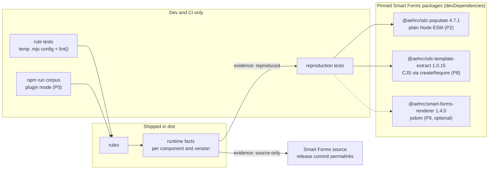

# Smart Forms rules plan: the `smart-forms/` plugin

Builds the Smart Forms compatibility plugin from [core-plan.md](core-plan.md) §2.1, §2.3, §4.2, §4.3 and §5, and the [plugin follow-ups](core-rules.md#plugin-follow-ups-not-in-this-plan) of the core rules plan. Researched on 2026-10-09 against Smart Forms commit `7e64a22f` (renderer 1.4.0, sdc-populate 4.7.1, sdc-template-extract 1.0.15). Revised the same day after a review: its runtime claims were checked against the source, and the population claims were reproduced with the published `@aehrc/sdc-populate@4.7.1`.

**Status: in progress.** S1, S3, S4, S7 and S11 were accepted on 2026-10-09, S2, S5, S9 and S10 with P1, and S13 with P2, the same day, and S6 for P4 on 2026-10-12, and S14 for P6, and S12 and S17 for P7, on 2026-10-13; P5's design questions were settled on 2026-10-13 ([P5](#settled-in-the-p5-review)), two of P6's the same day ([P6](#settled-in-the-p6-review)), six of P7's ([P7](#settled-in-the-p7-review)), and four of P8's ([P8](#settled-in-the-p8-review)); the other decisions are proposals until reviewed. A slice merges once every decision it cites is accepted; record each accepted override of core-plan in [plan-amendments.md](plan-amendments.md). Decision IDs are stable once other docs cite them.

P0 to P8 and H are done: config `compat` is resolved against the plugin's verified versions, the report names them in `run.compat`, the plugin has the two language rules, `questionnaire-variable-unavailable`, `unsupported-query-embedding`, `variable-name-collision`, `repeating-group-variable`, `named-expression-not-referenceable`, `forward-variable-reference` and `unsupported-template-extract-context`, plugin rules receive core's references, each marked conditional where fhirpath.js may skip it, available variables, declarations, dependencies, uses and input reads, the plugin supplies the sourceQueries result names population binds through core's `hostVariables` hook, and population facts, the embedding, sourceQueries, variable storage and evaluation order facts included, are reproduced against `@aehrc/sdc-populate@4.7.1`, and the template extraction facts against `@aehrc/sdc-template-extract@1.0.15`. Only the optional renderer harness, P9, is left.

## How to work on a slice

1. Pick the next slice in the [slice table](#slices-at-a-glance) whose status is `todo` and whose dependencies are done.
2. Read the slice section, every decision it cites (Sn, and Dn in [core-rules.md](core-rules.md#decisions)), the [GLOSSARY](../GLOSSARY.md) terms it uses, and the [runtime facts](#reference-smart-forms-runtime-facts) it relies on.
3. Re-check every runtime fact the slice relies on against the pinned source before writing the rule, and reproduce it where a harness exists (S10). Several facts in the first draft of this plan were wrong until reproduced.
4. If a decision the slice cites is not accepted, or the slice has an [open item](#open-items), ask the user to settle it before the PR merges. An unresolved decision blocks only the first slice that depends on it.
5. Complete the [checklist for every slice PR](#checklist-for-every-slice-pr), then set the slice's status to `done`.

## Slices at a glance

One PR per slice, in this order.

| Slice | Delivers | Default severity | Depends on | Status |
| :- | :- | :- | :- | :- |
| [P0](#p0-plugin-skeleton-and-compat) | Plugin skeleton, `compat` config, `run.compat`, `ctx.compat`, plugin test helper, corpus with the plugin | – | – | done |
| [P1](#p1-language-rules) | API stage A (language lookups), the site-eligibility helper, `smart-forms/unsupported-expression-language` | error | P0 | done |
|  | `smart-forms/expression-evaluated-as-fhirpath` | error | P0 | done |
| [P2](#p2-smart-formsquestionnaire-variable-unavailable) | API stage B (`referencesAt`, `variablesAt`), populate reproduction harness, `smart-forms/questionnaire-variable-unavailable` | error | P1 | done |
| [P3](#p3-smart-formsunsupported-query-embedding) | `smart-forms/unsupported-query-embedding` | error | P2 | done |
| [H](#h-contract-hardening) | `ctx.declarations` (API stage B2), frozen `ctx.sites`; fixes in P2's silence and P3's launch names | – | P3 | done |
| [P4](#p4-supplied-names-hook) | Supplied-names hook, `PLUGIN_CRASH`, built-in names rejected in config `hostVariables`; the plugin supplies sourceQueries result names | – | P0 | done |
| [P5](#p5-smart-formsvariable-name-collision-and-smart-formsrepeating-group-variable) | API stage C (`dependenciesOf`, `useOf`, `readsInput`, `definerOf`), item linkIds for pointer locations, `smart-forms/variable-name-collision` | error | H, P4 | done |
|  | `smart-forms/repeating-group-variable` | warning | P5 | done |
| [P6](#p6-smart-formsnamed-expression-not-referenceable) | `smart-forms/named-expression-not-referenceable` | error | H, P4, P5 | done |
| [P7](#p7-smart-formsforward-variable-reference) | API stage D (`conditional` flag on references), the `sort(…)` crash fix, `smart-forms/forward-variable-reference` (new, S12) | warning | P5, P6 | done |
| [P8](#p8-smart-formsunsupported-template-extract-context) | Template-extract reproduction harness, `smart-forms/unsupported-template-extract-context` | error | P0 | done |
| [P9](#p9-renderer-reproduction-harness-optional) | Renderer reproduction harness; upgrades renderer facts from source-only | – | P1 | optional |

P1 is the tracer bullet: it exercises the plugin package, the compat resolution, the report and the corpus run, and needs only small exports from core. P2 is the first slice that publishes analysis.

Severities are the core-plan §4.2 defaults. The research confirmed each one; S12 adds the only new rule. Four rule IDs differ from core-plan §4.2 (S17).

## Checklist for every slice PR

- The rule has `meta.docs`, written with the `explain` template, and `explain smart-forms/<rule>` works with the plugin listed.
- The rule has focused tests built from synthetic minimal forms. GP CCMP and other restricted forms are never committed (D14).
- Every runtime fact the rule depends on is recorded with its evidence (S4): a reproduction test against the pinned npm package where a harness exists, otherwise `source-only` with a permalink (S10).
- The rule reports only at sites some selected component evaluates (the [eligibility helper](#site-eligibility)).
- The rule stays silent where a core rule reports the same root cause (S9), with a test for each such case. The silence never depends on whether that core rule is enabled.
- Every message states only a consequence the evidence shows. Messages use author terms; `help` states the fix ([linter-design-guidelines.md](linter-design-guidelines.md), C3).
- The corpus has been run locally with the plugin (P0), and the PR description lists the findings that were added or removed, by rule ID, count and JSON Pointer, without expression excerpts from restricted forms (D14). A rule that reports at error merges only with zero false-positive errors on the corpus. The [corpus counts](#corpus-at-a-glance) in this plan are expectations to investigate, not targets to reproduce.
- `npm run check` passes.

## Principles

- **The plugin reports where Smart Forms differs from SDC; core reports SDC.** A plugin rule never re-reports an SDC violation that a core rule or the FHIR Validator already catches (S9).
- **A finding states a demonstrated runtime consequence** in the pinned components: a value that is never set, an expression that is ignored, a query sent with the wrong URL. If the consequence cannot be shown from source or a reproduction, the rule does not report it, and a message never claims more than was shown.
- **The supported integration is population, then rendering** (S1): rules assume population succeeded and its context reached the renderer. Template extraction is checked only when it is selected in `compat` (S3).
- **Version facts are data beside the rules** (S4). They are small typed structures with evidence links, not a universal entry schema; a runtime change can still require a rule change.
- **Publish core analysis when a slice needs it, together with what it needs** (S5, D15, D18).

## Architecture

The plugin is an ordinary npm package that a project's `.mjs` config imports and lists in `plugins`. Core owns the run: it loads the config, validates the plugin and resolves `compat`, finds the expression sites, analyses each document and calls the plugin's rules. The plugin owns only Smart Forms knowledge: its versions, its runtime facts, the names it supplies and its rules. Everything in the plugin box is new; a slice in parentheses marks a piece this plan adds, in core or the plugin. Dotted arrows show how the Smart Forms versions and supplied names flow through a run. The core pipeline itself is described in [architecture.md](architecture.md).

### How the plugin is embedded in a run

- **Config time.** `resolveRuleSet` checks the plugin's shape, registers its rules under `smart-forms/`, and resolves `compat` against the plugin's verified versions (S3). An invalid `compat` fails `lint` and `explain` with `CONFIG_INVALID` before any input is read.
- **Analysis time.** For each Questionnaire, core calls the plugin's `hostVariables({ document, compat })` before finding its expression sites, whether or not any of the plugin's rules is enabled, so `sdc/undefined-variable` accepts the sourceQueries names Smart Forms supplies (S6). Core drops names FHIRPath, FHIR or SDC define. A throw, a promise or an invalid result fails the run with `PLUGIN_CRASH`.
- **Rule time.** `runRules` calls each enabled rule's `check(ctx)` once per Questionnaire, synchronously. The rule reads the context, consults its facts, and reports. Core validates each finding, attaches the rule ID, severity, location and fingerprint, and applies suppressions as for any rule (S8).
- **Report time.** `run.compat` names the exact versions the run checked against.

### What a rule sees and does

A rule never reads Smart Forms code at run time and never evaluates an expression: it reasons from core's analysis and the plugin's recorded facts. `undefined` from `referencesAt` or `variablesAt` means the analysis is unavailable, and the rule reports nothing there.

### Where the facts come from

Each fact names its evidence (S4, S10). When a harness exists, the evidence is a reproduction test that runs the pinned package; otherwise it is a permalink, and the rule's message claims only what the source shows. Verifying a new Smart Forms version means adding it to the plugin's verified versions, re-running the reproductions, and updating the facts and, where behaviour changed, the rules.

## Shared plugin infrastructure

### Public API stages (S5)

`RuleContext` today gives a plugin `document`, the flat frozen `sites` and `declarations`, `compat`, `referencesAt` and `variablesAt`, `options: undefined` and `report()` with `relatedLocations`. Everything else is internal to core (`DocumentAnalysis`, `plugins/core-rule.ts`). Each stage is plumbing in `run/rules.ts` from an analysis core already computes once per document, plus exported readonly types in `index.ts` and a section in [architecture.md](architecture.md).

| Stage | Slice | Adds to `RuleContext` | Exported types and functions |
| :- | :- | :- | :- |
| 0 | P0 | `compat: Readonly<Record<string, string>>`, the resolved versions for the rule's own namespace | – |
| A | P1 | – | The query-language predicate, the SDC allowed-languages lookup and the six value-set codes (`isQueryLanguage`, `languagesAllowedAt`) |
| B | P2 | `referencesAt(site)`, `variablesAt(site)`; replaces the `scopeAt` stub and `Scope` | `VariableReference { name, startOffset, endOffset, complete }`; `AvailableVariables` with `resolve(name)` giving `{ name, origin, declaration? }`; `Variable`; `Declaration { name, kind, pointer, item?, useCases, site? }` |
| B2 | H | `declarations`: every declaration in the document, in document order, frozen; identical to the objects `variablesAt` resolves to | – |
| C | P5 | `dependenciesOf(declaration)`, `useOf(declaration)`, `readsInput(site)` | `Dependencies`, `DeclarationUse`; `definerOf` and `BuiltinDefiner` |
| D | P7 | – | `VariableReference.conditional` |

- **Empty versus unavailable.** `referencesAt` returns `undefined` when the site has no FHIRPath analysis (a non-FHIRPath site, or text that does not parse) and `[]` when it parses and references nothing. `variablesAt` returns `undefined` for an uncatalogued site. Both return `undefined` for an object that is not one of `ctx.sites`. Document both; a rule treats `undefined` as "cannot check", never as "no references".
- Stage B is a breaking contract change (`scopeAt` goes) and lifts D15 and D18. Core and the plugin stay at 0.1.0, and the peer range at `^0.1.0`, before the first release: core is unreleased, so 0.1.0 is the version that ships stage B, and a core without `referencesAt` fails the plugin's rule with `RULE_CRASH`. The GLOSSARY rename D15 deferred is done.
- `readsInput(site)` is in core because core owns the parser; the plugin takes no `fhirpath` dependency. Its definition is in [P5](#p5-smart-formsvariable-name-collision-and-smart-formsrepeating-group-variable). It returns `boolean | undefined`: `undefined` for a site with no FHIRPath analysis or not in `ctx.sites`, like `referencesAt`. `definerOf(name)` is exported so a plugin rule can stay silent where `sdc/reserved-name` reports (S9) without copying core's list of built-in names.
- The arrays a rule receives, `sites` and `declarations`, are frozen, not only their elements (H).
- P7 adds a `conditional` flag to `VariableReference` (stage D): fhirpath.js may skip evaluating the reference, because it is in an `iif` branch, a later `coalesce` argument or an argument evaluated per item of its target. The positions are listed in [P7](#p7-smart-formsforward-variable-reference).
- Not planned: a completion hook, rule options, an item-tree API, inline config. A plugin reads an item by resolving `site.item.pointer` against `document.resource` (strip `document.resourcePointer` first); put that helper in the plugin.

### Site eligibility

A private plugin helper, `readBy(ctx, site)` in `src/eligibility.ts`, returns the selected components that read a site, each with how it handles the language there, or none. It answers whatever the site's language: `unsupported-expression-language` reports exactly the sites a component reads but does not evaluate. It is built in P1 and used by every rule that reports at an expression site (P1, P2, P6). It accounts for each component's prerequisites (`src/facts/prerequisites.ts`), not only the location. A prerequisite never depends on the language at the site itself, though it may depend on the language of other extensions on the element:

- an itemPopulationContext is read only on an item with child items, and only the first of its URL on the item, with a `name` and expression text. Populate keeps one per name: a later one of the same name anywhere in the form replaces it, and it is never evaluated (`readPopulationExpressions.ts:56-63`);
- only the first initialExpression on an item is read. Populate evaluates it once for an item outside a repeating group with an itemPopulationContext. Below one, only a direct child of a repeating group is evaluated, once per repetition, and only when a direct child's initialExpression names a context and the group is reached; a nested repeating group is reached only when it has an itemPopulationContext of its own (`constructResponse.ts:225-238,574-713`);
- a targetConstraint is built only with `key` (`valueId`), `severity` (`valueCode` `error` or `warning`), `human` (`valueString`) and an `expression` sub-extension; the first `expression` sub-extension with a `valueExpression` is used. The renderer keeps one per key, reading root extensions and then each item's before its child items': a later built one with the same key replaces it, and it is never evaluated (`extractTargetConstraint.ts:55-90`);
- an answerOptionsToggleExpression is read only with an `option` sub-extension that has `valueCoding`, `valueString` or `valueInteger`; the first `expression` sub-extension with a `valueExpression` is used;
- an answerExpression is read only as a fallback when answerValueSet produced no codings, so it is evaluated, but not always;
- the renderer reads an initialExpression, an enableWhenExpression and an answerExpression only when no earlier extension of the same URL on the element has the language `text/fhirpath`: each getter takes the first one with that language (`getExpressionsFromItem.ts:29-60,178-191`). A second `text/fhirpath` one is read by nothing, and a `text/fhirpath` initialExpression after a CQL one is read by the renderer only. calculatedExpression and cqf-expression need no such prerequisite: the renderer reads every `text/fhirpath` one;
- candidateExpression, contextExpression, itemExtractionContext, the root `_title` cqf-expression and a root itemPopulationContext are read by nothing, and neither are uncatalogued and fragment sites.

`readBy` answers per component: a site population does not read, such as a second initialExpression, can still be read by the renderer, which reads the first `text/fhirpath` initialExpression to repopulate a form. A rule that cares about one component filters on `component` or on the handling.

A rule whose `ctx.compat` names no renderer or populate version throws, which a conforming core never causes: `resolveRuleSet` always selects every required component. A selected version with no facts throws too: it is a plugin bug.

### Completion and suppressions

Plugin rules do not take part in completion evidence: `completesCheck` and `leavesUnchecked` in `plugins/builtin.ts` are built-in tables, and core-rules.md ([Shared analysis](core-rules.md#shared-analysis-and-completion-evidence)) forbids a public completion framework. The consequences (S8):

- A suppression of a plugin finding is applied when it hides a finding, and stale when its file, expression or declaration is gone, like any suppression.
- When its target exists and the plugin reported nothing there, the suppression is not assessed: rule-completion evidence cannot establish staleness for a plugin rule.
- A plugin rule never makes a site unchecked.

Document this in [cli.md](cli.md) and the plugin README.

### Test harness

- A plugin test helper writes a temporary `.mjs` config that imports the plugin's built `dist` by absolute file URL, and calls `lint({ cwd, configPath })` in-process. This already works (`packages/core/test/lint.test.ts`, `test/support/tmp.ts`). Do not add an inline `config` option to `LintOptions` for tests: it would need its own answers for the base directory of `files`, `source.fsh` and suppression paths, the config path shown in the report, and the `.mjs`-only rule for plugins.
- CLI tests reuse the inline-plugin `.mjs` pattern in `packages/core/test/cli/lint.test.ts`.
- Both Vitest projects use one shared global setup that builds core at most once per run; the plugin's then builds the plugin (P0).
- Add a plugin docs test like core's `docs.test.ts`, which covers only built-in rules.

## Slices

### P0. Plugin skeleton and compat

Decisions: S1, S3, S4, S7, S11.

P0 resolves the compatibility target; it adds no Smart Forms findings and runs no compatibility checks. `run.compat` names the selected versions that enabled plugin rules run against, and its presence does not imply any coverage.

**Core:**
- Add `compat` to `knownKeys` and `LintConfig` (`config/validate.ts`, `config/types.ts`). Shape: `compat?: { [namespace]: "latest" | { [component]: string } }`. `validateConfig` checks the shape only.
- `validatePlugin` checks a plugin's `compat`: `verified` is a non-empty object whose lists are non-empty, unique, non-empty strings, none of them `"latest"`; `required` holds unique keys of `verified`. Failures point at `/plugins/<i>/compat/…`.
- `resolveRuleSet` checks the meaning, so `lint` and `explain` fail the same way before inputs are read. Each is `CONFIG_INVALID` with a pointer:
  - `/compat/<ns>` names no listed plugin. Help: list the plugin in `plugins`.
  - The plugin declares no compat.
  - A component is unknown, or a required component is missing.
  - A version is not verified. Help lists the verified versions; never fall back to the nearest one (core-plan §2.3).
- A listed plugin with compat and no `compat` entry gets `"latest"` (C1).
- `"latest"` selects every component, each at the last, newest, entry of its verified list in the installed plugin, not npm's latest (S3). npm already has renderer 1.5.0, populate 4.7.2 and template-extract 1.0.16; they stay unverified until a PR verifies them.
- `lint.ts` fills `run.compat` from the resolved versions, always exact. Make `template-extract` optional in the report schema (`smartFormsVersions`), `SmartFormsVersions` and [report-format.md](report-format.md); `schemaVersion` stays 1 before the first release. `report/text.ts` prints the Smart Forms line without template-extract when it is not selected.
- `ctx.compat` (stage 0): a frozen copy of the resolved versions for the rule's own namespace; `{}` for `sdc` and for a plugin without compat.

**Plugin contract addition:** `LintPlugin.compat?: { verified: Readonly<Record<string, readonly string[]>>; required: readonly string[] }`. The components are the keys of `verified`, each list oldest to newest; `required` lists those an explicit object must name. Core reads only this.

**Plugin:**
- Default export `{ meta: { name: 'smart-forms', version }, rules: {}, compat }`, with the version from a `package.json` JSON import.
- Components: `renderer` and `populate` (required), `template-extract` (optional). Verified: renderer 1.4.0, populate 4.7.1, template-extract 1.0.15.
- No runtime facts yet: each arrives with its first consumer (S4). Remove `compat` from `files` in `package.json`; nothing ships outside `dist`.
- Peer range stays `^0.1.0`: core is unreleased, so 0.1.0 is the version that ships `compat`. From P1, a rule that receives no version for a required component throws rather than check nothing, which a conforming core never causes: it selects every component in `compat.required` (`contract.ts`).
- Tests build through one shared global setup that builds core at most once per Vitest run, then the plugin, so the plugin's tests also run alone from a clean checkout.

**Corpus:** `npm run corpus -- --smart-forms` builds both packages, lints with the committed `packages/plugin-smart-forms/scripts/corpus.config.mjs` (it imports `../dist/index.js`, with `compat: 'latest'`), prints the Smart Forms versions from `run.compat`, and compares with a separate snapshot, `corpus/findings.smart-forms.json`. The snapshot keeps findings of every namespace, without messages; `--smart-forms --update` writes only that snapshot. Core slices keep their snapshot and stay independent of the plugin build.

**Docs:** cli.md (the `compat` key, its default and errors), report-format.md (the compat `CONFIG_INVALID` cases, optional `template-extract`), architecture.md (compat resolution and `ctx.compat`), GLOSSARY ("Compatibility matrix", "Component"), plan-amendments.md (S1, S3, S4, S7, S11 and the merge gate).

**Tests:**
- Resolution: `latest` resolves all three; no entry resolves like `latest`; with two versions per component, `latest` takes the last; an object with renderer and populate resolves without template-extract; an unknown version, an unknown component, a missing required component, a per-component `"latest"` and a namespace with no plugin each fail with their pointer; `explain` fails on the same config errors.
- Plugin validation: each invariant of `compat` above.
- Runner: a synthetic plugin rule receives its own namespace's versions as a frozen copy; a plugin without compat receives `{}`; with two compat plugins, neither sees the other's versions.
- Report: text and JSON show the versions, with and without template-extract.

**Done when** `npm run check` passes, `npm run corpus -- --smart-forms` prints `Smart Forms: renderer 1.4.0, populate 4.7.1, template-extract 1.0.15.`, and its findings are identical to the core-only run's.

### P1. Language rules

Decisions: S1, S2, S5, S9, S10, D3, D10, D11. Uses the [language facts](#languages-by-location). The corrections below were found in the source while implementing it.

Build stage A and the [eligibility helper](#site-eligibility). Both rules check sites that are `carrier === 'expression'`, catalogued, not fragment sites, with a `language` and with `expression` text, that `readBy` returns a component for. Both name the element as core does: `item "Text" (linkId)`, `item linkId`, `item "Text"`, `an item that has no linkId`, or `the Questionnaire root`.

**`smart-forms/unsupported-expression-language` (error).** A component ignores the expression because of its language. Locations: root and item `variable`, calculatedExpression, enableWhenExpression, answerExpression, cqf-expression on `_text`, `_prefix` and `_answerValueSet`. Accepted: `text/fhirpath` everywhere, plus `application/x-fhir-query` for `variable`.
- Stay silent when:
  - the language is not allowed at the location by SDC (`sdc/language-not-allowed`, or the Validator's `sdc-inv1`);
  - the language is outside the six value-set codes (`sdc/language-not-in-value-set`); Smart Forms also ignores it, but core already reports the code;
  - the site is uncatalogued, or no component reads the location (no finding in v1; the facts record them);
  - the site is an initialExpression (the next rule);
  - a calculatedExpression, enableWhenExpression, answerExpression or cqf-expression has a sibling `text/fhirpath` extension with the same URL on the same element that the renderer runs: the renderer uses the first `text/fhirpath` enableWhenExpression and answerExpression and every `text/fhirpath` calculatedExpression and cqf-expression, so the ignored one is an alternative, not lost behaviour (`getExpressionsFromItem.ts:48-60,137-152,178-191`). The alternative must have expression text: for enableWhenExpression and answerExpression, the first `text/fhirpath` one; for the others, any. One without text runs nothing, so the ignored expression is still reported;
  - a variable has no name, so ignoring it has no consequence, or the same element has a variable of its name that Smart Forms accepts (`text/fhirpath` or `application/x-fhir-query`), which sets the name; `sdc/duplicate-declaration` reports the duplicate.
- Message: `Smart Forms ignores this {extension} on {element} because it is written in {language}; it uses only text/fhirpath here, so {consequence}.` The extension is named `variable`, `calculatedExpression`, `enableWhenExpression`, `answerExpression`, or `cqf-expression on text`, `on prefix` or `on answerValueSet`. Consequences:
  - enableWhenExpression: "this expression never disables the item" (the item's `enableWhen` and `hidden` still apply);
  - calculatedExpression: "the answer is never calculated from it";
  - answerExpression: "its answers are not computed from it" (`answerOption` and `answerValueSet` still load);
  - variable: "this variable never sets %{name}". It does not claim that expressions using the name fail: Smart Forms keeps one flat set of names, so another declaration, such as a root FHIRPath variable of the same name, may still supply it;
  - cqf-expression on `_text`: "the text is not updated from it"; on `_prefix`: "the prefix is not updated from it";
  - cqf-expression on `_answerValueSet`: "the answer value set is not computed from it".
- Help:
  - a `text/x-fhir-query` variable: `set the language of this variable to application/x-fhir-query: Smart Forms runs a query in a variable only with that code`. It suggests the R4 code for a runtime reason, so it does not break slice 1's rule against suggesting the R4 code for spelling reasons.
  - otherwise: `rewrite it in FHIRPath with the language text/fhirpath; to use server data, fetch it in an application/x-fhir-query variable on this item or an ancestor and reference that variable`.
- Covers the core-rules follow-up "Smart Forms ignores `text/x-fhir-query` (D11)".

**`smart-forms/expression-evaluated-as-fhirpath` (error).** A component evaluates a non-FHIRPath expression as FHIRPath. Locations: targetConstraint and answerOptionsToggleExpression (renderer); initialExpression and itemPopulationContext (populate). The plan named only the first two; populate's are added (S2) because an `application/x-fhir-query` itemPopulationContext is valid SDC and occurs in the SDC demographics example.
- Stay silent when SDC disallows the language there: either query code on answerOptionsToggleExpression is `sdc/language-not-allowed`. targetConstraint has no R4 restriction, so every non-FHIRPath language is reported there. Stay silent, too, on a language outside the six codes: a misspelt `text/fhir-path` is evaluated as FHIRPath and may work, and core reports the code. The eligibility helper already excludes itemPopulationContexts populate never reads or replaces by name, a second initialExpression, targetConstraints and toggles the renderer never builds, and targetConstraints a later one with the same key replaces.
- Message: `Smart Forms {renderer|population} evaluates this {extension} on {element} as FHIRPath although it is written in {language}, so {consequence}.` Query text throws on `?` and the error is caught, so for both query codes the consequences are: targetConstraint "the constraint never reports a problem"; answerOptionsToggleExpression "its options are not toggled"; initialExpression "the answer is not prefilled"; itemPopulationContext "the group is not prefilled". CQL text can be valid FHIRPath that returns a value, such as `true` or an element name like `status`, and the renderer marks a targetConstraint invalid when the result is empty and the text contains `intersect` (`targetConstraint.ts:99-107`). So for the three CQL codes, and for a query targetConstraint whose text contains `intersect`, the consequence is only "the {language} is never run".
- Help: for an itemPopulationContext query, `fetch the resources in an application/x-fhir-query variable on the Questionnaire root, and set itemPopulationContext to FHIRPath over it, such as %name.entry.resource` (the GP CCMP pattern). Otherwise `rewrite it in FHIRPath with the language text/fhirpath`.

**Reference-only Expressions:** no finding in v1 (settled with P1). Core reports `sdc/external-expression` at info, and both rules check only sites with expression text.

**Reproduction:** the populate facts (variable, initialExpression, itemPopulationContext and their prerequisites) are reproduced against `@aehrc/sdc-populate@4.7.1` by the harness in `packages/plugin-smart-forms/test/reproduction/` (P2). Every renderer fact stays `source-only` until P9 (S10).

**Tests.** Positive: variable `text/x-fhir-query` at root and item; variable `text/cql`; calculatedExpression `application/x-fhir-query`; enableWhenExpression `text/cql`; answerExpression with both query codes; `_text`, `_prefix` and `_answerValueSet` cqf-expressions `text/cql`; a CQL item variable whose name a root FHIRPath variable declares; targetConstraint with `text/cql`, both query codes and `text/cql-identifier`; toggle with `text/cql` and `text/cql-expression`; initialExpression `text/cql` and `application/x-fhir-query`, including a child of a repeating itemPopulationContext group; itemPopulationContext with both query codes on a group with children. Negative: every stay-silent case above, with the core rule turned off for each S9 silence; an incomplete targetConstraint; `application/x-fhir-query` variables; and `text/fhirpath` at every location.

**Corpus:** GP CCMP 0. Other corpus forms: 1 for each rule (SDC form-behavior answerExpression `application/x-fhir-query`; SDC demographics itemPopulationContext `application/x-fhir-query` on a repeating group).

**Done when** both rules report as specified, each location in the language facts has evidence, and the corpus run shows only the expected findings.

### P2. `smart-forms/questionnaire-variable-unavailable`

Decisions: S1, S5, S9, S10, S13. Implements core-plan §4.3.

**Core API:** stage B, `referencesAt` and `variablesAt`. Record in plan-amendments.md that it lifts D15 and D18.

**Reproduction harness:** `@aehrc/sdc-populate@4.7.1` is an exact dev dependency of the plugin. It runs headlessly in plain Node ESM: `populateQuestionnaire({ questionnaire, patient, fetchResourceCallback, fetchResourceRequestConfig, timeoutMs })`, asserting on the URLs passed to `fetchResourceCallback`, the OperationOutcome issues, `populatedContext` and the response (`test/reproduction/populate.ts`). The lockfile resolves a single `fhirpath` 4.10.1. `fhirclient`, which populate declares but never imports at run time, is overridden with an empty local stub: the real package pulls in about 500 Expo and React Native packages (AGENTS.md). Reproduced in this slice: this rule's facts, P1's populate facts, and an item-level query variable feeding an initialExpression (used by P5 and P7).

**Rule (error).** A complete reference that resolves to the built-in `%questionnaire` or `%qitem` (`resolve(name).origin`), at a non-fragment FHIRPath site that `readBy` returns a component for, when a reader's unsupplied-name facts (`src/facts/names.ts`) list the name. No component supplies either name, and fhirpath.js throws on an undefined environment variable when the reference is evaluated. Every component catches the error, logs it with `console.warn` and keeps the previous result; populate also adds an OperationOutcome warning.
- A form declaration of the name in scope resolves to the declaration and is `sdc/reserved-name`'s; `%qitem` at a root site resolves to nothing and is `sdc/undefined-variable`'s.
- The rule is also silent for a name any declaration in the form has, wherever it is: `variablesAt` resolves `%questionnaire` to the built-in when the declaration is on another branch, or in the declaration's own expression (D25), and `sdc/reserved-name` reports the declaration, which is the root cause (S9). This claims nothing about whether the declaration supplies a value at run time.
- Fragments belong to P3.
- Range: the reference.
- A reference inside an `iif` branch still reports, because the branch may run; `iif(false, %qitem, 1)` returns `[1]` without failing, so the message says "when the reference is evaluated".
- Message, at every location except answerExpression: `Smart Forms does not supply %{name}, so this {extension} on {element} fails when the reference is evaluated, and {consequence}.` The consequence states what the failed evaluation leaves:

  | Location | Consequence |
  | :- | :- |
  | variable | `%{variable} gets no value from it` |
  | calculatedExpression | `the answer is not calculated from it` |
  | enableWhenExpression | `it does not change whether the item is enabled; the item starts disabled` |
  | cqf-expression on `_text`, `_prefix`, `_answerValueSet` | `the text`, `the prefix` or `the answer value set` `is not updated from it` |
  | targetConstraint | `the constraint result is not updated from this evaluation` |
  | answerOptionsToggleExpression | `its options are not toggled; they start disabled` |
  | initialExpression, read by population | `the answer is not prefilled` |
  | initialExpression, read only by the renderer | `the answer is not refilled from it when the form is repopulated` |
  | itemPopulationContext | `the group is not prefilled` |

- An answerExpression is never evaluated when the reference is its head, and throws when the reference comes later and is evaluated; inside an `iif` branch it may not be, and the other branch's answers are used. Head: `Smart Forms does not supply %{name} to an answerExpression, so its answers on {element} are never computed from this expression.` Later: `…are not computed from this expression when the reference is evaluated.`
- Dependents of a variable whose evaluation failed fail too; the rule reports only the reference itself.
- Help: for `%qitem` followed by `.linkId` on an item with a linkId, `use the literal value instead, such as '{linkId}'`, with any `\` or `'` in the linkId escaped; otherwise `copy the value the expression needs from the Questionnaire into the expression`.
- Note, at every location except answerExpression: `if the application running the form supplies %{name}, suppress this finding with a reason that names the application`.
- Host exceptions (S13): a renderer host can supply `%questionnaire` through `additionalContext`, and a direct `populate()` caller through a `context` parameter; the app does neither. A host can supply `%qitem` correctly only when every expression that uses it is on one item, because `additionalContext` is one value for the whole form. A host that does either records a suppression with a reason naming itself. `hostVariables` cannot express it: core resolves built-in names before host names, and from P4 config rejects them. No host can supply a name to an answerExpression: the renderer builds its context from the name before the first `.` alone, and `additionalContext` never reaches it.

**What a failed evaluation leaves in the renderer** (source only until P9; every catch logs with `console.warn` and keeps the previous value):

| Location | Result | Evidence |
| :- | :- | :- |
| variable, root and item | Not assigned, so it keeps its previous value, if any. Its own references then throw too | R`utils/fhirpath.ts:295-297,347-349` |
| calculatedExpression, cqf-expression | Keeps its previous value, initially `null` | R`utils/calculatedExpression.ts:97,142-144,241-243`; R`utils/getExpressionsFromItem.ts:79-126` |
| enableWhenExpression | Keeps the previous enabled state, initially `false`: the item starts disabled | R`utils/enableWhenExpression.ts:156-161,285-287`; R`utils/questionnaireStoreUtils/extractOtherExtensions.ts:418,443,505` |
| answerOptionsToggleExpression | Keeps the previous state, initially `undefined`, which counts as disabled | R`utils/answerOptionsToggleExpressions.ts:116-121,196-200`; R`hooks/useAnswerOptionsToggleExpressions.ts:46` |
| targetConstraint | Keeps the previous result, initially `undefined`: it never fires | R`utils/targetConstraint.ts:113-115,177-179`; R`utils/validate.ts:125` |
| answerExpression | Evaluated only when its head names a launch context with a resource, or an `application/x-fhir-query` variable whose expression is a ValueSet URL and whose expansion resolved, with only that name in its context. A throw falls back to the answerValueSet codings | R`hooks/useValueSetCodings.ts:66-124` |

Populate behaves the same way: a variable stays unset, an initialExpression leaves no answer, and an itemPopulationContext builds no group (P`createFhirPathContext.ts:257-264`; P`evaluateExpressions.ts:63-71,89-96,140-148`). _Reproduced in populate._

**Tests.** Positive: root variable `%questionnaire.title`; item variable `%qitem.text`; calculatedExpression, enableWhenExpression, targetConstraint, answerOptionsToggleExpression and `_text` cqf-expression with their consequences; answerExpression with `%questionnaire` as the head and with a later `%qitem`; initialExpression `%qitem.linkId` with the linkId help; a `text/fhirpath` initialExpression after a CQL one; itemPopulationContext on a group with children; a reference inside `iif`; two references in one expression; a backticked name; a name in `hostVariables` (removed in P4, when config rejects built-in names). Negative, with the core rule off for each S9 silence: a variable named `questionnaire` using `%questionnaire`; `%qitem` at the root; a declaration `questionnaire` on an ancestor and on another branch; use inside a fragment (P3); CQL; candidateExpression; a second `text/fhirpath` initialExpression, enableWhenExpression and answerExpression; text that does not parse; a reference after a computed `defineVariable`; a suppressed finding. Reproduction: the populate cases in `test/reproduction/populate-names.test.ts`.

**Corpus:** GP CCMP 0, Smart Forms forms 0, SDC STU4 2 (hunger-vital-signs, item variable `thisItem = %questionnaire.item.where(…)`).

**Core follow-up (not in this slice):** a config error for a built-in name listed in `hostVariables`. Done in P4. It is not a silent no-op for `qitem`: the built-in is added only at item sites, so a listed `qitem` resolves `%qitem` at the root.

**Upstream:** [aehrc/smart-forms#2140](https://github.com/aehrc/smart-forms/issues/2140) (`%questionnaire`) and [#2141](https://github.com/aehrc/smart-forms/issues/2141) (`%qitem`) report the missing names. When a release that supplies them is verified, its unsupplied-name facts omit the name, and the rule stays silent for that version without a rule change.

### P3. `smart-forms/unsupported-query-embedding`

Decisions: S1, S9, S10. Uses the [embedding facts](#x-fhir-query-embeddings).

**Scope:** fragment sites whose query site is a catalogued `variable`, on the root or an item, with the language `application/x-fhir-query` and a name. Populate fetches exactly those, and the renderer never replaces `{{…}}`. Other query locations belong to P1. Bundle `entry.request.url` in a contained sourceQueries Bundle is not an expression site and stays out of scope, except as a target of check 4.

**Rule (error).** Check in this order and report the first problem, one finding per fragment. A fragment ends at the first `}}`, as populate's non-greedy regex does.
1. **Not recognised.** The fragment text does not match `^%[^\r\n]+$`: populate needs `%` immediately after `{{` and at least one character after it. The query is sent with the braces in it.
2. **No launch context.** The Questionnaire declares no launchContext. Populate replaces embeddings only when a launch resource is supplied, so every embedding in the form is sent with its braces, and no other problem can occur. Report once per fragment (settled below).
3. **Invalid regular expression.** `new RegExp('{{%' + text + '}}', 'g')` throws. Populate builds that regular expression, unescaped, so population of the whole form fails with "An unknown error occurred". The linter decides this by compiling the same pattern. Metacharacters inside string literals count.
4. **Replacement fails or corrupts.** Simulate populate's replacement: apply the compiled pattern to the fragment's own `{{%text}}`, replacing with a sentinel.
   - The text is unchanged: the replacement never matches and the query is sent with its braces. Function calls, indexers, `+`, `*`, `?`, `^`, `$` and `\` do this.
   - The result is anything other than exactly the sentinel: the URL is corrupted. `|` does this: `{{%patient.id|id}}` becomes `p1|p1`.
   - Also apply the pattern to the text of every other `application/x-fhir-query` variable in the form: populate applies each embedding's replacement to every query. A match that is not an identical embedding corrupts that query; report it with the other variable as related location (`{{%patient.id|id}}` turns `Encounter?b={{%patient.id}}` into `Encounter?b=p1}}`).
5. **Head is not a launch context.** The text from `%` to the first `.` is not a root launchContext name: a variable, a sourceQueries name, a built-in or a backticked name. The query is sent with `undefined`. A missing `.` lands here too and is sent with an empty value.
6. **Depends on another name.** The remainder references a name that core resolves and that populate does not supply there. Populate evaluates the remainder against the launch resource with only these names: `%context` (the launch resource), `%ucum`, `%terminologyUrl`, `%async`, and `%fhirServerUrl` when a source server is configured. Form variables and other launch contexts, `%patient` included, are not available, so the evaluation throws and the embedding becomes empty. Names that do not resolve stay with `sdc/undefined-variable`. `%factory` resolves, but every use of it is a call, which check 4 reports first.

- Checks 1–5 are string checks and run even when `sdc/fragment-parse-error` reports the fragment; both findings are true and their fixes differ (S9). Check 6 needs references, so it is skipped for a fragment that does not parse.
- Operators and literals are not themselves a problem: `{{%patient.id = 'p1'}}`, `{{%patient.id & 'x'}}` and `{{%patient.id.length div 1}}` are replaced with their values.
- Range: the whole fragment for 1–5; the reference for 6.
- Messages:
  - 1: `Smart Forms does not replace the embedding {{ %patient.id }}: it must start with {{% with no space.` Help: `write it as {{%patient.id}}` (only when the trimmed text starts with `%`).
  - 2: `Smart Forms replaces {{…}} only when a launch context is supplied, and this Questionnaire declares none, so the query is sent with its braces.` Help: `declare the launch context the embedding uses, such as patient`.
  - 3: `Smart Forms builds a regular expression from the text inside {{…}}, and this text is not a valid one, so population of the whole form fails.`
  - 4, braces: `Smart Forms builds a regular expression from the text inside {{…}}, and this text does not match itself, so the query is sent with its braces.` Corrupts: `…and it matches other text, so it corrupts the query URL` (naming the other variable when it is another query).
  - 5: `Smart Forms fills {{%Condition.id}} only from a launch context, and Condition is not one, so the query is sent with "undefined".` A missing `.`: `…so the query is sent with an empty value.` Help: `use a launch context declared on the Questionnaire, such as %patient.id`.
  - 6: `Smart Forms evaluates the text after %{head} with only the launch resource, so %{name} is not available and the embedding becomes empty.` Help: `inside {{…}} only %context, %ucum, %terminologyUrl and %async are available, and %fhirServerUrl when a source server is configured`.
- Known limitations, not checked: values are inserted without URL encoding; a non-primitive result such as `%patient.name` becomes `[object Object]`; only the first result is used; a path with no result becomes `undefined`; a launch context that is declared but not supplied at runtime leaves its embeddings unreplaced or `undefined`.

**Tests.** Negative: `{{%patient.id}}`; several embeddings in one query; a custom launch name; `%context`, `%ucum` and `%terminologyUrl` in the remainder; an operator with literals; a fragment in contextExpression; the R5 query code; a fragment that does not parse (no check 6). Positive: each check above, including `{{%}}`, a metacharacter inside a string literal, the cross-query corruption, an item-level variable, and a head that is an x-fhir-query variable. Reproduction: each check against sdc-populate 4.7.1, asserting the URL passed to `fetchResourceCallback` or the failed population.

**Corpus:** GP CCMP 0 (15 embeddings: 14 `%patient.id`, 1 `%gpccmppractitionerrole.id`, a declared launchContext). SDC STU4 1 (rxterms item variable with `{{item.where(linkId=…)…}}`, check 1).

**Settled while building it** (2026-10-11):
- Facts: `src/facts/embeddings.ts`, one fact per behaviour of populate 4.7.1, reproduced in `test/reproduction/populate-embeddings.test.ts`. The renderer has none: it never replaces `{{…}}`. Each check runs only when its fact holds for the selected populate version.
- Scope: a query variable `readBy` returns populate for. Population fetches nothing for a variable without a name.
- Check 1 follows population's pattern, whose `.` excludes line breaks, so an embedding that spans lines is reported. A fragment inside which population still finds an embedding, such as `{{{%patient.id}}`, is not checked.
- Check 2 is reported once per fragment, as in the open item's default. A launchContext of any shape counts as declared, so the check never fires on a form population might fill.
- Check 4 searches every query the form fetches, this one included, and the request URLs of the contained Bundles the root's sourceQueries reference. Any match that is not an identical embedding is a corruption; one finding names every corrupted query, and the other queries are related locations. So `{{%patient.id|id}}` names both its own query and `Encounter?b={{%patient.id}}`.
- Check 5: an empty head (`{{%.id}}`) is not evaluated, so it is sent with an empty value, like a missing `.`. Launch context names are read by URL, as core reads them (S16).

### H. Contract hardening

Decisions: S5, S9. Found in the P4 design review (2026-10-12); a small PR before P4.

- **Core API, stage B2:** `RuleContext.declarations`, the frozen array of the document's declarations that core's own rules use, in document order. Each `Variable.declaration` from `variablesAt` is one of its elements, and each `declaration.site` one of `ctx.sites`. A launchContext or extractAllocateId `Declaration.item` is a different object from `site.item` for the same item: compare items by `pointer`.
- **Frozen arrays.** `ctx.sites` is frozen, not only its sites: a rule could otherwise add a site, which the runner then accepts as a finding location, or reorder them, which breaks "a fragment directly follows its query".
- **P2 fix.** `questionnaire-variable-unavailable` takes the names that silence it from `ctx.declarations`, every kind, extractAllocateId included, as P2 states. It unioned `variablesAt` over the sites, so an extractAllocateId `questionnaire` silenced it only when an extraction site sat on its element or below (reproduced).
- **P3 fix.** A launch name is read in population's order, `valueId ?? valueCoding.code` (PI`inputParameters.ts:97-121,346`). The rule read `valueCoding.code` first, so a `valueCoding` without a code beside a `valueId` gave a false check 5 (reproduced). "A launchContext of any shape counts as declared" stays: `declared` does not come from `ctx.declarations`, which holds only launchContexts whose name core can read.
- `contract.ts` documents the `ctx.compat` guarantee: every required component, and every other verified one unless an explicit config object omits it. Core's `sdc/duplicate-declaration` names elements with `rules/describe.ts`, like every other rule.

### P4. Supplied-names hook

Decisions: S1, S4, S6, S13, D1, D16, D19. Settles the core-rules follow-up "a plugin hook for supplied names". Settled in a design review on 2026-10-12; every population claim below was reproduced against `@aehrc/sdc-populate@4.7.1`.

**Core:**
- Add an optional `LintPlugin.hostVariables?({ document, compat }): readonly string[]`, synchronous and pure. `compat` is the same frozen object the plugin's rules get as `ctx.compat` (`{}` without compat). It only adds names.
- `lint.ts` calls it for each listed plugin with a hook, in config order, once per document (a root or Bundle-entry Questionnaire), before `findExpressionSites`. It runs whether or not any of the plugin's rules is enabled: listing a plugin activates its names, rule settings control only its findings.
- The result is checked for shape only: an array, possibly empty, whose every index holds a non-empty string that does not start with `%`. Duplicates are allowed, and so is a space (`` %`a b` ``). Core then drops a name FHIRPath, FHIR or SDC defines (`builtinNames`, or a `vs-` or `ext-` prefix), and merges the rest after config `hostVariables`. A hook name resolves with `origin: 'host'` when no declaration or assembleContext name wins.
- A throw, a returned promise or an invalid result fails the run with a new failure code, `PLUGIN_CRASH`. It carries a required `plugin: { name, version }` and `path`, the Questionnaire's file; its message names the plugin, the file and, for a Bundle entry, the resource pointer. `RULE_CRASH` gains `path` too. Schema enum and if/then, report-format.md.
- `validatePlugin` fails with `CONFIG_INVALID` at `/plugins/<i>/hostVariables` when the key is present and not a function. `RuleSet` keeps the hooks with their compat.
- A config `hostVariables` entry that FHIRPath, FHIR or SDC defines is `CONFIG_INVALID` at `/hostVariables/<i>`, the P2 core follow-up. For `questionnaire` and `qitem` the help says to remove it and suppress the findings with a reason that names the application (S13); for the others, that the name is always available. Config and the hook share one per-name shape check.
- This overrides core-plan §5.1, which says that plugins "do not subscribe to walker callbacks and do not extend the registry through this interface": a plugin now also supplies names to core's analysis. Recorded in [plan-amendments.md](plan-amendments.md) (S6).

**Plugin.** The Smart Forms plugin returns the sourceQueries result names population binds under the supported integration (S1), assuming external fetches succeed. Choosing the name and binding a value are separate steps in the runtime:
- **Read.** Only root extensions with the exact sourceQueries URL, every one of them; item-level ones are ignored. Nothing when the root `subjectType` is non-empty and lacks `Patient`: population stops before reading them.
- **Name.** A `#id` reference is named `id`, before any resolution. Any other non-empty reference is named `sourceQuery<i>`, where `i` counts from 0 every sourceQueries extension with a truthy `valueReference`: display-only, empty and `#` ones included.
- **Value.** A `#id` name is bound only when the first contained resource with that id and type Bundle has an `entry` element (`entry: []` included, any `Bundle.type`), to that Bundle itself. Another reference is fetched, and bound to whatever resource returns; a failed fetch or an OperationOutcome leaves it unset.
- **Returned.** A `#id` with such a Bundle, and every `sourceQuery<i>`. Never a missing or empty reference, `#` alone, or a name starting with `%` (`#%x` is bound as `%x`, but a host variable is written without `%`). A `#id` without such a Bundle stays `sdc/undefined-variable`.
- **Exception, not modelled.** With no launch resource supplied at run time, population also passes a `#id` to the fetch callback. In the app that is a GET to the server base, which fails or returns an unrelated resource.
- **The app fills no contained Bundle entry.** Population stores an entry's result only from a callback that resolves to `{ data: resource }`; the app's callback returns the resource itself. So in the app the name is bound and `%id.entry.resource` is empty (reproduced). The hook still returns the name.
- The facts live in `src/facts/source-queries.ts`, keyed by populate version and reproduced in `test/reproduction/populate-source-queries.test.ts`, whose harness callback returns the resource itself, as the app does. The hook and P3's rule share one reader of sourceQueries, `src/source-queries.ts`.
- The renderer sees these names only through `additionalContext`, after a successful population (S1). Template-extract never sees them, though they are available at extraction sites, as config names are (D19). In P4 that hides nothing Smart Forms evaluates: templateExtract carriers are `valueString`s core does not analyse, and Smart Forms does not evaluate itemExtractionContext.
- The app's own `additionalContext` names stay in config `hostVariables` (D1): they belong to the host, not to Smart Forms.

**Docs:** cli.md (`hostVariables`, `PLUGIN_CRASH`, and the S8 behaviour of plugin suppressions under Stale suppressions, as current behaviour), report-format.md, architecture.md, README.md, a plugin README (`packages/plugin-smart-forms/README.md`), and the `meta.docs` of `sdc/undefined-variable`, `sdc/reserved-name` and `sdc/shadowed-declaration`: a listed plugin can supply names, and listing a name the plugin does not supply asserts that the application supplies it.

**Tests:** core: the hook's merge, its compat, its runs with every rule off and per Bundle entry, the dropped built-ins, each `PLUGIN_CRASH`, the config error for each built-in kind. Plugin: the hook for each case above; lint cases with a contained Bundle written as raw `fsh` lines (explicit `contained[n]` indexes); JSON tests for `entry: []` and `valueReference: {}`, which FSH cannot write; reproductions of every fact. P2's case with `questionnaire` in `hostVariables` is removed.

**Corpus:** 48 `sdc/undefined-variable` findings removed from the Smart Forms snapshot, every `%PrePopQuery` reference in the six forms that declare it as a sourceQueries Bundle, and none added.

**Upstream:** draft an issue for the unfilled contained Bundle entries (populate reads only `response.data` there; the app's callback returns the resource since `da912b7d`). File it after checking the newest populate release, and cite it here. Drafted with P4, not filed yet: it needs a maintainer to check the newest populate release and file it.

**Settled while building it** (2026-10-13):
- Messages. `PLUGIN_CRASH`: `plugin <name>@<version> crashed in hostVariables on <file>: <error>`, `…returned a promise from hostVariables on <file>; hostVariables must be synchronous` and `…returned invalid host variables on <file>: <problem>`, where the problem names the entry, such as `entry 1: expected a non-empty string, got a string` or `entry 0 is missing` for a hole. A Bundle entry's Questionnaire is `<file> at <resource pointer>`. `RULE_CRASH` names the file the same way: `rule <id> crashed on <file>: <error>`. The GitHub annotation of either crash is at the file. A built-in name in config `hostVariables`: `<name> is defined by <FHIRPath, FHIR or SDC>, so it is not a host variable`.
- Core checks a hook's result inside the same `try` as the call. Every document is analysed, and so every hook called, before any rule runs: a hook's crash on a later document wins over a rule's crash on an earlier one.
- Facts: `src/facts/source-queries.ts`, six behaviours of populate 4.7.1 (`read-from-root`, `requires-patient-subject`, `contained-named-by-id`, `reference-named-by-index`, `entries-filled-only-from-data`, `contained-fetched-without-launch`), reproduced in `test/reproduction/populate-source-queries.test.ts`. The hook consults the first four; the last two are recorded for the open items. The renderer has none: it gets the names only through `additionalContext`.
- The hook returns names in extension order; two references to one Bundle return its name twice, which core allows.
- Limitation: the supplied names are available at extraction sites, so `sdc/undefined-variable` does not report a sourceQueries name in an itemExtractionContext, which a definition-based extraction engine evaluates without it. Recorded in the plugin README and the open items.
- P3 takes its sourceQueries request URLs from `src/source-queries.ts`, so only the first contained Bundle with an id counts, and none when that one has no `entry`. Its findings on the corpus are unchanged.
- Corpus: 48 `sdc/undefined-variable` findings removed from the Smart Forms snapshot (SDC test-fhirpath-prepop-source-query 2, 715.R4 13, 715.R4-modified 13, CVD Check 5, CVD Risk 8, CVD Risk-HISO 7), all at `%PrePopQuery` references, and none added. The core-only snapshot is unchanged.

### P5. `smart-forms/variable-name-collision` and `smart-forms/repeating-group-variable`

Decisions: S1, S5, S9, S10. Uses the [variable storage facts](#variable-storage-and-order) and P4's sourceQueries reader. Verified on 2026-10-13 against `7e64a22f`, with the population claims reproduced against `@aehrc/sdc-populate@4.7.1`; the renderer claims are `source-only` until P9. Six design questions were settled in a review the same day ([below](#settled-in-the-p5-review)); the overrides are in [plan-amendments.md](plan-amendments.md).

**Core API: stage C.**
- `dependenciesOf(declaration)` and `useOf(declaration)` publish the maps core already builds once per document (`analysis/document-analysis.ts`): `Dependencies { on, analysed, known }` (`analysis/dependencies.ts`) and `DeclarationUse`, `'referenced' | 'unreferenced' | 'blocked' | 'unknown'` (`analysis/uses.ts`). They compare declarations by identity and return `undefined` for an object that is not one of `ctx.declarations`. Drop the "stay internal" comments and export both types.
- `definerOf(name)` and its `BuiltinDefiner` type (`analysis/available-variables.ts`): the specification that defines a name, or `undefined`; `sdc/reserved-name` reports by it. Exported so a plugin rule stays silent on reserved names without copying core's list (decision B).
- `readsInput(site)`, defined below. It returns `undefined` where `referencesAt` does.

**`readsInput(site)`** is true when the expression's value can differ between two inputs that share their `linkId`: some term is evaluated with the expression's input as its focus, or the expression uses `%context`. It is a syntactic test, not proof that a value differs between repetitions.
- At the top level the input is the focus: a path, `$this` or a function call with no target reads it (`item.answer.value`, `$this.item`, `exists()`, `ofType(Coding)`). `%context` reads it anywhere.
- fhirpath.js 4.10.1 evaluates an argument typed `Expr` against the items of the function's target: `where`, `select`, `exists`, `all`, `repeat`, every argument of `iif`, the first of `aggregate`, the second of `trace` and `defineVariable` (`node_modules/fhirpath/src/fhirpath.js:79-120,191`). A path there reads the target, not the input: `%resource.item.where(linkId = 'x')` and `%resource.iif(true, item.answer.valueString, 0)` do not read it. `coalesce` evaluates its arguments against its own input.
- Every other argument and operand is evaluated against the enclosing focus, `$this` or else the input, not against the function's target (`fhirpath.js:753-754`): `%resource.item.select(answer.valueString).combine(item.answer.valueString)` reads the input.
- `today()`, `now()`, `timeOfDay()`, a literal, `%resource`, `%rootResource`, `%qitem` and other `%name` references do not read it.
- The input's `linkId` is the same in every repetition, so a term that reads only the input's `linkId` does not count (decision F): `linkId`, `$this.linkId`, `%context.linkId` and `%resource.item.where(linkId = %context.linkId).count()` are false; `linkId & item.answer.value` is true. `text` and `definition` are not excluded.
- Build it as a new value type in a walk that shares the visit-and-invoke skeleton of `findLinkIdReferences` (`analysis/fhirpath.ts`). Its `focusedArguments` answers a different question (whether a value is nodes of this form, for `sdc/unresolved-linkid`) and is not reused as is.
- Tests: each bullet above, and the probes against two repetitions: `item.where(linkId='a').answer.value`, `%context.item.answer.value` and `$this.item.answer.value` differ; `linkId`, `%resource.item.where(linkId='x').answer.value` and `%resource.item.where(linkId=%context.linkId).count()` do not.

**Also with P5** (found in the P4 design review):
- A pointer finding or related location at an item gets that item's linkId in the report. `jsonLocation` (`run/rules.ts:254-268`) takes a linkId only from a site, or from a declaration at that exact pointer, so `repeating-group-variable`'s related location "this group repeats" would show none. Strip `document.resourcePointer`, match a leading `(/item/\d+)+` and read the innermost item's linkId from `document.resource`: a contained resource does not match, a Bundle-entry prefix is kept, and the declaration-at-pointer case is covered too. Suppression matching is unchanged.
- Optionally export core's `elementName` (`rules/describe.ts`), which the plugin copies in `src/document.ts`, under the same S5 amendment as `definerOf`. The plugin has no copy of `placeOf`.

**Stored names.** Smart Forms keeps one value per name for the whole form (reproduced in populate, source-only in the renderer). These store a name:
- a `variable` whose `site.language` is exactly `text/fhirpath` or `application/x-fhir-query`, on the root or an item. Core declares a variable in any language; `text/x-fhir-query`, `text/cql` and the others bind nothing (reproduced);
- an itemPopulationContext that populate reads: the first of its URL on an item with child items, with a name and expression text (`src/facts/prerequisites.ts`). Never a root one or a second one on the same item. It collides in populate always; in the renderer, through `additionalContext`, only with x-fhir-query variables and launch contexts, because a renderer FHIRPath variable of the same name overwrites it on the next pass;
- a root launchContext, under the name Smart Forms reads (decision C): its name sub-extension read as population reads it, `valueId ?? valueCoding.code`, by position (S16). Re-check PI`inputParameters.ts:97-121,338-374` and reproduce before relying on it. Not `Declaration.name`, which core reads by URL and `valueCoding.code` first. Report at the extension's pointer;
- a sourceQueries result name the plugin's `hostVariables()` returns (decision A), on the root. It is not a declaration, so no core rule sees it, and populate binds the Bundles before FHIRPath variables, so a variable of the same name overwrites one (reproduced). Reuse `src/source-queries.ts`. Two references to one Bundle are one name, not a collision.

Not stored, so never reported: `allocateId`, `namedExpression` (P6), and any name `definerOf` defines (decision B): `sdc/reserved-name` reports that declaration, which is the root cause.

**`smart-forms/variable-name-collision` (error).** Two stored names on different elements overwrite each other.
- Group the stored names by name, in document order. The first one's element is the first element; report each stored name on another element. A sourceQueries name collides with every stored declaration of its name, the root's included: report at the declaration, with the sourceQueries extension as related location.
- Same-element pairs are `sdc/duplicate-declaration`'s (decision D, S9). Skip as a finding target any declaration with an earlier declaration of its name on its element, of any kind or language, taken from `ctx.declarations` whether or not `sdc/duplicate-declaration` is enabled. With `x` on the root and two `x` on one item, the item's first `x` gets the collision and its second only the duplicate finding. A launchContext is compared by its Smart Forms name with the root's earlier declarations and launchContexts.
- Ancestor and descendant pairs are included. Items are evaluated children first, so the ancestor's value is stored last and reaches the descendant's own expressions, the reverse of SDC scoping (reproduced in populate). This co-fires with `sdc/shadowed-declaration` at info, which states the SDC fact; this rule states the runtime consequence (S9).
- Do not say which declaration wins: item variables are evaluated in post-order with integer-like linkIds first in both components, the renderer repeats its pass, and an async-cached renderer variable is not re-evaluated.
- Two itemPopulationContexts of one name: populate evaluates only the last one's expression, and every group whose children read `%name` is built from its values. The first group gets the last group's repetitions, or none when its children return nothing for them (reproduced).
- Report at the later stored name (its site, or its pointer for a launchContext), with the first as related location: `%{name} is also declared here`, or `%{name} is also the name of this sourceQueries result`.
- Messages, with `{element}` from `elementName` (`the Questionnaire root`, `item "T" (id)`, …):
  - `%{name} is also declared on {element}; Smart Forms keeps one value for each name, so expressions on either element can get the other's value.` Help: `rename one of the declarations so the name is declared on one element only`.
  - `%{name} is also the name of a sourceQueries result; Smart Forms keeps one value for each name, so expressions that read either can get the other's value.` Help: `rename the declaration`.
- Tests. Positive: siblings each declaring `%x`; a root and an item variable; a variable and an itemPopulationContext; two itemPopulationContexts on different groups; a launchContext `patient` and an item variable `patient`; a launchContext named by `valueId`; an item x-fhir-query variable and a FHIRPath variable; a root variable and an item variable each named like a sourceQueries Bundle; an ancestor and a descendant, with the `sdc/shadowed-declaration` co-fire; `x` on the root and twice on one item. Negative: same element; a named calculatedExpression and a variable; item allocateIds; a `text/cql` variable; a second itemPopulationContext on one item; a root itemPopulationContext; a reserved name declared on two items; a `#id` sourceQueries reference with no Bundle; two references to one Bundle; a declaration in a contained resource.
- Corpus: GP CCMP 0 (58 root variables, 4 launchContexts and 7 itemPopulationContexts, all distinct). SDC 2 (sdc-modular-root: `person`, `linkIdPrefix`). No corpus declaration is named like a sourceQueries Bundle.

**`smart-forms/repeating-group-variable` (warning).** The renderer evaluates a variable on or below a repeating group once for each response item of its linkId, in document order, and keeps one value, the last one's. With no response item at all it is evaluated once against `{}`. Which repetition's value is kept depends on which have response items: at 7e64a22f a question with no answer has none, but renderer 1.4.0 still keeps an emptied one in some cases (R`utils/qrItem.ts:126-163` differs at the release commit), so the message says "one of them, usually the last". Populate evaluates it once, against `{}` (reproduced). Source-only (R`utils/fhirpath.ts:217-236,268-289`).
- A `text/fhirpath` `variable` on a group with `repeats: true`, or on any item below one, is dependent when:
  - `readsInput(site)` is true; or
  - `dependenciesOf(declaration).on` holds a dependent variable on the same item, earlier or later in its array (decision E). The renderer evaluates an item's variables in array order within each repetition, in one shared context, so a later one is read with the previous repetition's value. Compute it to a fixed point.
  - Root variables and variables on other items never make it dependent: a root variable is evaluated once before the per-item loop, and another item's variables in that item's own loop. A descendant's variable that reads the group's variable gets the previous pass's value, or none on the first pass, because the group is evaluated after its descendants; the group's variable is reported itself.
- Report each dependent variable, except:
  - one whose `useOf` is exactly `'unreferenced'`, core's `sdc/unused-declaration` condition, whatever that rule's setting; `'unknown'` and `'blocked'` still report. `useOf` follows SDC scoping, so a variable referenced only from another branch, legal in Smart Forms' flat namespace, reads `'unreferenced'` and is not reported; that reference is `sdc/undefined-variable`'s (S9);
  - an itemPopulationContext (populate binds it per repetition), a variable whose only repeating ancestor or self is a question, not a group, and an expression that does not parse.
- Report at the variable's site, with the nearest repeating group, the item itself included, as related location: `this group repeats`. A variable dependent only through same-item variables also gets the first of them: `%{other} is calculated for each repetition`.
- Messages, with `{group}` from `elementName` of that group:
  - Reads its input: `%{name} is calculated for each repetition of {group}, but Smart Forms keeps one value, so every repetition gets the value calculated for one of them, usually the last.`
  - Dependent only through another variable: `%{name} depends on %{other}, which is calculated for each repetition of {group}; Smart Forms keeps one value of each, so %{name} may use another repetition's value.`
  - Help: `compute it from the whole response, or move the item out of the repeating group`. Do not suggest a per-repetition calculatedExpression: the renderer evaluates those once per linkId against `{}` (R`utils/calculatedExpression.ts:192-210`).
- Tests. Positive: a variable on a repeating group reading its input; one using `%context`; on a descendant; on a nested repeat; a dependency on an earlier same-item variable; on a later one; `linkId & item.answer.value`; a variable whose use is `'unknown'`. Negative: a `%resource` path with a `where` predicate; `linkId` and `%context.linkId`; a reference to a root variable; a reference to a variable on another item; a constant; each case in "Report each dependent variable, except".
- Corpus: GP CCMP 0 (6 itemPopulationContexts on repeating groups, correctly silent). SDC 1 (rxterms `rxcui`). sdc-modular-root's `linkIdPrefix` on a repeating group is a constant, so silent.

**Settled while building it** (2026-10-13):
- `readsInput` follows fhirpath.js 4.10.1 where the plan's list is incomplete: `sort`'s arguments are evaluated against each item of its target, like `Expr` (`fhirpath.js:735-750`), and a `coalesce` argument against its target with the enclosing `$this`. A function on the input reads it except `iif` and `select`, which read it only through their arguments, and `today()`, `now()` and `timeOfDay()`, so `iif(%a > 1, 'x', 'y')` is false. The argument of `ofType`, `is` and `as` is a type and is not evaluated. A two-repetition test evaluates each probe with fhirpath.js and the R4 model, as `QuestionnaireResponse.item`, as the renderer does.
- A pointer location's linkId is the innermost item's along a leading `(/item/\d+)+` below the resource pointer. It also covers the declaration-at-pointer case, which `jsonLocation` no longer looks up.
- Population reads a launchContext only with a `name` sub-extension, found by URL, that has a `valueId` or a `valueCoding.code`, and a `type` sub-extension with a `valueCode` (PI`inputParameters.ts:97-121`); it then takes the name from `extension[0]` (`:346`). `variable-name-collision` stores a launchContext's name only then. A launchContext is a finding target only through a sourceQueries name: root extensions come before items, so it is never the later of two declarations.
- Facts: `src/facts/variables.ts`, five behaviours (`one-value-per-name` and `item-variable-per-response-item` for renderer 1.4.0, source-only; `one-value-per-name`, `population-context-stored-by-name`, `launch-context-named-by-position` and `item-variable-once` for populate 4.7.1), reproduced in `test/reproduction/populate-variable-storage.test.ts`. The renderer's languages decide which variables store a name, through the existing language facts. `suppliedSourceQueries` in `src/host-variables.ts` gives the hook and the rule the same sourceQueries, and `populationReadsContext` in `src/facts/prerequisites.ts` the itemPopulationContexts population reads, a replaced one included.
- `elementName` stays copied in the plugin; core does not export it.
- From a Codex review: fhirpath.js parses `sort(…)` as a `Functn` with no `Identifier` or `ParamList`, only `SortDirectionArgument` children, so `readsInput` reads those; a `%'…'` name is decoded before it is compared with `context`; the function table is a `Map`, so `__proto__(1)` is an unknown function rather than a crash. Escaped identifiers, such as `` `link\u0049d` ``, are not decoded and count as reads. Population also takes a launchContext's resource type from its second sub-extension (PI`inputParameters.ts:350`), so one with a description before its type stores nothing (reproduced). The renderer sets an `application/x-fhir-query` variable's name to `[]` without text, so a reference-only one stores its name.
- Not fixed here: `findFunctionCalls` throws on any `sort(…)` for the same parse shape, so linting an expression with `sort` fails with an unexpected error. It predates P5. Fixed in P7.
- Corpus: 3 findings added to the Smart Forms snapshot, none removed. `variable-name-collision` 2 (sdc-modular-root `/item/4/extension/0/valueExpression/expression`, `%person`, and `/item/4/extension/1/valueExpression/expression`, `%linkIdPrefix`), `repeating-group-variable` 1 (rxterms `/item/0/extension/3/valueExpression/expression`, `%rxcui`). GP CCMP 0 for both. The core-only snapshot is unchanged.

#### Settled in the P5 review

2026-10-13, with a second opinion from Codex.

- **A. sourceQueries names collide.** Included in `variable-name-collision`, because no core rule can see them. Rejected: an open item, or a separate rule for the same runtime problem.
- **B. Reserved names stay with `sdc/reserved-name`.** Core exports `definerOf`. Rejected: co-firing, which repeats the same fix against S9, and a plugin copy of the list, which drifts.
- **C. launchContext names as Smart Forms reads them.** Rejected: `Declaration.name`, which can claim a collision that does not happen, and skipping launchContexts where the readings differ. A launchContext written type-first stays an open item (S16).
- **D. A same-element duplicate is not a collision target.** Rejected: two findings with one fix on it, dropping every collision of an element with a duplicate, and one finding per element, which changes locations and fingerprints.
- **E. Same-item dependencies count in either order.** Rejected: deferring to P7, which is about population order, and ignoring the case.
- **F. `readsInput` excludes reads of the input's `linkId` only.** Rejected: accepting the false warnings, excluding `text` and `definition` as well, whose values can differ, and moving the exclusion into the plugin with a richer core API, which Codex preferred.

### P6. `smart-forms/named-expression-not-referenceable`

Decisions: S1, S5, S9, S14. Uses P5's stored names and P4's sourceQueries reader. Reviewed on 2026-10-13 against `7e64a22f`, with a second opinion from Codex: the population claims were reproduced against `@aehrc/sdc-populate@4.7.1` with probe forms; the renderer claims are `source-only` until P9, in files identical at `f846e2d8`. Two questions were settled the same day ([below](#settled-in-the-p6-review)).

**Available names.** Smart Forms makes a declaration available to other expressions only by storing a value under its name. Move `storedName` and `launchContextName` from `variable-name-collision.ts` into a shared module, answering per component; P5 keeps its behaviour.
- Population stores a `text/fhirpath` variable (an item one only when the root has extensions: P`createFhirPathContext.ts:126-128`), an `application/x-fhir-query` variable on the root or an item, an itemPopulationContext it reads (`populationReadsContext`), a root launchContext under its Smart Forms name when the host supplies its resource, and the sourceQueries results P4 supplies.
- The renderer stores `text/fhirpath` variables on the root and on items, and the names of `application/x-fhir-query` variables. Nothing else: no other named expression, no itemPopulationContext (R`utils/questionnaireStoreUtils/extractVariables.ts:48-77`; R`utils/questionnaireStoreUtils/extractOtherExtensions.ts:318-329`).
- A declaration is available at a site when a component that reads the site (`readBy`) stores it, or, at a renderer site other than an answerExpression, when population stores it: population's context reaches the renderer as `additionalContext` (S14). One set for every component would be wrong: population skips item FHIRPath variables when the root has no extensions, and the renderer does not.

**Rule (error).** For each complete reference at a site `readBy` returns a component for, other than an answerExpression ([below](#answerexpression-sites)), that `variablesAt` resolves to a declaration: report when the declaration is not available at the site. That is:
- (a) a named expression that is not a `variable`: calculated, initial, enableWhen, answer, candidate, context or answerOptionsToggle expression, targetConstraint, cqf-expression;
- (b) an itemPopulationContext population does not read: on the root, on an item with no child items (`item` absent or `[]`), after another itemPopulationContext on its item, or without expression text (each reproduced: the reference fails with "undefined environment variable", or the name is absent from `populatedContext`);
- (c) an itemExtractionContext: Smart Forms does not support definition-based extraction.

The consuming site and the declaration are checked separately: a reference in a candidateExpression is not reported, because nothing evaluates it. Report each reference at its range, as P2 does, with the declaration as related location.
- It never overlaps `sdc/undefined-variable`, which reports only references that resolve to nothing. It is triggered by the reference, never by the declaration alone (core-plan §4.2).
- An `allocateId` never reaches it: core makes allocateIds available only at extraction sites (D19), and no component reads those.

**Silent**, by checking each condition itself (S9):
- the resolved declaration's name is declared more than once on its element, of any kind: `sdc/duplicate-declaration` reports it, whatever its setting. Core resolves to the first one in document order, so skipping only later duplicates is not enough (reproduced: a named calculatedExpression `x` before a variable `x` on one item resolves to the calculatedExpression; population binds the variable);
- `definerOf(name)` is defined: `sdc/reserved-name` reports the declaration;
- a variable in a language no component stores, such as `text/cql`: `smart-forms/unsupported-expression-language` reports the variable, which is the root cause;
- a launchContext: whether population binds it depends on the resources the host supplies (patient always; user, encounter and fhirContext resources only when supplied, PI`inputParameters.ts:338-374`). A type-first launchContext binds nothing (reproduced) and stays the open item of S16;
- an itemPopulationContext that population reads although a later one of the same name replaces it: `smart-forms/variable-name-collision` reports the pair.

**Another value of the name.** Smart Forms keeps one value for each name, so a reference to an unavailable declaration can still get a value: from a declaration of the name that is available, anywhere in the form, or from a sourceQueries result P4 supplies (reproduced: a named expression `x` and a `#x` Bundle; an initialExpression reading `%x` gets the Bundle). Report it all the same, with each such declaration (`%{name} is also declared here`) and the sourceQueries extension (`%{name} is also the name of this sourceQueries result`) as further related locations. Never say which value the reference gets: item variables are evaluated in linkId key order, not document order (reproduced: items `a` then `2` give `a`'s value, items `b` then `c` give `c`'s). A name config `hostVariables` or assembleContext supplies gets the general message (settled).

**Messages**, with `{extension}` from `extensionName` of the declaration's site and `{element}` from `elementName`:
- `%{name} refers to the {extension} on {element}, which Smart Forms does not make available to other expressions{reason}, so the reference never gets its value.` It does not say the reference fails: a name the host supplies can still give it a value, and core does not tell a plugin which supplied name a declaration hides (decision G).
- With another value of the name: `%{name} refers to the {extension} on {element}, which Smart Forms does not make available to other expressions{reason}; Smart Forms keeps one value for each name, so the reference can get the value of another %{name} instead.`
- `{reason}` for (b): `, because the item has no child items`, `, because it is on the Questionnaire root`, `, because another itemPopulationContext comes first on the item`, `, because it has no expression text`. Empty otherwise.
- Help: `declare the value as a variable with a name no other declaration uses, on this item or an ancestor, and reference that`. For (b): `make it the only itemPopulationContext on a group with child items, with expression text, or declare the value as a variable`. Never suggest a variable of the same name: beside the named expression it is a duplicate declaration.

#### answerExpression sites

Settled in the P6 review: checked here, not deferred under S15. The renderer gives an answerExpression a context of its own, with at most one name, so S14 does not apply there (R`hooks/useValueSetCodings.ts:66-112`):
- The head is the text between the first `%` and the first `.` (`substring`, so with no `.` after the first `%` the head names nothing).
- The head is supplied when it is a root launchContext under its Smart Forms name whose resource the SMART launch has: Patient, Practitioner, Encounter, or a fhirContext resource of its type (R`utils/questionnaireStoreUtils/extractLaunchContext.ts:5-20`; R`utils/valueSet.ts:197-213`). Otherwise when it is an `application/x-fhir-query` variable, root or item, whose expression matches the renderer's ValueSet URL pattern, whose expansion resolved, and that the renderer keeps for its URL: only then does the renderer set the variable's `result` (R`utils/questionnaireStoreUtils/resolveValueSets.ts:37-66`; R`utils/valueSet.ts:39-40,184-195`). It collects the variables by name, root variables first and then each item's after its child items', and maps each URL to the last name in that object's key order, so of two variables with one URL only the later one gets the expansion (R`utils/questionnaireStoreUtils/extractVariables.ts:22-38`; R`utils/questionnaireStoreUtils/extractOtherExtensions.ts:190-201,318-329`). A search or `$lookup` query variable never gets one.
- Nothing else reaches it: no FHIRPath variable, no itemPopulationContext, no sourceQueries result, no `additionalContext`, so no host name. fhirpath.js adds only `%context` and `%ucum`.
- When the head is not supplied, the expression is never evaluated. When it is, a reference to any other name throws when it is evaluated, the error is caught, and the item keeps the answerValueSet codings, which are empty whenever the fallback runs.

At an answerExpression the renderer reads:
- **Head.** The reference at the first `%` is complete, its name is the renderer's head, it resolves to a declaration or to a host or assembled name, and the head is not statically supplied: not a root launchContext under its Smart Forms name, and not an `application/x-fhir-query` variable the renderer gives the expansion, as above. Report once, at the head; the expression's other references are not reported, because it is never evaluated. Message: `Smart Forms computes an answerExpression only when it starts with a launch context or with an application/x-fhir-query variable that expands a ValueSet, and %{name} is neither, so the answers on {element} are never computed from this expression.` Help: `start the expression with a launch context, or with an application/x-fhir-query variable whose expression is a ValueSet URL, or list the answers with answerOption or answerValueSet`.
- **Other references**, when the head is supplied: each complete reference other than the head that resolves to a declaration, a launchContext included, or to a host or assembled name. Message: `Smart Forms gives an answerExpression only %{head}, the name it starts with, so %{name} has no value here, and the answers on {element} are not computed from this expression when the reference is evaluated.` Help: `compute the answers from %{head} alone`.
- The silences above apply, except the launchContext one, which covers only a launchContext head. A head whose query fails or whose ValueSet does not expand fails at run time and is not reported. A built-in name, such as `%resource`, is left to the [open item](#open-items); `%questionnaire` and `%qitem` are `questionnaire-variable-unavailable`'s.

**Tests.** Positive: (a) for each kind; (b) each reason: root, no `item`, `item: []`, second on its item (with its own name, so it does not exercise the duplicate silence), no expression text; (c); another available declaration of the name; a sourceQueries result of the name; two other declarations of the name, with no claim of which wins; a configured host name with the general message; answerExpression heads: a FHIRPath variable, an itemPopulationContext, a search query variable, a `$lookup` query variable, a named calculatedExpression, a configured host name; answerExpression references after a patient launchContext head: a FHIRPath variable, another launchContext. Negative: a reference to a variable; to an itemPopulationContext population reads, at a population site and at a renderer site; an unresolved name; a reference in a candidateExpression; a same-element duplicate; a reserved name; a `text/cql` variable; a launchContext, including a type-first one; a second itemPopulationContext of a name on another group; an answerExpression headed by a patient launchContext or a ValueSet URL query variable; a later reference to the head itself; a second `text/fhirpath` answerExpression, which the renderer does not read.

**Corpus:** GP CCMP 0 under S14. SDC 3: sdc-test-fhirpath-prepop-candexpr (two initialExpressions using a named candidateExpression), and rxterms (an answerExpression headed by a `$lookup` query variable, which the renderer never evaluates).

**Settled while building it** (2026-10-13):
- `src/stored-names.ts` holds `storedName` and `launchContextName`, moved from `variable-name-collision.ts`. `storedName` takes the components to answer for, every selected one by default, which is what P5 uses; P5's lint cases are unchanged.
- The rule's targets are the declarations (a), (b) and (c) list: named expressions, the itemExtractionContext among them, and itemPopulationContexts. A `variable` is never a target outside an answerExpression. Population does not store an item FHIRPath variable when the root has no extensions, so an itemPopulationContext that reads one fails (reproduced: population succeeds through an item query variable, with an undefined-variable warning); an initialExpression that reads one is not prefilled either, although the renderer stores the variable. This is a known limitation in `meta.docs` and an [open item](#open-items): it concerns a variable, not a named expression, and a check per site cannot cover the initialExpression.
- The declaration the reference resolves to is the first related location, `%{name} is declared here`, as in `sdc/dependency-cycle`. A head or other reference at an answerExpression that resolves to a host or assembled name has no related location.
- An answerExpression head is supplied by any root launchContext whose Smart Forms name (`launchContextName`) is the head, or by the `application/x-fhir-query` variable of that name the renderer gives the expansion: the rule collects the variables as the renderer does, into an object by name, and maps each expression that matches the ValueSet URL pattern, copied from R`utils/valueSet.ts:39-40`, to a name in that object's key order. The renderer looks both up by name across the form.
- The silences are checked per reference, at both kinds of site: a variable no component stores, which also covers a FHIRPath variable without text, counts as a variable in an unsupported language.
- Facts: four new behaviours in `src/facts/variables.ts`: `named-expression-not-stored` (renderer source-only, populate reproduced), `item-fhirpath-variable-needs-root-extensions` (populate, reproduced), `additional-context-reaches-expressions` and `answer-expression-head-only` (renderer, source-only, in files identical at `f846e2d8`). `one-value-per-name` and `population-context-stored-by-name` gain evidence. The reproductions are in `test/reproduction/populate-variable-storage.test.ts`: each kind of unread itemPopulationContext, `item: []` included, and a named initialExpression, calculatedExpression and itemExtractionContext store no name; a `#x` Bundle supplies `%x` in place of a named expression `x`; sibling items `b` then `c` give `c`'s value; a variable after a named calculatedExpression of its name on one item is bound.
- A group with `item: []` cannot be written in FSH, so its case is `test/named-expression-not-referenceable.test.ts`.
- From a review: the general message said the reference "fails when it is evaluated", which is false when the host supplies the name; it now says the reference never gets its value. Two variables with one ValueSet URL were both taken to supply a head; only the one the renderer keeps does now (`shared-value-set`).
- Corpus: the rule adds 3 findings, as expected, and removes none. `named-expression-not-referenceable` 3: sdc-test-fhirpath-prepop-candexpr `/item/0/item/1/item/0/extension/0/valueExpression/expression` and `/item/0/item/1/item/1/extension/0/valueExpression/expression` (`%selectedContact`, a named candidateExpression), and rxterms `/item/0/item/1/extension/1/valueExpression/expression` (head `%strengthFormLookup`, a `$lookup` query variable). GP CCMP 0. The core-only snapshot is unchanged.

#### Settled in the P6 review

2026-10-13, with a second opinion from Codex.

- **G. Host names keep the general message.** Core resolves a reference to a declaration before a configured or assembled name, and does not tell a plugin which supplied name a declaration hides. Whether the host's value reaches the reference depends on the component, so the message claims only that the declaration is not available. Rejected: a host-specific message.
- **H. answerExpression is checked in P6.** Its context holds only the head, so S14 does not apply there, and every other reference, host names included, gets no value. Rejected: leaving answerExpression sites out of P6 under S15.

### P7. `smart-forms/forward-variable-reference`

Decisions: S1, S4, S5, S9, S10, S12, S17, D8. New rule, not in core-plan §4.2. Uses P6's `src/stored-names.ts` and stage C. Reviewed on 2026-10-13 against `7e64a22f`, with a second opinion from Codex: the population claims were reproduced against `@aehrc/sdc-populate@4.7.1` with probe forms; the renderer claims are `source-only` until P9. Six questions were settled the same day ([below](#settled-in-the-p7-review)); the overrides are in [plan-amendments.md](plan-amendments.md).

**Population order** (P`createFhirPathContext.ts:68-153,199-214`; P`populate.ts:81-111`; P`readPopulationExpressions.ts:53-63`; P`evaluateExpressions.ts:126-153`; reproduced):
1. Supplied names: the launch resources, the sourceQueries results and the `application/x-fhir-query` variables with a name and expression text, on the root and on items, all bound before any FHIRPath is evaluated.
2. Root `text/fhirpath` variables, in array order.
3. Item `text/fhirpath` variables, only when the root has extensions (`:126-128`). Population collects them into a plain object keyed by linkId, filled in post-order (an item after its child items), for every item with an `extension` property, and evaluates them in `Object.keys` order: integer-like keys (canonical decimal strings from `0` to `4294967294`) first, in ascending numeric order, then the others in order of first insertion. Within an item, array order. A later item with a duplicate linkId keeps the first one's position and replaces its variables when it has an `extension` property, even `extension: []`; without one, the earlier item's variables stay. A linkId of `__proto__` sets the object's prototype instead of a key.
4. The itemPopulationContexts population reads, keyed by name, filled in pre-order.
5. initialExpressions.

A reference fails when its name is not yet bound: fhirpath.js throws "Attempting to access an undefined environment variable", populate catches it, adds an OperationOutcome warning (`invalid`) and leaves the variable's name unset, and population still succeeds (P`createFhirPathContext.ts:250-264`). Every later expression that reads the variable fails in turn. When the name is already bound by something evaluated earlier, nothing fails: the reference silently reads that value (reproduced: a root `y` read instead of an item `y`; an earlier declaration read instead of a later one). fhirpath.js looks names up with `in` (`fhirpath.js:332`), so an Object property name such as `%constructor` or `%toString` never fails.

Reproduced examples: a child `a` reading its group `g`'s variable fails; a child `a` or `1.1` of group `1` gets the value, because `1` is integer-like and comes first; a child `1` of group `2`, or `2` of group `10`, fails.

**Core API: `VariableReference.conditional` (stage D).** True when fhirpath.js 4.10.1 may skip evaluating the reference, so a failure is not certain. Positions:
- an argument of `iif` after the criterion, in function and method form;
- an argument of `coalesce` after the first: it stops at the first non-empty one;
- an argument evaluated once per item of its target, so skipped on an empty one: `where`, `select`, `exists`, `all`, `repeat`, the first of `aggregate`, and `sort`'s selectors, which are skipped on a single item, and of which later ones run only for ties (`filtering.js:171`).

The flag passes down to every reference below such an argument: a nested `iif`, or a function inside a branch. A call whose name is escaped, so `toCall` returns `undefined`, counts as conditional. Never conditional: the `iif` criterion, the operands of `and`, `or`, `xor`, `implies` and every other operator, `combine` and `union` arguments, `trace`'s projection, `defineVariable`'s value and `aggregate`'s second argument, all evaluated eagerly (reproduced: `false and %fwd`, `{}.combine(%fwd)` and `defineVariable('z', %fwd)` on `{}` fail).
- Compute it in `findVariableReferences` (`analysis/fhirpath.ts:240-274`), passing the flag down through `visit`. Do not reuse `itemArguments` (`:489`) as it is: it also marks the `iif` criterion, `trace`'s projection and `defineVariable`'s value, which answer `readsInput`'s question, not this one.
- Fix the `sort(…)` crash in the same change (P5, "Not fixed here"): `toCall` throws on sort's parse shape, a `Functn` with only `SortDirectionArgument` children, in both `findFunctionCalls` and `findVariableReferences`, and `findVariableReferences` visits only `ParamList`, so it must also visit those children. Tests: `(1|2).sort($this)` and `(1|2).sort(%x)` lint without a crash, and `%x` is a conditional reference.
- Additive: the report, the schema, fingerprints and suppressions do not change. No existing rule uses it: P2 and P6 report every complete reference.

**Population runs only** when the form has a root launchContext population reads, a root sourceQueries with a `valueReference`, or an `application/x-fhir-query` variable with a name and expression text (PI`inputParameters.ts:70-76,96-180`; reproduced in `populate-prerequisites.test.ts`). Otherwise the rule reports nothing.

**Rule (warning).** The referencing variable is a `text/fhirpath` `variable` that `readBy` gives to populate and that population evaluates (`storedName(ctx, versions, declaration, ['populate'])`, which already leaves out item variables when the root has no extensions). Its references come from `ctx.referencesAt(site)`: complete, not conditional, and resolved by `variablesAt` to a declaration. Not from `dependenciesOf`, which drops ranges and flags. A reference is forward when the declaration it resolves to is:
- (a) a root `text/fhirpath` variable later in array order, read from a root variable;
- (b) a `text/fhirpath` variable later in array order on the same item (D8);
- (c) a `text/fhirpath` variable on an ancestor item whose linkId comes after the referencing item's in population's key order. Build that order as population does: a plain object filled in post-order, `object[linkId] = …` for each item with an `extension` property, read with `Object.keys`;
- (d) an itemPopulationContext population reads (`populationReadsContext`), on the referencing variable's item or an ancestor: every itemPopulationContext is evaluated after every variable.

Never forward: an `application/x-fhir-query` variable, a launchContext or a sourceQueries result, all bound first (the renderer also presets query names to `[]`); a root variable read from an item. Out of scope: an initialExpression, evaluated last; an itemPopulationContext, read in pre-order, so a parent's before its child's; calculatedExpression and the other renderer-only sites, which population does not evaluate. A sibling, cousin or root-to-item reference resolves to nothing in core and is `sdc/undefined-variable`'s.

**Population consumer** (decision M). Report only when population uses the referencing variable's value: an initialExpression or itemPopulationContext that population reads (`readBy`) references it, directly or through a chain of variables population evaluates. Without one, the only effect is the OperationOutcome warning. Do not use `useOf`: it also counts renderer-only consumers.

**Silent**, by checking each condition itself (S9):
- the name is bound before the referencing variable is evaluated: by another stored declaration of the name that population evaluates earlier, a launchContext under its Smart Forms name, a sourceQueries result, or an `application/x-fhir-query` variable with a name and expression text, anywhere in the form. The reference then reads that value, and `variable-name-collision` reports the pair. Decide from the form, not from that rule's setting. `storedName` accepts a query variable without text, which population does not fetch: check the text;
- the name is an Object property name, such as `constructor` or `toString`, so fhirpath.js finds it with `in`;
- the name is declared more than once on the declaration's element: `sdc/duplicate-declaration`;
- `definerOf(name)` is defined: `sdc/reserved-name`;
- the reference is an edge of a dependency cycle: the declaration depends, through `dependenciesOf`, on the referencing variable, a self-reference (D25) included. `sdc/dependency-cycle` reports it, and reordering cannot fix it. Another forward reference in the same variable is still reported;
- population does not store the declaration: a `text/cql` variable (P1), a named expression or an itemPopulationContext population does not read (P6), or a replaced itemPopulationContext (P5);
- the referencing item or the declaration's item has no linkId, a linkId another item also has, or the linkId `__proto__`: population's order is not the document's, and the Validator reports the first two.

Co-firing with `repeating-group-variable` on a later variable on the same item (P5 decision E) is allowed (decision L, S9): reordering fixes population, while every repetition still shares one value.

**Location.** One finding per referencing variable and resolved declaration, at the range of its first eligible reference (decision N). Related locations: the declaration, `%{name} is declared here`, then the first population consumer, `this prefill expression uses %{variable}`.

**Messages**, with `{variable}` the referencing variable's name, `{name}` the referenced one, and `{element}` from `elementName` of the declaration's element:
- (a), (b), (c): `%{variable} references %{name} on {element}, which Smart Forms evaluates after %{variable} when it prefills the form, so %{variable} has no value while the form is prefilled.`
- (d): `%{variable} references the itemPopulationContext %{name} on {element}, which Smart Forms evaluates only after every variable when it prefills the form, so %{variable} has no value while the form is prefilled.`
- Help:
  - (a), (b): `move %{name} before %{variable} on {element}`;
  - (c): `compute the value in %{variable} itself`, with `, or declare %{name} on the Questionnaire root` when `readsInput` is false for the declaration's site: root variables are evaluated against the response, not the item;
  - (d): `compute %{variable} from the itemPopulationContext's expression instead of %{name}, or read %{name} only in initialExpressions`.

**The renderer is not the basis of the finding** (source-only, kept out of the message under S10). Its first pass starts from `{}`, so the reference throws, and the error is caught with a console warning. After `additionalContext` is merged, the variable reads the later variable's value from the previous update, through every iteration of the calculation loop, so it may recover with a stale value (R`utils/fhirpath.ts:193-197,295-297`; R`utils/calculatedExpression.ts:838-856`; R`stores/questionnaireStore.ts:267`; R`utils/manageForm.ts:149`; R`utils/questionnaireStoreUtils/createQuestionnaireModel.ts:130,153`).

**Facts** in `src/facts/variables.ts`: `population-evaluation-order` (populate 4.7.1, reproduced: the five steps and the key order), `population-needs-input` (populate 4.7.1, reproduced) and the renderer's stale forward read (renderer 1.4.0, source-only). Make the comment "Items are evaluated children first, so an ancestor's value reaches a descendant" cite the order fact.

**Tests.**
- Positive: (a); (b) on the root and on an item; (c) with child `a` of group `g`, a grandchild and its grandparent, child `1` of group `2`, child `2` of group `10`; (d) from the group's own variable and from a descendant's; an `iif` criterion; an `and` operand; a `combine` argument; a consumer through a chain of variables; two references to one name (one finding); references to two later names (two findings); a co-fire with `repeating-group-variable`.
- Negative: an earlier variable; an item variable reading a root variable; child `a`, `b` or `1.1` of group `1`; a later `application/x-fhir-query` variable, on the root and on an item; a launchContext; a sourceQueries result; an `iif` branch in function, method and nested form; a later `coalesce` argument; a `where` over `%resource`; a `sort` selector; no population consumer; a consumer only the renderer reads (a calculatedExpression); a form population does not run for; a root without extensions; a name bound earlier by a root variable of the same name, a launchContext or a query variable; `%constructor`; each silence above with its core rule off; a `text/cql` referencing variable; text that does not parse; an incomplete reference; a suppressed finding.
- Reproductions against populate 4.7.1 in `test/reproduction/`: (a) with a dependent initialExpression left empty; (b); (c) with `g`/`a` failing, `1`/`a` and `1`/`1.1` succeeding, and `2`/`1` failing; (d); an `iif` branch with no issue against an `iif` criterion with one; `coalesce`; a `where` over `%resource`; a name bound earlier by a launchContext or a `#id` Bundle giving that value; the duplicate-linkId cases; a form with no input that population does not run.

**Docs:** README rule table, the rules-library example (`docs/.vitepress/rules.ts`), `meta.docs` known limitations (references at conditional positions, the renderer, a root without extensions), architecture.md and GLOSSARY "Reference" for `conditional`, the comments on `VariableReference` and `referencesAt`, and core-rules.md's plugin follow-up for D8 and its "Forward references" runtime bullets, marked applied in P7.

**Corpus:** 0 in all 66 forms, GP CCMP included, from a scan in population's order (470 variables, 34 itemPopulationContexts population reads, 485 references from variables to declarations; no ancestor reference that only the integer-like order makes safe). Evidence is synthetic only. The Smart Forms corpus snapshot predates P5 and P6 and shows their 6 findings as added: refresh it in its own commit before the rule, so P7's diff shows only P7.

**Settled while building it** (2026-10-13):
- Population runs only when the form has a root launchContext with a `name` sub-extension that has a `valueId` or a `valueCoding.code` and a `type` sub-extension with a `valueCode`, found by URL as population finds them (PI`inputParameters.ts:96-121`), so a type-first one, which binds nothing, still makes it run; a root sourceQueries with a `valueReference`; or an `application/x-fhir-query` variable with a name and expression text, on the root or an item. It also needs a `subjectType` that is empty or includes Patient (PI`inputParameters.ts:293-303`). Each is reproduced, and settled with the user.
- A linkId `__proto__` keeps the plan's per-item silence. Population never evaluates that item's variables, and fails altogether only when the response gets an item with that linkId, because adding display text calls `map` on `answerOptions['__proto__']` (P`processValueSets.ts:99`); a question with no answer gets none. Both are reproduced. Treating any `__proto__` item as stopping population, as first settled, was based on a probe with a top-level group only.
- Population binds a launch resource only for `patient`, `user` or `encounter` of the matching type, or a fhirContext resource of the launchContext's type (PI`inputParameters.ts:338-374`). The silence for a name bound earlier still counts every root launchContext under its Smart Forms name, since the host decides which it supplies.
- A population consumer's reference counts wherever it is, at a conditional position included: the consumer uses the value whenever it evaluates it. The chain follows `dependenciesOf` through `text/fhirpath` variables population evaluates; an itemPopulationContext is a consumer itself. Settled with the user.
- Another stored declaration of the name on an item whose linkId is missing or duplicated may be evaluated first, so the rule stays silent (settled with the user). Declarations in a contained resource take no part: population does not evaluate them.
- The rule gives each declaration population evaluates a position: its step (1 for the names bound first, 2 for root variables, 3 for item variables, 4 for itemPopulationContexts), its item's place in the key order and its place in its extension array. A reference is forward when the declaration's position is later than the variable's, which covers (a) to (d). (a) and (b) share their message and help. The cycle silence follows `dependenciesOf` to any depth.
- Facts: three new behaviours in `src/facts/variables.ts`: `population-evaluation-order` and `population-needs-input` (populate 4.7.1, reproduced in `test/reproduction/populate-evaluation-order.test.ts` and the environment tests of `populate-prerequisites.test.ts`) and `stale-forward-read` (renderer 1.4.0, source-only; `utils/manageForm.ts` differs at `f846e2d8`, so it is cited at line 144 there).
- Core: `findFunctionCalls` reports `sort`, and `` `sort` ``, with the name and position the `FunctionInvocation` gives, and `findVariableReferences` visits sort's arguments; `readsInput` shares the helpers. `findLinkIdReferences` visits them too, after a second review: it did not, so `sdc/unresolved-linkid` missed a linkId selector there.
- An item without a linkId cannot be written in a lint case, so its silences are in `test/forward-variable-reference.test.ts`.
- From a review: an itemPopulationContext got its position before its item's linkId was checked, so (d) was reported on an item with no linkId or a duplicate one; the check now comes first. A variable in an item's `modifierExtension`, which core declares but population never reads, took a position from that array; only declarations in the `extension` array of the root or an item take part now.
- From a second review: a linkId was counted as written, while population keys items by `String(linkId)`, so an item `undefined` and a later item without a linkId, which replaces its variables, were not seen as sharing a key; linkIds are counted as strings now. A variable on a `__proto__` item counted as possibly evaluated earlier for the earlier-binding silence, which hid findings; population never evaluates it, so it never binds the name, and its own references stay silent.
- Corpus: the rule adds no finding in the 66 forms, GP CCMP included, and removes none; the core-only snapshot is unchanged by stage D and the `sort` fix. `corpus/` is gitignored, so the refresh of the Smart Forms snapshot before the rule, which added only P5's and P6's 6 findings, is local and has no commit.

#### Settled in the P7 review

2026-10-13, with a second opinion from Codex.

- **I. S12 and S17 are accepted, amended.** The renderer may recover with a stale value, not "still produces a value"; `conditional` means that evaluation may be skipped, not only an `iif` branch.
- **J. `conditional` covers every position fhirpath.js may skip** (the list above). Rejected: `iif` branches only, with the rest a known limitation: population's `%resource` is an empty response, so a `where` over it never evaluates its predicate.
- **K. References at conditional positions are not reported.** Rejected: a hedged message, as P2 has, which would report references an author deliberately put behind a branch and predicates over the empty response. Listed as a known limitation.
- **L. Co-firing with `repeating-group-variable` is allowed;** S9 lists the pair. Rejected: silencing P7 there. The findings state different consequences with different fixes.
- **M. A finding needs a population consumer.** Rejected: reporting every forward reference, whose only effect would be an OperationOutcome warning, and `useOf`, which counts renderer-only consumers.
- **N. One finding per referencing variable and resolved declaration,** at its first eligible reference. Rejected: one per reference, as P2 and P6 do: every reference to one later declaration needs the same fix.

### P8. `smart-forms/unsupported-template-extract-context`

Decisions: S1, S3, S4, S9, S10, S11, S17. Renamed from core-plan §4.2's `template-extract-context-string-only` (decision Q). Reviewed on 2026-10-13 against template-extract's release commit `0fca4c36`, with a second opinion from Codex: the claims marked _reproduced_ were run against the published `@aehrc/sdc-template-extract@1.0.15` with probe forms; the others are from the source at `0fca4c36`, and P8's reproduction tests confirm them. Four questions were settled the same day ([below](#settled-in-the-p8-review)); the overrides are in [plan-amendments.md](plan-amendments.md). No core change: suppression by exact pointer moved out of P8 (decision P).

**Runs only when `template-extract` is selected in `compat`** (S3). `ctx.compat['template-extract']` is the selected version, or absent. `requireCompat` stays for renderer and populate: add a lookup for template-extract that returns `undefined` when it is not selected, and keep `Component`, `components` and `FactTable` as they are. The facts go in their own table, `src/facts/extraction.ts`, keyed by template-extract version, and `facts.test.ts` covers them. `readBy` does not apply: templates are not catalogued sites, and nothing in the eligibility helper knows extraction.

**Reproduction harness:** `@aehrc/sdc-template-extract@1.0.15` as an exact dev dependency of the plugin. Its ESM build fails in plain Node and in Vitest (`ERR_UNSUPPORTED_DIR_IMPORT` on `fhirpath/fhir-context/r4`); load the CJS build with `createRequire(import.meta.url)` in `test/reproduction/extract.ts`, beside `populate.ts`, and call `inAppExtract(response, questionnaire, null)`. It returns `{ extractSuccess, extractResult }`; `extractResult` is `{ extractedBundle, issues, debugInfo }`, or an OperationOutcome on failure, and each issue's text is in `details.text`. No Vitest config change and no override: it adds clean-deep, three lodash packages, deepmerge, js-base64 and a nested `uuid@11.1.1`, has no install script, and its fhirpath `^4.3.0` dedupes to 4.10.1. Its type declarations import `fhir/r4`; use the loose types `populate.ts` uses.

**Which templates are extracted.** Copy template-extract's selection (T`templateExtractRef.ts:131-186,228-240`; T`templateMap.ts:43-110`; T`misc.ts:15-32`; the root-only case and the `templateExtractBundle` case reproduced):
1. Collect each `templateExtract` extension's reference: the first `template` slice whose `valueReference.reference` starts with `#`, without the `#`. An extension with none contributes nothing: a full URL, `#` alone or a missing slice gives no template.
2. Key the references by owner: the root's under `QuestionnaireLevel`, set first, then each item's under its linkId, in pre-order; a later owner with the same key replaces the earlier one's references.
3. Map each template id to its key; the last mapping wins, so a template referenced from several owners is extracted once.
4. A template is a top-level `contained` resource with that id, the last one when ids repeat, whose key names an item: `getQuestionnaireItem` finds the first item in pre-order with that linkId. A root reference therefore names no item, and its template is never extracted, unless an item has the linkId `QuestionnaireLevel`. A `#id` that matches no contained resource is ignored without a warning.

Extraction also skips a template, with a warning, when the response has no item for its key (T`populateIntoTemplates.ts:38-43`). That depends on the response, so the rule does not check it, and the message says "when Smart Forms extracts this template".

**Rule (error).** In a template, a `templateExtractContext` extension with a `valueExpression` and no `valueString`, when it is the first templateExtractContext in its `extension` array and an expression site exists at the Expression (decision O). Template-extract reads a context only from a truthy `valueString` (T`walkTemplate.ts:89-111`; reproduced): it returns the warning `Template <id>: TemplateExtractContext extension found on <path> but no valueString found.`, carries on extracting, creates no context, evaluates the values below against an enclosing context when there is one and against the item's response item otherwise (T`templateExtractPath.ts:50-81`; T`evaluateTemplateExtractPath.ts:35-70`), never repeats for each result of this context, and leaves the extension in the output (T`removeTemplateArtifacts.ts:29-35`). Enclosing contexts and a repeating response item still repeat the extraction.
- The walk covers every `extension` array at any depth: in arrays, backbone elements, `_field` primitive wrappers, nested extensions and resources contained in the template (T`walkTemplate.ts:19-68`). Never `modifierExtension`.
- Report at the expression site: `ctx.sites` has an uncatalogued site whose `expressionPointer` is the Expression's pointer when the Expression has a string `language` and an `expression` or a `reference` (`expression-sites.ts:140-146`). Pick the site with carrier `expression`: a query's fragments share its `expressionPointer`. Never report with `pointer` alone.
- One finding per context, however many owners reference its template.
- Stay silent:
  - `valueString` is a string, empty included: the Validator reports an empty string, and `valueString` wins when both are present (reproduced);
  - the Expression has no site: no `language`, or neither `expression` nor `reference` (decision O). R4 makes `Expression.language` 1..1, so the Validator reports the first;
  - a later templateExtractContext in the same `extension` array: template-extract reads only the first (`findIndex`, T`walkTemplate.ts:90`), so it never reads this one whatever its value. An open item;
  - a templateExtractContext in the template resource's own `extension`: template-extract reads it, but misextracts such a context even as `valueString` (reproduced: one entry with a nested resource-type key and no repetition), so the help would mislead. An open item;
  - a contained resource that is not a template under the selection above, a root-only reference and a `templateExtractBundle` included. Nothing reads `templateExtractBundle`, and a form with only it is not extracted at all (reproduced);
  - `compat` without template-extract.
- Co-firing (S9): `sdc/uncatalogued-expression` (info) fires on the same site, and `sdc/external-expression`, `sdc/parse-error` and `sdc/unknown-function` can. Each states a different fact with a different fix.
- Message: `When Smart Forms extracts this template, it ignores this templateExtractContext because it reads only valueString, so the values below it are extracted without this context.` With `name` set, a variant in the style of P6's `{reason}`: `…without this context, and %{name} is never bound to its value.` Template-extract binds no name to any context, `valueString` included: its only names are `%resource`, `%rootResource` and the extractAllocateId names (T`createFhirPathContext.ts:10-19`; reproduced: a value reading `%ctx` fails with "Attempting to access an undefined environment variable"). Do not say `%{name}` is unavailable: an extractAllocateId can supply the same name.
- Help:
  - `text/fhirpath` with `expression`: `set the context as valueString with the same FHIRPath`;
  - another language, or a `reference` only: `set the context as valueString with a FHIRPath expression`;
  - with `name`, append: `, and rewrite the values below it without %{name}: Smart Forms binds no name to a context`.

**Facts** in `src/facts/extraction.ts`, for template-extract 1.0.15, reproduced: the context read only from `valueString` (the warning, extraction going on, the extension left in the output, `valueString` winning when both are present, only the first context in an `extension` array), the template selection (the four steps, a root-only reference not extracted, the last mapping winning), no name bound to a context, and `templateExtractBundle` unread. Each names its reproduction test, as S4 requires.

**Tests.**
- Positive: a `text/fhirpath` context on a sub-element, such as `Observation.component` or `Patient.name`; one with `name` (the variant and its help); a CQL context and a `reference`-only one (their help); a context in a `_field` wrapper; one in a resource contained in the template; a template referenced from two items (one finding); from the root and an item; an explicit `compat` with template-extract; a suppression by `pointer`, which core-plan §6.3 already allows for a site in a contained resource, applied.
- Negative: `valueString`; `valueString` with `valueExpression`; `valueString: ""` with `valueExpression`; a context with no `language`, and one with neither `expression` nor `reference`, in JSON fixtures as P6's `item: []`; a later context in the same `extension` array; a context in the template resource's own `extension`; one in `modifierExtension`; a root-only reference; a full-URL or bare `#` template reference; a `#id` matching no contained resource; a contained resource no `templateExtract` references; a `templateExtractBundle`; an explicit `compat` without template-extract.
- Reproductions against template-extract 1.0.15 in `test/reproduction/`: each fact above. Match an issue by its logical path as well as its text: a `templateExtractValue` with no `valueString` gets the same "TemplateExtractContext … but no valueString found." text. Put the context on a sub-element, never on the template root.

**Docs:** README rule table, the plugin README, the rules-library example (`docs/.vitepress/rules.ts`), `meta.docs` known limitations (a context with no `language`, a later context in an `extension` array, the template root, templates the response gives no item).

**Corpus:** 0. All 28 templateExtractContexts (SDC 19, Smart Forms 9, GP CCMP 0) use `valueString`; 21 item `templateExtract`s, all with a `#id`; 1 root `templateExtract`, with no `template` slice; 1 `templateExtractBundle`, whose contexts no `templateExtract` references. Synthetic fixtures only.

**Settled while building it** (2026-10-13):
- A `template` slice whose reference is `#` alone is the first `#` slice: template-extract takes the empty id from it and reads no later slice of that extension, so the extension gives no template (reproduced). The reader in `src/templates.ts` copies this with the other selection steps, and `test/templates.test.ts` mirrors each reproduced selection case.
- Facts: five behaviours in `src/facts/extraction.ts`, keyed by template-extract version (`context-read-only-from-value-string`, `first-context-only`, `template-selection`, `no-context-name`, `template-extract-bundle-unread`), each with reproduced evidence only; the source lines are cited in the module's comments, since the evidence permalinks point at the renderer's and populate's release commit. `templateExtractVersion` in `src/eligibility.ts` is the lookup.
- A lint case can give a contained resource a `resourceType`, so a template is an inline instance mapped to its FSH line; each case's template has its own id: with one id shared by every case's template, no finding in a template was mapped. A resource contained in the template is written by path, so its finding is not mapped.
- SUSHI does not write both `valueString` and `valueExpression` on one extension, an Expression with no `language` or with neither `expression` nor `reference`, and a case config cannot set `compat`; those cases are in `test/unsupported-template-extract-context.test.ts`.
- Corpus: the rule adds no finding in the 66 forms and removes none.

#### Settled in the P8 review

2026-10-13, with a second opinion from Codex.

- **O. Report only at an expression site.** A context with no `language`, or with neither `expression` nor `reference`, has no site and is not reported: R4 makes `Expression.language` 1..1, so the Validator reports it. Rejected: reporting it with `pointer`, which no suppression can hide today, and making core treat a pointer finding at a site's pointer as that site.
- **P. Suppression by exact pointer moves out of P8** into an open item, with what this review found about it. Rejected: building it in P8, which would override core-plan §6.3 and guidelines §6 and needs S8, for findings decision O no longer produces.
- **Q. The rule is `unsupported-template-extract-context`** (S17). Rejected: core-plan's `template-extract-context-string-only`, which describes the runtime rather than the author's problem, and says nothing of a `reference`-only Expression.
- **R. A root-only `templateExtract`, a template reference that is not `#id`, and a `#id` matching no contained resource are open items.** Each is ignored without a warning, with a different cause and fix from an ignored context. Rejected: a rule in P8.

### P9. Renderer reproduction harness (optional)

- `@aehrc/smart-forms-renderer@1.4.0` cannot be imported in plain Node (`lib/index.js` imports `@fontsource` CSS). It needs a separate jsdom Vitest project with `server.deps.inline`, `react`, `react-dom` and `@tanstack/react-query`.
- `buildForm`, `questionnaireStore` and `questionnaireResponseStore` are exported, so store-level checks without mounting React may work. Unverified.
- Keep it out of `npm run check` if it is slow; run it in a separate CI job.
- Upgrade the renderer facts from `source-only` to reproduced, starting with the P7 timing and the P1 ignored locations.
- Do not depend on `@aehrc/questionnaire-test-toolkit`: it is unpublished and a React harness. Its pipeline passes `{ patient, ...populatedContext }`; the app, which S1 models, passes `populatedContext` alone.

## Decisions

Proposed on 2026-10-09 and revised after review. S1, S3, S4, S7 and S11 were accepted on 2026-10-09, S2, S5, S9 and S10 with P1, and S13 with P2, the same day, and S6 for P4 on 2026-10-12, and S14 for P6, and S12 and S17 for P7, on 2026-10-13; they are recorded in [plan-amendments.md](plan-amendments.md). The others are proposals.

### Model

- **S1. The supported integration is population followed by rendering, assuming population succeeded.** The app populates only with a SMART client, a patient and a user, and only for an unedited, unsaved response; when population fails it renders without populated context. After a successful population it passes `populatedContext` as `additionalContext` (`usePopulate.tsx:62-151`), which holds `%patient` only when a patient launchContext is declared. Template extraction is a separate step on the response, checked when selected (S3). Renderer-only and extraction-only targets are deferred: a renderer used without population, and a run where population failed, are outside the supported integration, and rules may report or miss findings there.
  _Why:_ this is the pipeline the app runs when it works, and a rule that assumed the renderer alone would report every itemPopulationContext reference in GP CCMP. Suppressions remove false findings in other integrations, but cannot add findings S14 omits for them, which is why those targets are deferred rather than claimed.
- **S2. Plugin rules map a location to a component through the runtime facts, never through `site.useCases`.**
  _Why:_ D20 made use cases follow the SDC table, not Smart Forms' evaluators. Populate evaluates initialExpression without a language check although SDC files it under both rendering and population.
- **S9. A plugin rule stays silent where a core rule or the Validator reports the same root cause, by checking the condition itself, never whether that rule ran.** Co-firing is allowed only when the two findings state different facts with different fixes: `variable-name-collision` with `sdc/shadowed-declaration`, embedding checks 1–5 with `sdc/fragment-parse-error`, `forward-variable-reference` with `repeating-group-variable` (P7 review, decision L), and `unsupported-template-extract-context` with `sdc/uncatalogued-expression`.
  _Why:_ one root cause should produce one finding, and a plugin finding must not appear or disappear when a core rule is turned off.
- **S14. Within S1, `named-expression-not-referenceable` does not report populate-only names at renderer sites, except at an answerExpression.**
  _Why:_ after a successful population they reach the renderer through `additionalContext`. An answerExpression gets a context of its own, which `additionalContext` never reaches (P6 review).

### Compat

- **S3. `compat` is validated by core and resolved against the plugin's declared versions.** `"latest"` is the default and selects every component at its newest verified version in the installed plugin. An explicit object must name renderer and populate with exact verified versions, and may omit template-extract; extraction rules run only when template-extract is selected. There is no per-component `"latest"` and no nearest-version fallback. A plugin lists each component's verified versions oldest to newest, and `"latest"` takes the last; core treats versions as opaque strings and never compares them, so keeping the order is the plugin's job. Each component's versions are verified independently: under S1 any combination of listed versions is accepted, and a selected stack is never described as verified as a whole. If evidence shows that one component's behaviour depends on another's version, add supported combinations then.
  _Why:_ core-plan §2.3 forbids silent fallback, C1 sets the default, and a project that does not use template extraction should not have to pin it. Validation in core makes `lint` and `explain` fail identically before inputs are read.
- **S4. Runtime facts are small typed structures in the plugin, each with its evidence.** Group them by what they describe: language handling by location and component, eligibility prerequisites, supplied names, the evaluation order. Each fact that varies by version is keyed by component version, and carries its evidence: a reproduction test, or `source-only` with a permalink. A location can relate to several rules; a fact does not name a rule. JSON is optional packaging. A unit test checks that every referenced reproduction test exists. Each fact, and that test, arrive with the first slice that consumes a fact (P1); P0 ships only the verified versions.
  _Why:_ the facts have different shapes, and one universal entry schema would become a second rule engine. A new Smart Forms version can change facts, reproductions and rules.
- **S11. Runtime evidence is cited at a release commit where possible.** The local checkout is `7e64a22f`; the release commit for renderer 1.4.0 and populate 4.7.1 is `f846e2d8`. They differ by three UI fixes in the renderer (including `utils/manageForm.ts`), the addition of `questionnaire-test-toolkit`, and a change to `sdc-assemble/src/utils/assemble.ts`. The populate source, the app's prepopulate code, and the renderer's `utils/fhirpath.ts` and `stores/questionnaireStore.ts` are identical in both. Link to `f846e2d8` for a file after checking it is identical (`git diff f846e2d8 7e64a22f -- <file>`). Check each cited file against the release of the package it belongs to: one commit need not cover every component, and template-extract 1.0.15 has its own: `0fca4c36`, where its `src/` is identical to `7e64a22f` (only `package.json` differs: fhirpath `^4.3.0`, as published). Cite template-extract at `0fca4c36`, not `f846e2d8`, whose `package.json` already says `^4.10.1`. `smart-forms-replay` (branch `feature/questionnaire-test-toolkit`) holds unreleased code under the same version numbers and is not evidence.
  _Why:_ a fact claims behaviour of a published version.

### Core contract

- **S5. Core publishes analysis to plugins in stages, each with the slice that first needs it and with everything that slice needs** ([table](#public-api-stages-s5)). References and name resolution go together in P2; declarations, dependencies, uses and `readsInput` in P5. Types are readonly, and "unavailable" (`undefined`) is distinct from "empty".
  _Why:_ D15 and D18 deferred publication until a plugin rule needs it. Publishing references without resolution would make plugins reconstruct core's answers.
- **S6. A plugin can supply host names through an optional, synchronous `hostVariables({ document, compat })` hook.** Core merges them with config `hostVariables`. The hook only adds names. `compat` is the plugin's resolved versions, as its rules get them, so the names can depend on the selected version (S4). The Smart Forms plugin supplies only sourceQueries result names that get a value. This overrides core-plan §5.1, under which a plugin only reads core's analysis.
  _Why:_ D16 left these names to config until a plugin could supply them. Host `additionalContext` names belong to the host, not to Smart Forms, so they stay in config (D1).
- **S7. No `presets`, `languages` or rule options.** Listing a plugin already enables its rules at their defaults, none of the nine rules needs options, and deployment facts belong in `compat` or `hostVariables`. Amend core-plan §6.1 and §6.2, whose examples use `presets` and `languages`.
  _Why:_ the keys would add configuration with no consumer.
- **S8. Plugin rules take part in no completion evidence.** A suppression of a plugin finding is applied or stale as usual, but an existing target with no plugin finding cannot be shown stale, so it is not assessed. Plugin rules never make a site unchecked.
  _Why:_ core-rules.md forbids a public completion framework; this is the current behaviour of `assess` in `run/suppressions.ts`, now documented.

### Rules

- **S10. Every runtime fact has a reproduction test against the pinned npm package where a harness exists.** Populate runs in plain Node ESM; template-extract through its CJS build; the renderer needs jsdom (P9). Until a harness exists, a fact is `source-only` with a permalink, and a message based on it claims only what the source shows.
  _Why:_ core-plan §2.1 asks for reproduction tests. Reproduction corrected several facts in this plan's first draft: item query variables, sourceQueries naming, the embedding replacement.
- **S12. Add `smart-forms/forward-variable-reference` (warning) for the D8 follow-up.**
  _Why:_ it is a different failure from a collision or an unexposed name, with a different fix. Warning, because the demonstrated failure is during population; the renderer may recover, with a stale value (P7 review, decision I).
- **S13. A host-supplied `%questionnaire` or `%qitem` is handled by a suppression with a reason.** From P4, config `hostVariables` rejects both names, and its help points here. A host can supply `%qitem` correctly only when every expression that uses it is on one item. This does not apply to an answerExpression: the renderer builds its context from the name before the first `.` alone, so `additionalContext` never reaches it, and its finding has no suppression note.
  _Why:_ `hostVariables` cannot express it (config rejects built-in names) and names no component, and rule options are not built (S7).
- **S15. No rule for the answerExpression fallback or for `%context` being `{}`.** The names an answerExpression references are checked by P6 (P6 review, decision H); the fallback itself is not. The fallback runs only when answerValueSet produced no codings, supplies only the first `%name` found by string operations, and has one FHIRPath answerExpression in the corpus. `%context` is `{}` at most renderer and populate evaluators, but the result is a silent empty value and the corpus has no real case. Record both as facts; revisit with corpus evidence.
  _Why:_ low value now.
- **S16. A launchContext is read by position in Smart Forms.** Populate and the renderer read `extension[0]` and `[1]` of a launchContext, while core finds sub-extensions by URL. A launchContext written type-first loses its resource. Record it as a fact; a rule is an open item.
- **S17. Rule IDs name the author's problem and avoid report vocabulary.** Five IDs differ from core-plan §4.2:
  - `unchecked-language-evaluated-as-fhirpath` → `expression-evaluated-as-fhirpath`: "unchecked" already means a site an applicable check could not complete (`expressions.unchecked`).
  - `x-fhir-query-embedding-shape` → `unsupported-query-embedding`: "shape" does not say what is wrong.
  - `flat-variable-context` → `variable-name-collision`: names the author's problem; "flat variable context" stays the glossary term for the runtime behaviour.
  - The new D8 rule is `forward-variable-reference`, not `variable-evaluation-order`.
  - `template-extract-context-string-only` → `unsupported-template-extract-context`: names the author's problem, like the other `unsupported-*` rules, and covers a `reference`-only Expression (P8 review, decision Q).
  The reference flag is `conditional`, not `lazy`: it marks a reference fhirpath.js may not evaluate, at the positions P7 lists, and nothing about whether the branch is meant to guard it (P7 review, decision I). Use the glossary terms available variables, declarations, host variables and expression sites throughout.

## Open items

| Item | Blocks |
| :- | :- |
| Review and accept S8, S15 and S16; record the accepted overrides in plan-amendments.md. | The first slice that cites each one. |
| Smart Forms-specific Expressions outside the core catalogue (binding-parameter expression, QuestionnaireItemTextAriaLabelExpression, calculatedExpression on `_text` and `_prefix`) cannot be targeted without an extension URL on uncatalogued sites. Add one, or catalogue them in the plugin? | Nothing in v1. |
| Should P3 check embeddings in sourceQueries Bundle `request.url` through pointer findings (possible after suppression by exact pointer)? 25 embeddings in 5 corpus forms, all fine. | Nothing in v1. |
| Renderer-only and extraction-only targets (S1): an explicit `compat` without populate, and the findings S14 omits for such hosts. | Nothing in v1. |
| Populate evaluates the initialExpressions of the children of a repeating group without an itemPopulationContext, but builds that group only from an itemPopulationContext, so their answers are never prefilled whatever the language. A rule for it? `expression-evaluated-as-fhirpath` still reports a non-FHIRPath one there; its consequence holds, but the language is not its cause. | Nothing in v1. |
| itemPopulationContext on a repeating group binds only direct children, chosen by text between the first `%` and the first `.` of a child's initialExpression. A rule for consumers it does not bind? | Nothing in v1. |
| A rule for a launchContext written type-first (S16)? | Nothing in v1. |
| Population skips item FHIRPath variables when the Questionnaire root has no extensions (P`createFhirPathContext.ts:126-128`, reproduced), so an itemPopulationContext or initialExpression that reads one fails during population although the renderer stores the variable. A rule at the declaration? `named-expression-not-referenceable` does not report it (P6). | Nothing in v1. |
| Built-in names other than `%questionnaire` and `%qitem`, such as `%resource`, are not supplied to an answerExpression either: fhirpath.js adds only `%context` and `%ucum` (P6). Extend `questionnaire-variable-unavailable`? | Nothing in v1. |
| A plugin diagnostic for a sourceQueries reference population never binds: a `#id` with no first contained Bundle with `entry`, an empty or display-only reference, `#%x`. A pointer finding at the extension, so suppressible only after suppression by exact pointer. It cannot prove every binding failure: a fetched reference can still fail at run time. | Nothing in v1. |
| In the app, `%<sourceQueries Bundle>.entry.resource` is always empty (P4): population fills entries only from a `{ data }` callback. A finding or a note for expressions that read it, until upstream fixes it? All 48 `%PrePopQuery` references in the corpus do. | Nothing in v1. |
| Host names, from config or a plugin, are available at extraction sites (D19), but template-extract receives none. Report them at extraction sites when template carriers become sites, or in a template-extract rule. | Nothing in v1. |
| Suppression by exact pointer, moved out of P8 (P8 review, decision P). A finding reported with only a `pointer` cannot be suppressed: `assess` searches expression sites (`run/suppressions.ts:97-106`), so the entry is stale (`:173`) and the finding stays. No finding has only a pointer today: siteless declarations go through `assessDeclaration`, and related locations get no fingerprint. Proposed: a suppression `pointer` that equals a finding's `jsonLocation.pointer` hides it when no expression site has that pointer; it is stale when the pointer no longer resolves, and not assessed when it resolves with no finding (S8). `linkId` and `resource` are filters that must all match (`resource` names the owning Questionnaire, `linkId` is `linkIdAt` of the pointer); `extensionUrl` and `name` never match such a target. Not `CONFIG_INVALID`: whether a pointer has a site depends on the file. Keep declaration pointers on their own path (D22). Key the fingerprint as an uncatalogued site's (`fingerprint.ts:20-22`), so a finding keeps it whether reported with a site or a pointer; reordering contained resources or extensions still changes it. A pointer can drift to another extension when an earlier one is removed, widening the suppression. Overrides core-plan §6.3 and guidelines §6 ("not array-based JSON pointers"), and needs S8 accepted. | A context with no `language` in `unsupported-template-extract-context`; the sourceQueries diagnostic above; P3's `request.url` check. |
| `templateExtractValue` is read only from `valueString` too (T`walkTemplate.ts:216-241,358-372`): a `valueExpression` value is dropped, the static template value kept and the extension left, with a warning that wrongly says "TemplateExtractContext". A sibling rule, or a wider `unsupported-template-extract-context`? | Nothing in v1. |
| Templates template-extract ignores without a warning (P8 review, decision R): a `templateExtract` only on the root (its key `QuestionnaireLevel` names no item), a `template` reference that is not `#id`, and a `#id` matching no contained resource. A template referenced from several items is extracted for only the last. A rule for each? | Nothing in v1. |
| Template-extract reads only the first templateExtractContext in an `extension` array, so a later one is never read, whatever its value; and it misextracts a context in the template resource's own `extension`, even as `valueString`. `unsupported-template-extract-context` is silent on both. A rule? | Nothing in v1. |
| `run.rules` (rule metadata, effective severities, `docsUrl`) and a config-only `run.hostVariables` in the report, or SARIF renders the report plus the rule set. Copy `meta.docsUrl` into findings. | SARIF (#31). |
| The report schema's `smartFormsVersions` hard-codes renderer and populate. Use a generic component-to-version map, and keep required components in compat resolution. | The first release. |
| Remove `RuleContext.options`, always `undefined` under S7; show the resolved compat in `explain`. | The first release. |

## Corrections to existing docs

Apply with the first slice that relies on each fact.

- **core-plan §4.2, rule IDs.** Renamed by S17, and `smart-forms/forward-variable-reference` added (S12).
- **core-plan §4.2, unchecked-language rule.** Add populate's initialExpression and itemPopulationContext.
- **core-plan §4.2, x-fhir-query-embedding-shape.** Applied in P3 ([plan-amendments.md](plan-amendments.md)). Scope is `application/x-fhir-query` variables, root and item. "Not the supported `%launchContext.path` shape" is replaced by the six checks in P3: operators and literals can be replaced, and the failures come from the unescaped regular expression.
- **core-plan §4.2, "itemPopulationContext on a repeating group is a valid population pattern".** Valid, but bound per repetition only for direct children, as described in [Variable storage and order](#variable-storage-and-order).
- **core-plan §4.2, template-extract rule.** The failure is not silent: template-extract returns an OperationOutcome warning.
- **core-rules.md, Smart Forms runtime, "Variables are evaluated in array order, in one flat namespace."** True for root variables only. Item variables are evaluated in post-order of items, with integer-like linkIds first (JavaScript key order), and each repetition overwrites the name. Applied in P5.
- **core-rules.md, "The renderer sets every x-fhir-query variable name to `[]`".** Only `application/x-fhir-query`. A `text/x-fhir-query` variable's name is unbound, so references to it throw. Applied in P5.
- **core-rules.md, x-fhir-query variables.** Populate fetches `application/x-fhir-query` variables on items as well as on the root. Applied in P5.
- **core-rules.md, sourceQueries.** The name of a `#id` reference is chosen before resolution; a value is supplied only for the first contained Bundle of that id with an `entry` element; `i` in `sourceQuery<i>` counts every extension with a `valueReference`. Applied in P4.
- **core-rules.md, Plugin follow-ups, "Smart Forms ignores `text/x-fhir-query` (D11)".** Applied in P1. Only at filtering locations. At targetConstraint, answerOptionsToggleExpression, initialExpression and itemPopulationContext it is evaluated as FHIRPath. `application/x-fhir-query` is also ignored everywhere except `variable`. D11's attribution should cover both P1 rules.
- **core-rules.md, x-fhir-query embeddings, "reproduce one before a plugin check rejects an expression".** Applied in P3. Reproduced: populate builds an unescaped regular expression from each embedding and applies it to every query. Replace "`%context` and `%ucum` can still resolve" with the full list in P3 check 6, and note there is no model.
- **report-format.md, "invalid rule options".** Cannot happen (S7); remove or mark as reserved.
- **report schema, `smartFormsVersions`.** `template-extract` becomes optional. Applied in P0.
- **plugin `package.json`, `files: ["dist", "compat"]`.** Fixed in P0.

## Reference: Smart Forms runtime facts

Checked on 2026-10-09 at `7e64a22f`; see S11 for which files are identical at the release commit. Facts marked _reproduced_ were run against `@aehrc/sdc-populate@4.7.1` with fhirpath 4.10.1. Permalink base: `https://github.com/aehrc/smart-forms/blob/7e64a22f32129b36660392738b8541e8876d931d/`. Abbreviations: R = `packages/smart-forms-renderer/src/`, P = `packages/sdc-populate/src/SDCPopulateQuestionnaireOperation/utils/`, PI = `packages/sdc-populate/src/inAppPopulation/utils/`, T = `packages/sdc-template-extract/src/SDCExtractQuestionnaireResponseOperation/utils/`.

### Languages by location

Language checks are exact string comparisons. No `text/x-fhir-query` string appears anywhere in Smart Forms history.

| Location | Component and handling | Any other language |
| :- | :- | :- |
| variable, root and item | Renderer: `text/fhirpath` evaluated; `application/x-fhir-query` names preset to `[]` when unset or falsy, so a value from `additionalContext` or from a FHIRPath variable of the same name survives (R`utils/fhirpath.ts:242-253`), values from `additionalContext` (R`utils/questionnaireStoreUtils/extractVariables.ts:48-77`; R`utils/questionnaireStoreUtils/extractOtherExtensions.ts:318-329`). Populate: `text/fhirpath` evaluated; `application/x-fhir-query` fetched, root and item alike (PI`inputParameters.ts:143-193,272-277,435-451`; P`createFhirPathContext.ts:272-283,342-369`). _Reproduced:_ root FHIRPath, root and item queries feeding an initialExpression; `text/x-fhir-query` and `text/cql` neither fetched nor evaluated. | Ignored; this variable never binds its name, and references throw unless another declaration supplies it (Smart Forms keeps one flat set of names). Not lost when a variable of the same name on the same element is accepted |
| calculatedExpression | Renderer: every `text/fhirpath` one (R`utils/getExpressionsFromItem.ts:137-144`). Populate does not evaluate it. | Ignored; an alternative when a `text/fhirpath` one with expression text is on the same element |
| enableWhenExpression | Renderer: the first `text/fhirpath` one (R`utils/getExpressionsFromItem.ts:48-60`). The `hidden` extension and the item's `enableWhen` still apply (R`hooks/useHidden.ts:37-48`; R`utils/qItem.ts:49-55`). | Ignored; never disables the item, unless the first `text/fhirpath` one on the same element has expression text and is used instead |
| answerExpression | Renderer: the first `text/fhirpath` one, as a fallback when answerValueSet produced no codings (R`utils/getExpressionsFromItem.ts:178-191`; R`hooks/useValueSetCodings.ts:66-124`). Populate does not read it. | Ignored; `answerOption` and `answerValueSet` still load; an alternative when the first `text/fhirpath` one on the same element has expression text |
| cqf-expression on `_text`, `_prefix`, `_answerValueSet` | Renderer: every `text/fhirpath` one (R`utils/getExpressionsFromItem.ts:78-126,146-152`). On `_answerValueSet` the result selects the value set (R`utils/calculatedExpression.ts:225-238`). | Ignored; an alternative when a `text/fhirpath` one with expression text is on the same element |
| initialExpression | Populate: **no check**; only the first on an item, found by URL; skips an Expression with no text (P`readPopulationExpressions.ts:68,91,108-121`; P`evaluateExpressions.ts:49-75`). Below a repeating itemPopulationContext group, only direct children of a reached repeating group are evaluated (P`constructResponse.ts:574-713`). _Reproduced._ Renderer: the first `text/fhirpath` one, for repopulation only (R`utils/getExpressionsFromItem.ts:29-41`). | Evaluated as FHIRPath. _Reproduced in populate._ |
| itemPopulationContext | Populate: **no check**; only the first on an item with children, found by URL, with a `name` and text; one per name, the last winning (P`readPopulationExpressions.ts:53-63,128-141`; P`evaluateExpressions.ts:77-157`). _Reproduced._ The renderer does not read it. | Evaluated as FHIRPath. _Reproduced._ |
| answerOptionsToggleExpression | Renderer: **no check**; needs an `option` sub-extension with `valueCoding`, `valueString` or `valueInteger`, and uses the first `expression` sub-extension with a `valueExpression` (R`utils/answerOptionsToggleExpressions.ts:69-122`; R`utils/getExpressionsFromItem.ts:198-262`). | Evaluated as FHIRPath |
| targetConstraint | Renderer: **no check**; root and item; built only with `key` (`valueId`), `severity` (`valueCode` `error` or `warning`), `human` (`valueString`) and an `expression` sub-extension, using the first `expression` sub-extension with a `valueExpression`; one per key, the last built one winning (R`utils/questionnaireStoreUtils/extractTargetConstraint.ts:11-90`; R`utils/targetConstraint.ts:68-180`). | Evaluated as FHIRPath |
| candidateExpression, contextExpression, itemExtractionContext, root `_title` cqf-expression, root itemPopulationContext | No reader. The root `_title` reaches only styled-text rendering (R`.../QuestionnaireTitleText.tsx:52`). | Unsupported whatever the language |

- Evaluating non-FHIRPath text as FHIRPath: query text such as `Observation?…` throws on `?`, and the error is caught. A bare CQL identifier or a query without `?` usually returns `[]`: a targetConstraint never fires, unless its text contains `intersect`, which the renderer then treats as a violation (R`utils/targetConstraint.ts:99-107`); a toggle disables its options; a population answer is empty. CQL text can also be valid FHIRPath that returns a value, such as `true`, or an identifier that names an element, such as `status`.
- A reference-only Expression is ignored at every reader: filtering locations drop it by language, and unchecked locations skip an Expression with no text. Smart Forms has no CQL or Library handling.
- History: renderer filters since August 2023 (cqf-expression since May 2024); targetConstraint unchecked since 6722e4ce (renderer 1.0.0-alpha.22); answerOptionsToggleExpression unchecked since 6d1dbecf (alpha.49); populate unchecked since at least 2.0.0; template-extract reads only `valueString` since 0.1.0.

### Environments

- **App pipeline.** Population runs only with a SMART client, a patient and a user, while the form is loading, for a Questionnaire with `contained` or `extension`, and with no edits and no saved response (`apps/smart-forms-app/src/features/prepopulate/hooks/usePopulate.tsx:62-76`). On success it passes `populatedContext` as `additionalContext` (`:128`); on failure it shows a message and keeps the build without it. `populateQuestionnaire` reports no success when the form has no launchContexts, sourceQueries or query variables (PI`populateQuestionnaire.ts:120-125`); a query variable alone is enough. _Reproduced._ `populatedContext` holds `patient` only when a patient launchContext is declared (PI`inputParameters.ts:346-374`). _Reproduced._
- **Renderer.** `{ ...existing, resource: QR, rootResource: QR }`; then every `application/x-fhir-query` variable name set to `[]` if unset; then variables in order (R`utils/fhirpath.ts:178-357`). Root variables are evaluated against the response, item variables against the response item or `{}`. `additionalContext` is merged after the first pass (R`stores/questionnaireStore.ts:244-267`), and `buildForm` immediately reevaluates with it (R`utils/manageForm.ts:126-150`). Each update starts from the previous update's context, and the calculation loop (at most 10 iterations) reuses it (R`utils/calculatedExpression.ts:838-856`); the store saves the new context at the end of the update (R`stores/questionnaireStore.ts:614`). When the form has no targetConstraints, enableWhenExpressions, toggles or processed value sets, other-expression evaluation short-circuits (R`utils/fhirpath.ts:59-68`). Not reproduced.
- **Populate.** `{ resource: emptyQR, rootResource: emptyQR }`, plus every `context` parameter carrying a non-Bundle resource, contained-batch and reference contexts (fetched), then `text/fhirpath` variables (P`createFhirPathContext.ts:68-110,241-283,342-369,505-515`). In-app population builds context parameters from launchContexts, sourceQueries and `application/x-fhir-query` variables on the root and on items (PI`inputParameters.ts:143-193,244-277,338-451`). FHIRPath variables are skipped when the root has no extensions; query variables are still fetched (P`createFhirPathContext.ts:126-128`). _Reproduced._ A failing initialExpression on a child of a repeating itemPopulationContext group only warns, with no OperationOutcome issue (P`constructResponse.ts:671-677`). _Reproduced._
- **Template-extract.** `{ resource, rootResource, ...allocateIds }` from the root only (T`createFhirPathContext.ts:10-19`; T`extractAllocateId.ts:4-29`). No host names.
- **`%questionnaire`, `%qitem`.** No component supplies either. fhirpath.js 4.10.1 throws "Attempting to access an undefined environment variable" when the reference is evaluated; `iif(false, %qitem, 1)` returns `[1]`. A host's `additionalContext` reaches every later evaluation (R`stores/questionnaireStore.ts:267,634`). _Reproduced in populate._ Reported upstream as [aehrc/smart-forms#2140](https://github.com/aehrc/smart-forms/issues/2140) and [#2141](https://github.com/aehrc/smart-forms/issues/2141).
- **`%context`.** `{}` at renderer calculatedExpression, enableWhenExpression, answerOptionsToggleExpression, targetConstraint, parameterised value sets, and populate initialExpression, itemPopulationContext and variables. Exceptions: renderer root and item variables (R`utils/fhirpath.ts:275,326`).
- **answerExpression fallback.** It supplies one name: the text between the first `%` and the first `.`, resolved from patient, user, encounter or fhirContext, or an `application/x-fhir-query` variable whose result was set (R`hooks/useValueSetCodings.ts:66-124`). The renderer sets a result only for a query whose expression matches its ValueSet URL pattern, to the expanded ValueSet, so a search or `$lookup` query variable never supplies one (R`utils/questionnaireStoreUtils/resolveValueSets.ts:37-66`; R`utils/valueSet.ts:39-40,184-195`).
- **sourceQueries.** Read from root extensions only, every one; nothing when `subjectType` is non-empty and lacks `Patient` (PI`inputParameters.ts:127-141,209-212`). Name: `<id>` for a `#id` reference, chosen before resolution; `sourceQuery<i>` for any other reference, `i` counting from 0 every extension with a truthy `valueReference`, display-only, empty and `#` ones included (PI`:262-269,395-429`). Value: a `#id` name is bound only when the first contained resource with that id and type Bundle has an `entry` element, to that Bundle; an `entry: []` Bundle is bound without fetching (P`createFhirPathContext.ts:78-80,391-414,559-597`). A missing or entry-less Bundle leaves the name unset. Another reference is fetched and bound to the returned resource, any type, unless the fetch fails or returns an OperationOutcome (P`:291-371`). An entry's result is stored only from a callback that resolves to `{ data }` (P`:432-437`); the app's callback returns the resource, so in the app `entry.resource` stays empty. With no launch resource, `#` references are not filtered and are passed to `fetchResourceCallback` too (P`:523-550,716-721`). _Reproduced_ (`populate-source-queries.test.ts`, with the app's callback shape as the harness default).

### Variable storage and order

- **Renderer.** Declarations are collected by linkId (`QuestionnaireLevel` for the root); values live in one object keyed by name. Every consumer, calculatedExpression, enableWhenExpression, targetConstraint, answerOptionsToggleExpression and value sets, evaluates with that object, so a name declared on one element reaches expressions on every element (R`utils/fhirpath.ts:94-149,193-237`). Order: root variables in array order; then each linkId of the response item map, inserted in post-order (children first), with integer-like linkIds moved first by JavaScript; then each response item with that linkId, in document order: one per repetition, including those inside every repetition of an ancestor, the last overwriting (R`utils/fhirpath.ts:217-289,319-341`; R`utils/questionnaireResponseStoreUtils/updatableResponseItems.ts:35-97`). Descendants run under their own linkId, so an ancestor's variables are evaluated after its descendants'. A linkId with no response item is evaluated once against `{}`. At 7e64a22f a question with no answer has no response item (R`utils/qrItem.ts:126-160`), but that file differs at the release commit f846e2d8: renderer 1.4.0 still adds an emptied item to a group with no other items, or before a later item, and drops it only when it replaces an item at its own position. The context carries over from the previous pass. A variable with no `%` whose value came from an async terminology call is cached and not re-evaluated (R`utils/fhirpath.ts:270-272,321-323`). Item variables need a `name`, root variables do not (`:269`). A later item with a duplicate linkId replaces the earlier one's variables (R`utils/questionnaireStoreUtils/extractOtherExtensions.ts:320`). calculatedExpression is evaluated once per linkId against `{}` (R`utils/calculatedExpression.ts:192-210`). No named expression other than `variable` is exposed.
- **Repetition dependence (probed with fhirpath.js against two repetitions).** A path or `$this` on the input and `%context` differ per repetition, except the input's `linkId`; paths inside a predicate over `%resource`, and references to root variables, do not. Within a repetition an item's variables are evaluated in array order in the shared object: a variable referencing an earlier variable on the same item inherits the difference, and one referencing a later one reads the previous repetition's value. A variable on a descendant item referencing the group's variable gets one value: the group is evaluated after its descendants, so it reads the previous pass's last value, and on the first pass the reference throws and is caught (R`utils/fhirpath.ts:295-297`).
- **Populate.** One object, in order (P`createFhirPathContext.ts:68-153`): the resource context parameters, which hold the launchContexts; the contained `#` sourceQueries Bundles; the fetched references in parameter order, other sourceQueries and then `application/x-fhir-query` variables, root then items (PI`inputParameters.ts:244-277`); the `#` Bundles with entries again, so a Bundle beats a query variable of the same name (`:93,465`); root FHIRPath variables in array order; item FHIRPath variables in post-order with integer-like linkIds first (a record keyed by linkId, `:141-153,213`), once per linkId, against `{}`; itemPopulationContexts keyed by name (P`evaluateExpressions.ts:126-153`); initialExpressions (P`readPopulationExpressions.ts:32-63`; P`evaluateExpressions.ts:49-152`). A failure is an OperationOutcome warning and the name stays unset. `populatedContext`, which the app passes to the renderer, is the whole object (P`populate.ts:81-101,143`). _Reproduced:_ an item variable `x` overwrites a root `x`; items `a` and `2` that both declare `x` give `a`'s value; an item variable `patient` replaces the launch Patient, in `populatedContext` too; an itemPopulationContext `x` overwrites a variable `x`; an inner item's `%x` gets the outer item's value.
- **itemPopulationContext on a repeating group.** The context name of an initialExpression is the text between its first `%` and its first `.` (P`readPopulationExpressions.ts:143-148`): `iif(%ctx.exists(), %ctx.code, {})` gives `ctx`; `(%ctx).code` and `%ctx` give no match. The first direct child, in array order, whose name is a known itemPopulationContext with a value selects it; it need not be the group's own. Every direct child's initialExpression is then evaluated with `[name]: [value]` in each repetition. Deeper items get a binding only through a child that has its own itemPopulationContext (P`constructResponse.ts:577-703`). Two itemPopulationContexts of one name: only the last one's expression is evaluated, and every group whose children read the name is built from its values, so the first group gets the last group's repetitions, or none when its children return nothing for them. _Reproduced._
- **Version notes.** Populate's repeating-group logic changed in 1ab3e980 and 68b09beb (2026) before 4.7.1. The renderer's variable files are unchanged since October 2025.

### x-fhir-query embeddings

All _reproduced_ with `populateQuestionnaire`, a `patient` launchContext and an `application/x-fhir-query` variable, asserting the URL passed to `fetchResourceCallback`.

- Only populate replaces embeddings, in `application/x-fhir-query` variables on the root and items and in contained sourceQueries Bundle URLs, and only when at least one launch resource is supplied (P`createFhirPathContext.ts:523,605-755`). With no launchContext declared, every embedding is sent with its braces, even one that is not a valid regular expression.
- Recognition: `/{}`) is skipped. The head is `split('.')[0]`, looked up only among launch resources. The remainder is evaluated with `fhirpath.evaluate(launchResource, rest, { async, terminologyUrl, fhirServerUrl? })`: the options land in the environment slot and there is no model. `%context`, `%ucum`, `%factory`, `%terminologyUrl`, `%async` resolve, and `%fhirServerUrl` when a source server is set; everything else, other launch contexts included, throws. A throw leaves `''`; a missing or empty result gives `undefined`; only the first result is used.
- Outcomes: an undeclared or unsupplied head gives `undefined`; a missing `.` gives an empty value; `%patient.name` gives `[object Object]`.
- Replacement: `new RegExp('{{%' + embedding + '}}', 'g')`, unescaped, applied to every query in the form (P`createFhirPathContext.ts:706,729`).
  - Braces stay: function calls, indexers, `+`, `*`, `?`, `^`, `$`, `\`.
  - URL corrupted: `|` (`{{%patient.id|id}}` → `p1|p1`, and `Encounter?b={{%patient.id}}` in another variable → `Encounter?b=p1}}`); a `{` that makes the fragment end early.
  - SyntaxError, so population returns no result ("An unknown error occurred", `populateQuestionnaire.ts:225-233`): unbalanced `(`, `)` or `[`, `++`, `**`, `{2,1}`, also inside string literals such as `= ')'`.
  - Replaced: operators and literals such as `= 'p1'` (`true`), `& 'x'` (`p1x`), `.length div 1`.
- Values are not URL-encoded. Unchanged since 79454c9e (May 2023).

### Template extraction

Cited at template-extract's release commit `0fca4c36` (S11), where these files are identical to `7e64a22f`. Reproduced against `@aehrc/sdc-template-extract@1.0.15` in `test/reproduction/extract-contexts.test.ts` and `extract-templates.test.ts` (P8).

- templateExtractContext is read only from a truthy `valueString`, and only the first one in each `extension` array (T`walkTemplate.ts:89-111`); otherwise the warning `Template <id>: TemplateExtractContext extension found on <path> but no valueString found.` is returned (T`populateIntoTemplates.ts:46-50,158-161`) and extraction goes on. The values below are evaluated against an enclosing context, or else against the response item of the item that references the template, once per repetition (T`templateExtractPath.ts:50-81`; T`evaluateTemplateExtractPath.ts:35-70`), and the extension is not removed (T`removeTemplateArtifacts.ts:29-35`). `valueString` wins when both are present. No context binds a name: the only names are `%resource`, `%rootResource` and the extractAllocateId names (T`createFhirPathContext.ts:10-19`).
- templateExtractValue is read only from `valueString` too; a `valueExpression` value is dropped with the same warning text (T`walkTemplate.ts:216-241,358-372`).
- Templates are found by the first `#id` `template` slice of a `templateExtract` on an item (a `#` alone is such a slice, and gives no template), in the Questionnaire's top-level `contained` (T`templateExtractRef.ts:131-186,228-240`; T`templateMap.ts:43-110`). A root `templateExtract` is keyed `QuestionnaireLevel`, which names no item, so its template is never extracted, without a warning. A template referenced from several items is extracted for the last; a `#id` matching nothing is ignored. `templateExtractBundle` has no reader.

### Packages for reproduction

- `@aehrc/sdc-populate@4.7.1`: plain Node ESM, verified.
- `@aehrc/sdc-template-extract@1.0.15`: CJS through `createRequire`, in plain Node and in Vitest; ESM fails on a directory import (`ERR_UNSUPPORTED_DIR_IMPORT`). Verified in the P8 review.
- `@aehrc/smart-forms-renderer@1.4.0`: needs jsdom, React and CSS handling; store-level use unverified.
- `@aehrc/questionnaire-test-toolkit`: unpublished; added after the release commit.
- The aehrc packages require `fhirpath ^4.10.1` (template-extract `^4.3.0`); check the lockfile dedupes to the pinned 4.10.1.

### Corpus at a glance

| Rule | GP CCMP | Other corpus forms |
| :- | :- | :- |
| unsupported-expression-language | 0 | 1 |
| expression-evaluated-as-fhirpath | 0 | 1 |
| questionnaire-variable-unavailable | 0 | 2 |
| unsupported-query-embedding | 0 | 1 |
| variable-name-collision | 0 | 2 |
| repeating-group-variable | 0 | 1 |
| named-expression-not-referenceable | 0 | 3 |
| forward-variable-reference | 0 | 0 |
| unsupported-template-extract-context | 0 | 0 |

Counts come from read-only scans during research, not from the rules. They are expectations to investigate; each slice reviews its own findings.
